<p align="center">
  <picture>
    <source media="(prefers-color-scheme: dark)" srcset="assets/app-icon/formpublisher-256.png">
    
  </picture>
</p>

<h1 align="center">FormPublisher</h1>

<p align="center">
  <b>Open what FormWeb makes; see every route of the site.</b><br>
  Import a FormWeb export, a publication folder or the site open in FormWeb,<br>
  list its routes and look at them in a FormDeck-style window. Free and open source.
</p>

<p align="center">
  
  
  
  
  
  
</p>

<p align="center">
  <a href="docs/MANUAL.md">Manual</a> ·
  <a href=".docs/wiki/Home.md">Wiki</a> ·
  <a href="AGENTS.md">Agents</a> ·
  <a href="#run-it-from-source">Run it from source</a>
</p>

<br>

<p align="center">
  <a href="#features">Features</a> · <a href="#everything-in-the-box">In the box</a> · <a href="#built-for-agents">Agents</a> · <a href="#under-the-hood">Under the hood</a> · <a href="#run-it-from-source">Run from source</a>
</p>

<br>

<table>
  <tr>
    <td width="25%" valign="top"><h3>Reads FormWeb</h3>Opens a <code>site-export.zip</code>, a publication folder, or the site currently open in a running FormWeb, and never changes it.</td>
    <td width="25%" valign="top"><h3>Every route</h3>Lists the site's routes from its <code>routes.json</code>: path, page, locale, item and stylesheet.</td>
    <td width="25%" valign="top"><h3>FormDeck's window</h3>Home, tabs, a routes strip, an inspector and a status bar, in the Form family's look, with 26 interface languages.</td>
    <td width="25%" valign="top"><h3>Agent-ready</h3>The window, a command line and an MCP server share one engine, so Claude Code, Codex and Cursor import and list sites the way a person does.</td>
  </tr>
</table>

<br>

## Features

<table>
  <tr>
    <td width="50%" valign="top">
      <h3>Import a FormWeb export</h3>
      Drop a <code>site-export.zip</code> from FormWeb on Home, or pick it from the file dialog. FormPublisher unpacks it into its own data folder.
    </td>
    <td width="50%" valign="top">
      <h3>Open a publication folder</h3>
      Point it at a FormWeb publication folder (<code>publications/[slug]/[version]/</code>) and it imports the site exactly as FormWeb wrote it.
    </td>
  </tr>
  <tr>
    <td width="50%" valign="top">
      <h3>The site open in FormWeb</h3>
      With FormWeb running on the same computer, import the site it has open through FormWeb's read-only <code>/api/export</code>. FormPublisher only reads; it never replaces or edits what FormWeb has open.
    </td>
    <td width="50%" valign="top">
      <h3>Routes at a glance</h3>
      Every route of the site in a strip beside the stage, with its page, locale, item and stylesheet in the inspector, and the count in the status bar.
    </td>
  </tr>
  <tr>
    <td width="50%" valign="top">
      <h3>A window you know</h3>
      Home with Start and Recent (under the title bar, with Recent keeping still when a site arrives), one tab per open site, a title bar, a status bar, a dark theme and a light one, built on the same layout as FormDeck.
    </td>
    <td width="50%" valign="top">
      <h3>26 interface languages</h3>
      The interface comes in 26 languages, from English and Spanish to Japanese and Korean, chosen in Preferences.
    </td>
  </tr>
  <tr>
    <td width="50%" valign="top">
      <h3>Preview</h3>
      The mounted site is served by a static host on its own origin (port 8281), as a real host would. Pick a device size, force the dark or light theme, emulate reduced motion, throttle the network to Fast or Slow, and open the current route in your browser.
    </td>
    <td width="50%" valign="top">
      <h3>Checks</h3>
      Static checks run offline on the files: links, assets, redirects, sitemap, robots, metadata, images, headings, external requests and size budgets. Live checks report the console, failed requests and layout shift from the preview. A deep check drives the Chrome you already have, at two widths on a slow network and CPU.
    </td>
  </tr>
  <tr>
    <td width="50%" valign="top">
      <h3>Package and sign</h3>
      Build a deterministic <code>site.zip</code> with a <code>publish.json</code> that lists every file by SHA-256, reproduce it byte for byte, and sign it with an Ed25519 key. Verify a signature, inspect a build and compare two.
    </td>
    <td width="50%" valign="top">
      <h3>Open .fweb projects</h3>
      Import a <code>.fweb</code> project directly, including FormWeb's version 2 zip projects of up to 512 MiB. <code>formweb-core</code>, built from the vendored FormWeb crates by <code>./setup/install_compiler</code>, exports it to a site the same way FormWeb does.
    </td>
  </tr>
  <tr>
    <td width="50%" valign="top">
      <h3>Publish</h3>
      Prepare a folder for Static zip, Netlify, Cloudflare Pages, Vercel, GitHub Pages or nginx, with the redirects, headers and 404 rule that host expects and the exact commands to run. Each folder is written from the build's own <code>site.zip</code>, can be verified against <code>publish.json</code>, and nothing is ever uploaded.
    </td>
    <td width="50%" valign="top">
      <h3>Receive from FormWeb</h3>
      FormWeb's Send to FormPublisher posts a site to <code>/api/receive/formweb</code> on this computer, or leaves it in the <code>inbox/</code> folder when FormPublisher is closed. The window shows a toast and the site appears in Recent.
    </td>
  </tr>
  <tr>
    <td width="50%" valign="top">
      <h3>Demo</h3>
      Home's Demos row opens a bundled sample site, "Northwind Notes", with a short tour of Preview, Checks, Package and Publish. <a href="demo/index.html">demo/index.html</a> is the same walk-through offline: open it straight from disk, no network and no build.
    </td>
    <td width="50%" valign="top">
      <h3>Agent tools</h3>
      21 command line commands and 18 MCP tools cover the whole path from import to a prepared folder, and the trash, so Claude Code, Codex and Cursor do what a person does in the window. Deleting for good stays a person's action.
    </td>
  </tr>
  <tr>
    <td width="50%" valign="top">
      <h3>Trash</h3>
      Removed sites, builds, keys and prepared folders wait in a Trash on Home with their kind, time and size. Restore puts one back where it came from when the place is free, entries from before 0.1.4 included; when the place is unknown a dialog asks where it goes. Delete for good and Empty Trash ask first.
    </td>
    <td width="50%" valign="top">
      <h3>Rebindable shortcuts</h3>
      Change any command's keys in the Keyboard Shortcuts dialog. A combination another command holds offers Replace or Cancel, risky ones are refused with a reason, and Reset and Reset all restore the defaults.
    </td>
  </tr>
  <tr>
    <td width="50%" valign="top">
      <h3>Model files left out</h3>
      FormWeb's <code>site.formweb.json</code> and <code>asset-access.json</code> stay out of the prepared host folders unless you tick Keep FormWeb's model files (<code>--include-model</code>, <code>includeModel</code>). The package is unchanged, and each prepared folder says what was left out.
    </td>
    <td width="50%" valign="top">
      <h3>Check and build on arrival</h3>
      Two switches in Preferences, off by default, run the static checks and then a build on every site FormWeb sends, so the problems and the package are ready when you open it. FormWeb also leaves the site's name and project beside the file in the inbox.
    </td>
  </tr>
  <tr>
    <td width="50%" valign="top">
      <h3>Revisions and diffs</h3>
      A site that arrives again gains a revision. Home's site card and the site's panel list the revisions and show the files and routes added, removed and changed between any two. <code>revisions</code> and <code>diff</code> do the same for agents.
    </td>
    <td width="50%" valign="top">
      <h3>Desktop app</h3>
      <code>./build_app</code> freezes the engine and builds a Tauri 2 shell around it: a splash, one window with no white flash, a single instance, and the engine stopped with the app, even on a terminate signal. It prefers port 8280, where FormWeb looks first.
    </td>
  </tr>
</table>

> [!NOTE]
> This version imports, previews, checks, packages, signs and prepares a folder per host; it does not upload anywhere. The desktop app is built from this folder with `./build_app`.

## Screenshots

Taken from the running app on the demo site, at 1600 by 1000, in the dark and the light theme.

<table>
  <tr>
    <td width="50%" valign="top"><b>Home</b><br><picture><source media="(prefers-color-scheme: dark)" srcset="docs/images/home-dark.webp"></picture></td>
    <td width="50%" valign="top"><b>Preview</b><br><picture><source media="(prefers-color-scheme: dark)" srcset="docs/images/preview-dark.webp">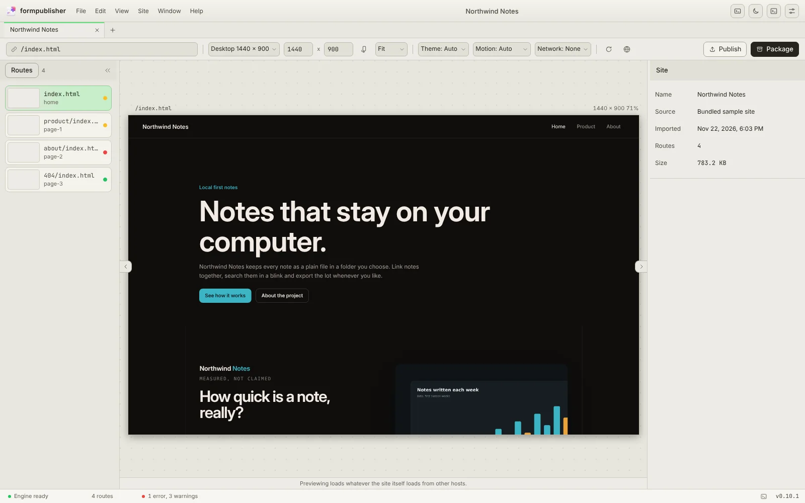</picture></td>
  </tr>
  <tr>
    <td width="50%" valign="top"><b>Checks</b><br><picture><source media="(prefers-color-scheme: dark)" srcset="docs/images/checks-dark.webp">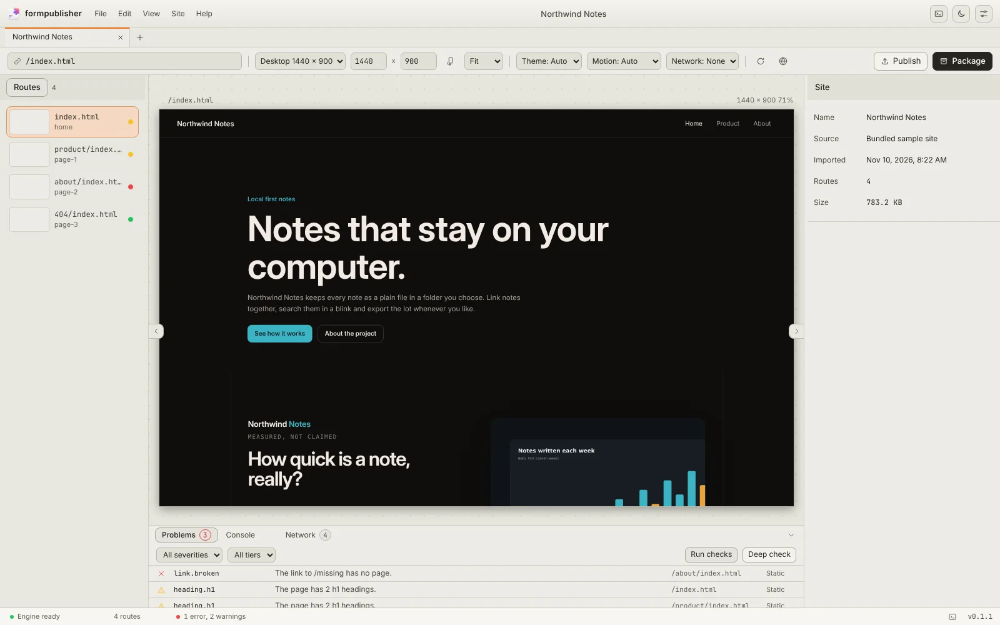</picture></td>
    <td width="50%" valign="top"><b>Package</b><br><picture><source media="(prefers-color-scheme: dark)" srcset="docs/images/package-dark.webp">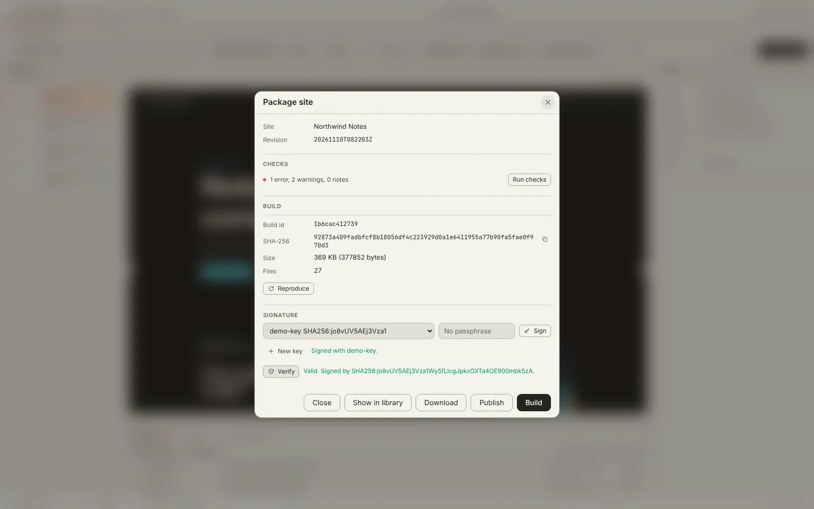</picture></td>
  </tr>
  <tr>
    <td width="50%" valign="top"><b>Publish</b><br><picture><source media="(prefers-color-scheme: dark)" srcset="docs/images/publish-dark.webp">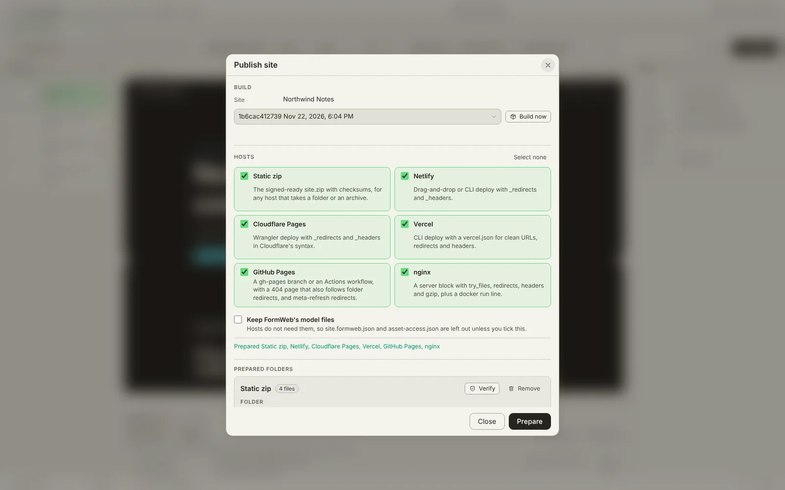</picture></td>
    <td width="50%" valign="top"><b>Prepared folders</b><br><picture><source media="(prefers-color-scheme: dark)" srcset="docs/images/publish-results-dark.webp">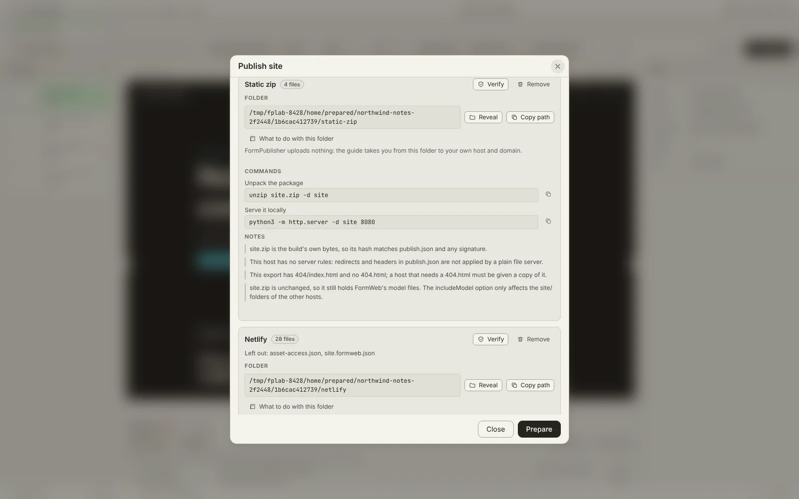</picture></td>
  </tr>
  <tr>
    <td width="50%" valign="top"><b>Publish, model files</b><br><picture><source media="(prefers-color-scheme: dark)" srcset="docs/images/publish-model-dark.webp">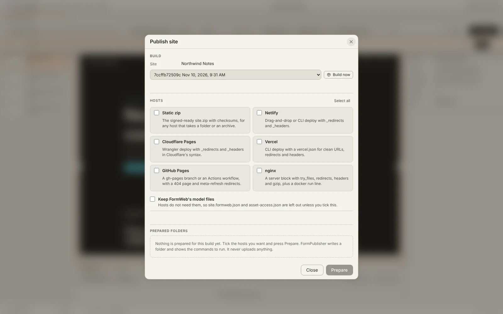</picture></td>
    <td width="50%" valign="top"><b>Revisions</b><br><picture><source media="(prefers-color-scheme: dark)" srcset="docs/images/revisions-dark.webp">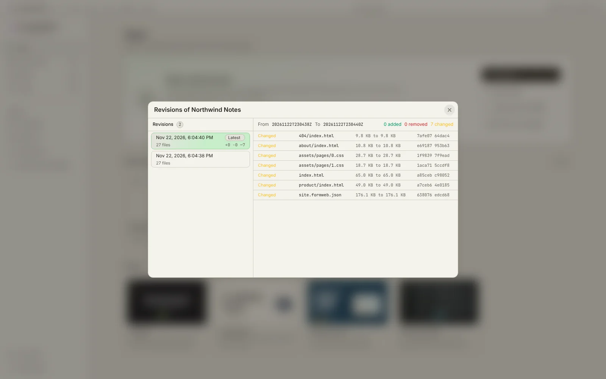</picture></td>
  </tr>
  <tr>
    <td width="50%" valign="top"><b>Trash</b><br><picture><source media="(prefers-color-scheme: dark)" srcset="docs/images/trash-dark.webp">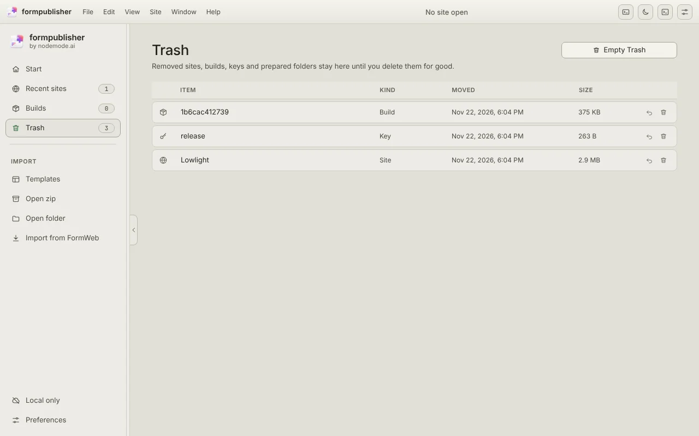</picture></td>
    <td width="50%" valign="top"><b>Keyboard shortcuts</b><br><picture><source media="(prefers-color-scheme: dark)" srcset="docs/images/shortcuts-dark.webp">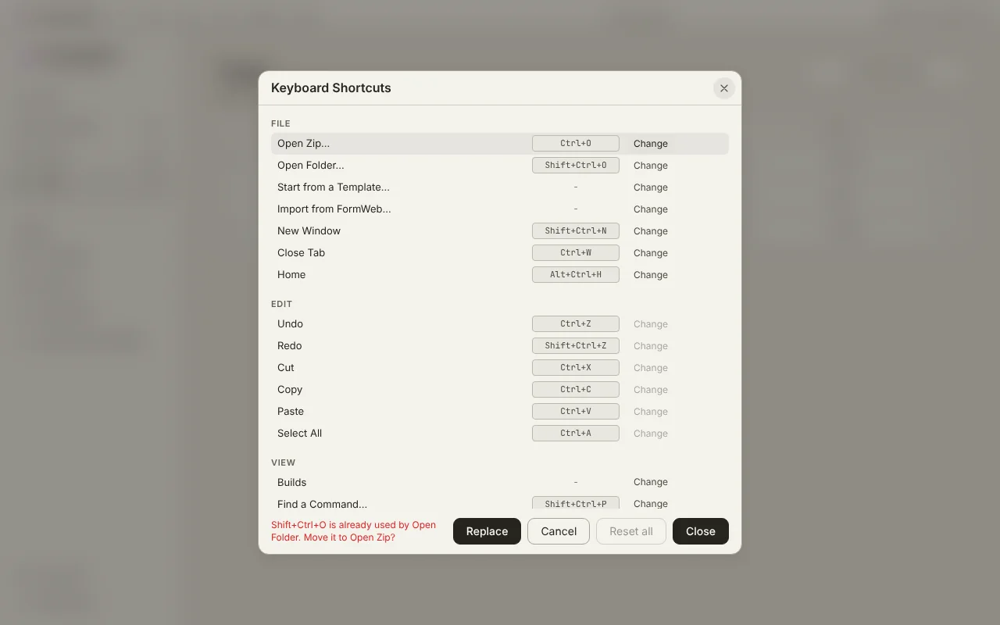</picture></td>
  </tr>
  <tr>
    <td width="50%" valign="top"><b>Preferences</b><br><picture><source media="(prefers-color-scheme: dark)" srcset="docs/images/preferences-dark.webp">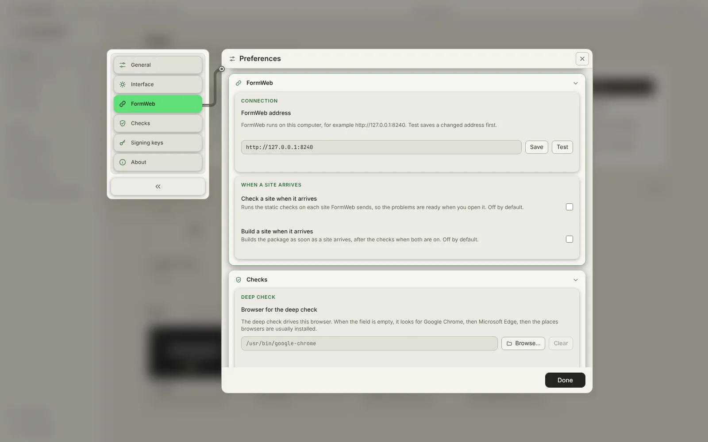</picture></td>
    <td width="50%" valign="top"><b>Desktop splash</b><br>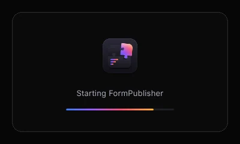</td>
  </tr>
  <tr>
    <td width="50%" valign="top"><b>Recent, new site arrived</b><br><picture><source media="(prefers-color-scheme: dark)" srcset="docs/images/recent-notice-dark.webp">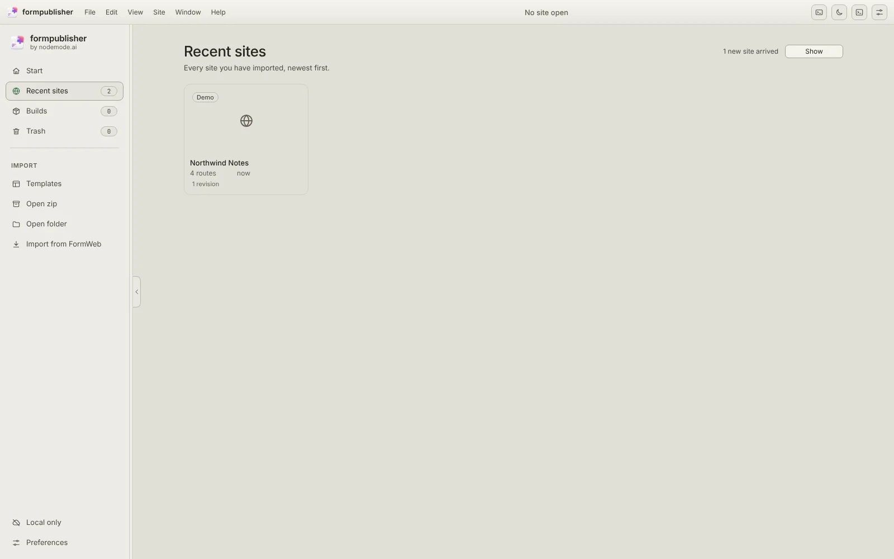</picture></td>
  </tr>
</table>

## Everything in the box

<table>
  <tr>
    <td width="33%" valign="top"><h4>In the window</h4>Home · Start and Recent · Trash · site tabs · routes strip · inspector · status bar · Preferences · Keyboard Shortcuts</td>
    <td width="33%" valign="top"><h4>Command line and MCP tools</h4>status · sites · import · routes · check · build · sign · verify · targets · prepare · prepared · trash · receive-status</td>
    <td width="33%" valign="top"><h4>Ways in</h4>site-export.zip · publication folder · the running FormWeb's current site · sent from FormWeb (endpoint or inbox) · the demo</td>
  </tr>
</table>

## Built for agents

The window, the command line and the MCP server call one engine, so an agent and a person see the same sites, and an import an agent makes appears in the open window at once.

```sh
./formpublisher run status                     # the engine, the data folder, whether FormWeb is reachable
./formpublisher run sites                      # the sites already imported
./formpublisher run import site-export.zip     # import a FormWeb export (or a publication folder)
./formpublisher run import-formweb             # import the site open in a running FormWeb, read-only
./formpublisher run routes SITE-ID             # the routes of one site
./formpublisher run revisions SITE-ID          # its revisions; diff SITE-ID shows what changed between two
./formpublisher run check SITE-ID              # the static checks (--deep for the browser run, --last for the stored result)
./formpublisher run build SITE-ID              # the deterministic site.zip and publish.json
./formpublisher run sign BUILD-ID --key NAME   # an Ed25519 signature; verify BUILD-ID checks it
./formpublisher run targets                    # the six hosts
./formpublisher run prepare BUILD-ID --target netlify --target nginx
./formpublisher mcp                            # MCP server on stdio
```

| Command | Does |
| --- | --- |
| `status`, `sites`, `routes ID` | the engine, the imported sites, one site's routes |
| `revisions ID`, `diff ID [--from R] [--to R]` | a site's revisions, and the files and routes that changed between two |
| `import PATH`, `import-formweb` | import an export, a folder or the site open in FormWeb |
| `check ID`, `build ID`, `builds` | run the checks, build the package, list builds |
| `sign BUILD`, `verify BUILD`, `keys` | sign, verify (exits 1 when invalid), list or create (`--create NAME`) keys |
| `targets`, `prepare BUILD --target T [--include-model]`, `prepared BUILD` | list hosts, prepare a folder per host (FormWeb's model files left out unless `--include-model`), list what is prepared |
| `trash`, `trash restore ENTRY`, `trash delete ENTRY`, `trash empty --yes` | list the trash, move an entry back (`--to PATH` names the place when it is unknown), delete one for good, empty it (refuses without `--yes`) |
| `receive-status` | the receive endpoint, the inbox folder and the last receipts |

Every command takes `--json`. The MCP server has 18 tools over the same routes:

| MCP tool | Does |
| --- | --- |
| `formpublisher_status`, `list_sites`, `site_routes` | read the engine, the sites and the routes |
| `list_revisions`, `diff_revisions` | read a site's revisions and what changed between two |
| `import_site`, `import_formweb_current` | import an export or folder, or the site open in FormWeb |
| `run_checks`, `get_checks` | run the checks, read the stored result |
| `build_package`, `list_builds` | build the package, list builds |
| `sign_build`, `verify_build` | sign with a named key, verify a signature |
| `list_targets`, `prepare_publish`, `get_prepared` | list the six hosts, prepare folders with their commands (`includeModel` keeps FormWeb's model files), read what is prepared |
| `list_trash`, `restore_from_trash` | read the trash, move an entry back to its recorded or inferred origin (no tool deletes) |

`.mcp.json`, `.codex/config.toml` and `.cursor/mcp.json` are already wired in this repo, with the `formpublisher-harness` skill for driving the app and `formpublisher-skillset` for changing it. See [`AGENTS.md`](AGENTS.md).

## Demo

Home's Demos row opens the bundled sample site, "Northwind Notes", and a quick tour walks Preview, Checks, Package and Publish. To see it without installing anything, open [`demo/index.html`](demo/index.html) from disk in a browser: it shows the FormPublisher window in both themes driving the sample site through the device widths, with the checks, the package manifest and the six prepared folders taken from real runs of the engine (`demo/data/`). The sample's pictures are CC0; `demo/MEDIA.md` lists their sources.

### Agents

```sh
./formpublisher agents install       # the same MCP server and skills for your account: Claude Code, Codex and Cursor
./formpublisher agents status        # what is installed, which servers, how many skills, whether formMCP is found
./formpublisher agents sync          # mirror .claude/skills to .agents/skills
./formpublisher agents sync --check  # exits 1 on any drift, for CI
```

Two MCP servers are registered: `formpublisher` and `formmcp`, the Form family hub that reaches every installed Form app's own tools. formMCP is a separate app: when it is not installed, `formmcp` shows as failed or unavailable in your agent and everything else works.

## Under the hood

- **One engine:** a FastAPI engine on 127.0.0.1:8280 owns the imported sites and the data folder; the interface, the command line and the MCP server are thin layers over its routes.
- **Read-only toward FormWeb:** FormPublisher imports exports and folders and may read a running FormWeb's `/api/export`; it never calls FormWeb's `/api/load` and never writes to FormWeb.
- **Loopback only:** the engine answers on 127.0.0.1 and refuses any other Host or Origin.
- **Zero flash:** every container exists in its final layout before the first paint, and the window is revealed once it is ready.
- **Inline icons, no libraries:** icons are inline `currentColor` SVG; colours, sizes and every `z-index` come from tokens.

## Run it from source

**Requires:** Node 22.12 or newer, Python 3.12, git. Rust stable and the Tauri prerequisites only for the desktop window.

```sh
git clone git@github.com:nodemode-dev/formpublisher.git
cd formpublisher
./formpublisher_oc_install        # engine venv and interface packages
./setup/install_compiler          # builds formweb-core for .fweb projects (needs Rust; the install runs it when cargo is present)
./formpublisher                   # interface at http://localhost:5280, engine on 127.0.0.1:8280
```

`./formpublisher_oc_install` is the install, `./formpublisher` is the boot, and `./build_app` makes the desktop app start to finish and logs to `build_app.log`. On Windows use `formpublisher_oc_install.bat`, `formpublisher.bat` and `build_app.bat`.

Ports and folders:

| Port | What |
| --- | --- |
| 5280 | interface (Vite, localhost only) |
| 5281 | Vite preview of a production build |
| 8280 | engine (`FORMPUBLISHER_PORT`) |
| 8281 | site host, serves the mounted site (`FORMPUBLISHER_HOST_PORT`) |

| Data folder | Holds |
| --- | --- |
| `sites/` | imported sites and their revisions |
| `checks/` | stored check results and deep-run thumbnails |
| `builds/` | packages: `site.zip`, `publish.json`, `site.zip.sig` |
| `prepared/` | the folders Publish writes, one per build and host |
| `inbox/` | sites FormWeb leaves for FormPublisher (`imported/` and `failed/` below it) |
| `keys/` | signing keys |
| `trash/` | removed items, each with a `.trash.json` record, restorable from Home |
| `engine.json` | the running engine's app, port, pid, version and start time, so FormWeb finds it on any port |

`./formpublisher serve` serves a production build from the engine alone, `./formpublisher desktop dev` opens the desktop window, and `./formpublisher doctor` checks the toolchain. `FORMPUBLISHER_HOME` moves the data folder (`~/FormPublisher` by default).

> [!IMPORTANT]
> **Status:** in development. Importing from the site open in FormWeb needs FormWeb running on the same computer. Publish prepares folders but never uploads. The deep check needs Chrome and the optional `requirements-deep.txt`; `.fweb` projects need `formweb-core`.

**Contributing:** changes to FormPublisher come here as pull requests into `main`; changes to how a site is made or exported belong in FormWeb. See [`CONTRIBUTING.md`](CONTRIBUTING.md), [`CODE_OF_CONDUCT.md`](CODE_OF_CONDUCT.md) and [`AGENTS.md`](AGENTS.md). Report security issues privately as [`SECURITY.md`](SECURITY.md) describes.

## Repository

| Path | What it is |
| --- | --- |
| `frontend/` | the interface (vanilla TypeScript and Vite) |
| `backend/` | the FastAPI engine, the command line and the MCP server |
| `src-tauri/` | the Tauri 2 shell |
| `setup/` | install, build and agent scripts |
| `docs/` | the manual and its screenshots |
| `demo/` | the sample site and the offline demo (`index.html`) |
| `.docs/wiki/` | the wiki pages |
| `assets/` | the app icon used by this README |

Docs: [`docs/MANUAL.md`](docs/MANUAL.md), [`.docs/wiki`](.docs/wiki) · Agents: [`CLAUDE.md`](CLAUDE.md), [`AGENTS.md`](AGENTS.md) · Changes: [`CHANGELOG.md`](CHANGELOG.md)

---

## Maintainers

| Maintainer | Role |
|---|---|
| [@nodemode-ai](https://github.com/nodemode-ai) | Owner |
| [@gbarnai](https://github.com/gbarnai) | Co-owner |

## License

FormPublisher is licensed under the GNU General Public License v3.0 ([`LICENSE`](LICENSE), SPDX `GPL-3.0-only`). Copyright 2026 NodeAgentc, Inc. Third-party notices: [`NOTICE.md`](NOTICE.md).
