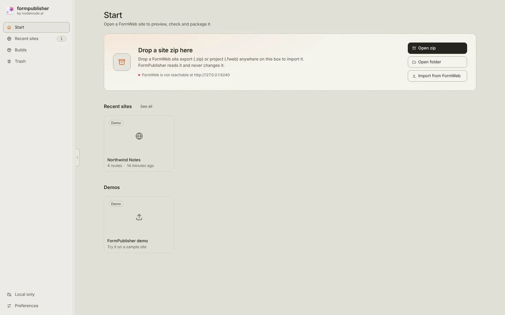
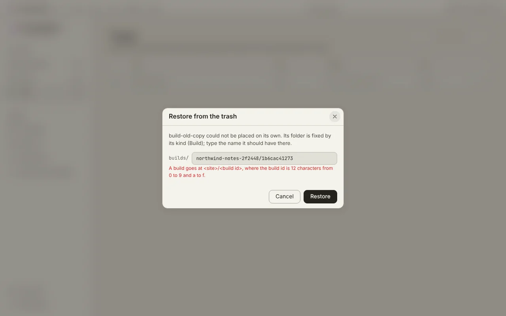
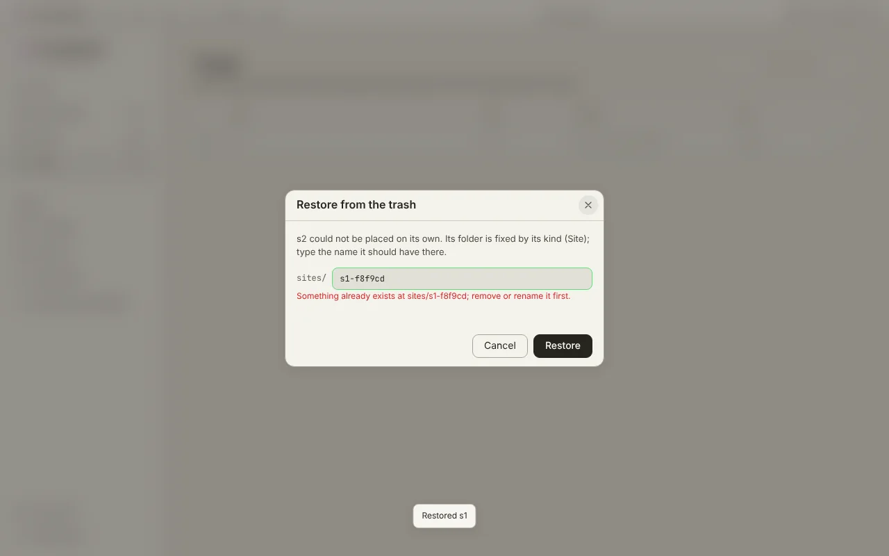
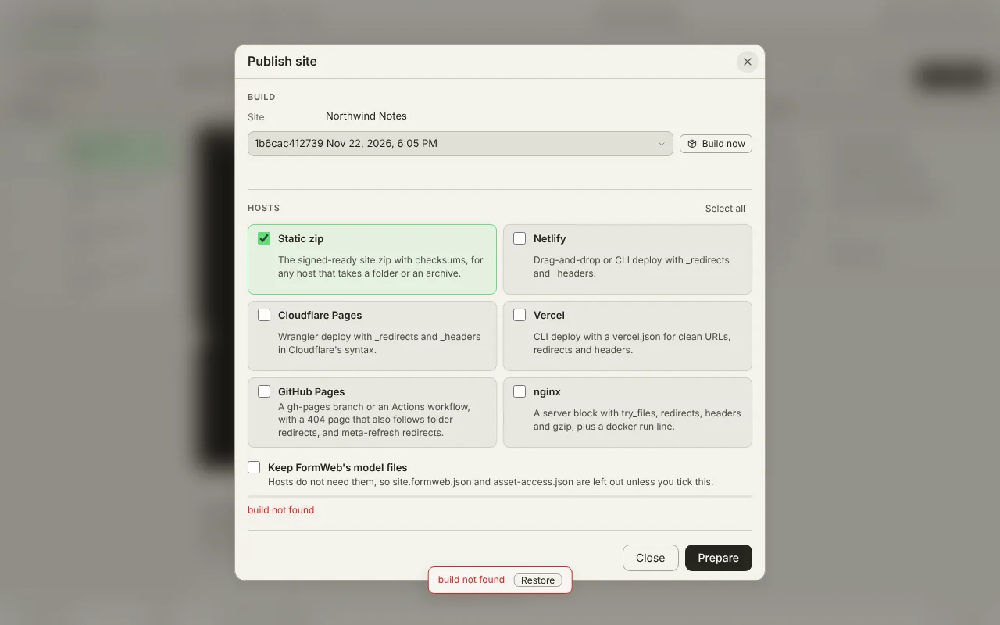

# FormPublisher Manual

FormPublisher is the Form family's site publisher. It opens what FormWeb makes, lists the site's routes and shows them in a FormDeck-style window. People and agents use the same steps: each one is also a command line command and an MCP tool.

It imports FormWeb sites, previews them on device sizes, checks them, builds signed packages, and prepares a folder with the exact commands for each of six hosts. It never uploads anything. It runs in a browser tab or as a desktop app.

## Contents

- [Getting started](#getting-started)
- [The desktop app](#the-desktop-app)
- [Home](#home)
- [Trash](#trash)
- [Keyboard shortcuts](#keyboard-shortcuts)
- [The window](#the-window)
- [Preferences](#preferences)
- [Importing a site](#importing-a-site)
- [Routes](#routes)
- [.fweb projects](#fweb-projects)
- [Preview](#preview)
- [Checks](#checks)
- [Packages and signatures](#packages-and-signatures)
- [The .fpub format](#the-fpub-format)
- [Publish](#publish)
- [Live-site check](#live-site-check)
- [Templates](#templates)
- [Receive from FormWeb](#receive-from-formweb)
- [Revisions and diffs](#revisions-and-diffs)
- [The demo](#the-demo)
- [The agent dock](#the-agent-dock)
- [Agents](#agents)
- [The command line](#the-command-line)
- [The MCP server](#the-mcp-server)
- [Settings and the data folder](#settings-and-the-data-folder)
- [Who may change things](#who-may-change-things)
- [Error codes](#error-codes)
- [When something goes wrong](#when-something-goes-wrong)

## Getting started

From the repository:

```sh
./formpublisher_oc_install        # the engine's Python venv and the interface packages, once
./formpublisher                   # engine on 127.0.0.1:8280 and interface on http://localhost:5280
```

Open http://localhost:5280. `./formpublisher build` then `./formpublisher serve` runs the built interface from the engine alone on http://127.0.0.1:8280. `./formpublisher doctor` checks the toolchain, the installs and the ports, and prints a vendor row: `vendor: in step at VERSION`, or the first problem with a pointer to `./formpublisher vendor --check` for the rest. Windows has `formpublisher.bat` and `formpublisher_oc_install.bat`. The launchers stop with their own message and exit code 1 when something they need is missing: `boot` after a failed install, `desktop dev` without the desktop tools ("the desktop tools are missing: run formpublisher.bat install"), `backend\boot_backend.bat` without Python 3.12 ("Python 3.12 is needed") or when installing the engine requirements fails; `doctor` prints "missing" for a tool that is not installed. `formpublisher.bat run`, `cli`, `mcp`, `agents` and `vendor` pass up to 8 arguments on to the command, so `formpublisher.bat vendor --check` and `formpublisher.bat agents sync --check` work. The launchers were run under Wine 9.0; real Windows has not been run.

What it needs: Node 22.12 or newer (the install and the build scripts stop with a message when it is older) and Python 3.12. The desktop app also needs Rust, at the version `src-tauri/rust-toolchain.toml` pins (1.97.0); the scripts and CI use that version for the shell and for the vendored `formweb-core`, and `build_app` installs it with rustup when it is missing.

### Locking the engine's packages

The engine's Python packages are locked with hashes. `backend/requirements.lock` holds `requirements.txt`, `requirements-deep.txt` and `requirements-build.txt` (which pins PyInstaller 6.22.3), and `backend/requirements-test.lock` holds the same plus pytest. `./formpublisher_oc_install`, its `.bat`, `setup/freeze_backend` and CI install with `pip install --require-hashes -r backend/requirements.lock`, so a package whose bytes do not match its hash is refused. `backend/requirements-extra-hashes.json` adds the hash of the cryptography 50.0.2 wheel that the family's release build uses for Intel Macs.

After you change a requirements file, run `python setup/lock_requirements.py` and commit the locks. It writes both with uv 0.11.32 (and stops, naming `python -m pip install uv==0.11.32`, when that uv is not on the path); `python setup/lock_requirements.py --check` verifies that the locks hold every pin, and CI runs it.

## The desktop app

`./build_app` (`build_app.bat` on Windows) builds the desktop app from this folder, start to finish, and logs to `build_app.log`. It freezes the engine with PyInstaller into a folder: `setup/freeze_backend` writes it to `src-tauri/engine/` (git ignores everything in it but `.gitkeep`), with the `formpublisher-engine` program in it and the built interface, the four demo sites with their font licences, this manual and the `formweb-core` compiler inside. Playwright for Python and the Node.js driver it carries are frozen into the engine too (see [Deep tier](#deep-tier)). Then it builds the Tauri 2 shell, which ships that folder as the resource folder `engine`: `FormPublisher.app/Contents/Resources/engine/formpublisher-engine` on macOS, `engine\formpublisher-engine.exe` beside the app on Windows, and the resource folder's `engine/` on Linux. `freeze_backend` lists the frozen files in `backend/build/engine-files.txt`. On Windows the engine is built without a console window; set `FORMPUBLISHER_ENGINE_WINDOWED=0` to keep one for debugging. On macOS the folder is flattened (no symbolic links and no `.framework`, which Tauri cannot ship as resources) and, when `APPLE_SIGNING_IDENTITY` is set, each Mach-O file in it is signed. `formpublisher-engine --selfcheck` proves a frozen engine starts, runs the `formweb-core` inside it once, and it takes the same commands as the command line (`formpublisher-engine cli ...`). The freeze step runs that self-check before the engine goes into the app, and on macOS `build_app` runs it again on the engine inside the finished app, under the app's signature, before it packs the disk image. With `APPLE_SIGNING_IDENTITY` set the app is signed with that identity and a failed `codesign --verify` stops the build; without it the app is signed ad hoc. `build_app` does not notarize; a downloaded copy of such a build is stopped by macOS once at its first open, and [When something goes wrong](#when-something-goes-wrong) has the step.

When the app starts it shows a small splash with a gradient bar, which stays above other windows while it shows so another app cannot hide it, starts the engine, and reveals the main window only once the interface has drawn its first frame, so there is no white flash. A second launch focuses the running window instead of opening another. Closing the last window ends the app and the engine it started; a terminate or interrupt signal does the same, engine and anything the engine started included. The shell starts its engine with `FORMPUBLISHER_SHELL_PID` (its own process id) and `FORMPUBLISHER_DESKTOP=1` set. The engine makes the window's key at its start and hands it to the shell, which puts it into the page it opens; see [Who may change things](#who-may-change-things). On Windows it also holds the engine in a job object, so the engine ends with the shell; on every system the engine watches the shell's process and leaves within about 2 seconds of the shell disappearing, so a shell that crashes or is killed leaves no engine running. If the engine does not start, a native dialog says why and the app ends: the engine program is missing, it could not be started, it stopped with a code, it did not answer within 90 seconds, it did not hand over the key for the window within 10 seconds, or the engine that answered is another version than the app's. The dialog also shows the engine's last 12 lines of output and the path of its log (see [When something goes wrong](#when-something-goes-wrong)).

The port rule: the app uses `FORMPUBLISHER_PORT` when that is set, else 8280 when it is free, else any free port the system hands out. Before it starts its own engine, the shell reads `engine.json` in the data folder: an engine that file names and that still answers the health route is ended and replaced, never adopted, so the window talks to an engine this app started itself. Once the site host and the inbox watcher are up, the engine writes `engine.json` in the data folder with `app`, `port`, `hostPort` (the site host port it really bound), `pid`, `version` and `started`, so FormWeb finds the running app on whatever port it took. A stopping engine removes the file only when it still names its own pid, so a second engine on another port and data folder never loses its file. When FormPublisher is closed, FormWeb leaves the site in the inbox, where the engine imports it on its next scan (see [Receive from FormWeb](#receive-from-formweb)). Running from source, `./formpublisher desktop dev` opens the window over the source tree instead of the frozen engine.

In the desktop app, Open Folder uses the system folder panel. Cancelling the panel imports nothing, and if the panel fails the app falls back to the typed path dialog, which is also what the browser always shows. Reveal Site Folder opens the site's folder in the system file manager through the app's `reveal_path` command, which only accepts a path inside the data folder (`FORMPUBLISHER_HOME`, or `~/FormPublisher`); anything outside it, or a path that does not exist, is refused.

On Linux the app builds with WebKitGTK 4.1 installed: `setup/freeze_backend` makes the engine folder, then `cargo build --release` in `src-tauri` builds the shell (about 8 minutes from cold). On macOS the app needs macOS 13 on Apple silicon and macOS 14 on Intel: the cryptography wheel that the release build uses for Intel is built for 14, so `build_app` sets 14.0 as the minimum for an x86_64 macOS target, while `tauri.conf.json` keeps 13.0. That wheel links OpenSSL as a separate library rather than carrying its own. `setup/freeze_backend` asks `setup/openssl_libs.py` for those libraries and hands them to PyInstaller first, so the engine holds the OpenSSL cryptography needs; Python's own `_ssl` uses the same one. Linux and Windows use the menus inside the window. On macOS the menus are in the system menu bar, with Preferences in the app menu; View > Menus in Window keeps them in the window instead, from the next start. On macOS the title row of the page is the window's title bar: the close, minimize and zoom buttons sit at its left, and its empty parts and the site name drag the window. The window's minimum size is 1024 x 680, and the window title stays "FormPublisher" in every language while the page shows the site name. A language change in Preferences changes the menus and the window at once, as in the browser.

## Home

Home is the start page. Its side panel lists Start, Recent sites, Builds and Trash, then your open sites, the three ways to import (Open zip, Open folder, Import from FormWeb), Local only and Preferences. Start offers a drop zone for a FormWeb export, the recent sites and the demos. Opening a site puts it in a tab. Home starts under the title bar, so the brand, the menubar, the theme button and Preferences stay usable while Home is open; only the content below the title bar is locked. File > Home (`Alt+Mod+H`), the brand in the title bar and the plus button of the tab strip all show Home; Escape, or a site under Open sites, goes back to the open site.

The menubar has File (Home first, the imports, New Window, Close Tab, Package Site, Publish Site and Preferences), Edit, View (Builds, Find a Command, the theme, the density, the panes and the Agent Dock), Site (the checks, Reload Routes, Reveal Site Folder, Remove Site), Window (Minimize, Maximize and Full Screen; the first two work in the desktop app) and Help (Documentation, Keyboard Shortcuts, Demos and About). Help > Documentation opens the manual that is bundled with the engine, in a sheet in the window: the engine serves it at `GET /api/docs/manual` and its pictures at `GET /api/docs/images/{name}`, so it works with the network off and there is no link to GitHub. The menus in the window work from the keyboard: F10 opens File, and on Windows and Linux a lone Alt focuses the bar and Alt with a menu's first letter opens it; the arrow keys, Home and End move, Enter chooses, Escape goes back one level, and typing the start of an item's name jumps to it. Each menu item with a shortcut shows it as key caps, one cap for each key. Preferences (`Mod+,`, the title bar button, File > Preferences, or the app menu on macOS) is a window with its categories on a rail at the left, General, Interface, FormWeb, Checks, Signing keys and About; each category is a card that folds, and the rail can be folded to icons. See [Preferences](#preferences).



Recent sites keep still while they are on screen. When a site arrives (for example from FormWeb's Send to FormPublisher) while Start or Recent sites is showing, the cards do not move. A row above each list says how many new sites arrived, and Show re-sorts the list with the new sites in place. The row is always there, empty when nothing arrived, so the cards never shift. When Recent is not on screen the lists update as before.


## Importing a site

There are four ways in, and all of them only read:

- **A site export.** Drop FormWeb's `site-export.zip` on Home, or choose it. A `.fweb` project (see [.fweb projects](#fweb-projects)) and a `.fpub` package go in the same way: Open, the file picker and the drop take `.zip`, `.fweb` and `.fpub`.
- **A .fpub package.** One build saved from another FormPublisher. See [The .fpub format](#the-fpub-format).
- **A publication folder.** Choose a FormWeb publication folder, `publications/[slug]/[version]/`.
- **The site open in FormWeb, or one of its saved projects.** With FormWeb running on the same computer, import its current site, or pick one of its saved projects from a short list. FormPublisher asks FormWeb's `GET /api/export` (or `GET /api/projects` and `GET /api/projects/[id]/file`) over loopback. It never calls `/api/load` and never changes what FormWeb has open.

## Routes

A site's routes come from its `routes.json`. Each has a path, a page, a locale, an item and a stylesheet. The routes strip lists them as cards, the inspector shows the selected route, and the status bar shows how many there are. The strip can be dragged wider or narrower and folds to a rail of thumbnails and status marks (see [The window](#the-window)).

## Trash

Removing a site, a build, a signing key or a prepared folder moves it to `trash/` in the data folder; nothing is deleted at once. Each entry gets a `.trash.json` record beside it with its kind, label, origin, time and size. Home's Trash page lists the entries newest first with a kind icon, the label, the kind, the time and the size. Restore moves an entry back to where it came from. Delete for good and Empty Trash remove entries for good, and both ask first. The page refreshes by itself when something is removed or restored, and restoring a site refreshes Recent.

A restore only goes ahead when the place is free: if something already sits at the origin (or a key with the same id exists) it answers 409 with the reason, and the window shows it as a notice. Entries moved to the trash before 0.1.4 have no record. Their kind and origin are inferred from the name: a site from its `site.json` id, a key from its `entry.json`, a build from `build-[site]-[12 hex]-[stamp]`, and a prepared folder from `prepared-[site]-[build]-[target]-[stamp]`, matched against the known targets and the build id. A stamp may end in a `-N` counter. The list marks such rows as inferred, and they restore like any other. A prepared folder from before 0.1.4 lost its hidden record, so restoring it prepares the same target again from its build, which gives the same folder; if the build is gone or is itself in the trash, the restore answers 409 naming it.

An entry whose origin cannot be recorded or inferred answers 409 with the code `origin-unknown`. Restore it to a named place: the window opens a "Restore from the trash" dialog that shows the kind's own folder as a fixed prefix and asks for the name, a key getting `.pem` added. The engine's refusal shows inside the dialog, which stays open until the name is accepted. The same dialog asks for a passphrase when a locked key needs one, and for a place and a passphrase together when an entry needs both; it sends them in one request, and no row is added or removed while it is open.

The dialog checks the shape of the name before it asks, and the engine applies the same rule (a wrong shape answers 409 `place-invalid`). A site is lowercase letters, digits and hyphens. A key is 16 hex characters. A build is `<site>/<12-hex build id>`. A prepared folder is `<site>/<build id>/<target>`. A restored site whose `site.json` had no id gets its folder name as id.

<picture><source media="(prefers-color-scheme: dark)" srcset="images/trash-origin-dark.webp"></picture>

<picture><source media="(prefers-color-scheme: dark)" srcset="images/restore-dialog-dark.webp"></picture>

Removing a signing key deletes its secret, and the trash keeps only its public half: a key restored from the trash can verify but cannot sign (see [Keys](#keys)). An entry that an earlier version moved there still holds the key's `.pem`, and restoring it brings the secret back, kept the way a new key's is. A trashed key whose record (`entry.json`) is missing or damaged is rebuilt from such a `.pem` when you restore it. An unencrypted key gets back its id (the first 16 hex characters of the SHA-256 of its public key) and its fingerprint, and the list shows it as "Recovered key [id]". An encrypted key answers 409 `passphrase-required`; a wrong passphrase answers `passphrase-wrong`, and the right one restores the key. In the window, restoring a locked key asks for its passphrase in the Restore from the trash dialog, which shows a wrong passphrase inline and clears the field. A file that cannot be read, a key that is not Ed25519, or more than one `.pem` stays `entry-damaged`. An id that is already present answers `place-taken`. The passphrase is never logged, stored or echoed.

The restore answer also carries `message`, kept for older callers. The same restore is `POST /api/trash/{entry}/restore` with the body `{"origin": "...", "passphrase": "..."}` and `trash restore ENTRY --to PATH` on the command line. For a locked key the command line has `trash restore ENTRY --passphrase-stdin`, which reads one line from standard input. No flag takes the passphrase itself. The origin is used only when none is recorded or inferred, it must be free, and it must resolve inside the kind's own folder (a key directly in `keys/`); a path that leaves it, an absolute path, one of another kind or a taken place is refused.


The routes are `GET /api/trash`, `POST /api/trash/{entry}/restore`, `DELETE /api/trash/{entry}` and `DELETE /api/trash` (empty). An entry name is only accepted when it appears in the folder listing. See [The command line](#the-command-line) and [The MCP server](#the-mcp-server) for the agent side: an agent can list the trash and restore from it to a recorded or inferred origin, but restoring to a named place and deleting for good stay with a person.

## Keyboard shortcuts

Keyboard Shortcuts (`Mod+/`, in the Help menu) lists every command with its keys. Each row has Change and Reset. Change records the next combination you press; no command runs while it records. Escape cancels, and Backspace clears the binding. Reset restores that command's default, and Reset all restores every default.

Some combinations are refused with a reason: ones without a modifier, ones the browser or the system keeps, and the text-editing commands (copy, paste and the like). When another command already holds the combination, the dialog names it and offers Replace or Cancel. Overrides are stored in the browser's local storage under `formpublisher_shortcuts`, and the menus, the command palette, the dialog and the desktop app's native menus pick them up at once. The agent dock's chord (View, Agent Dock, `Mod+J`) changes here like any other, and the dock follows it.

## The window

The window is built on the layout the Form family shares: the title bar, the tabs, the options bar, the routes strip, the stage, the inspector, the bottom panel, the agent dock (see [The agent dock](#the-agent-dock)) and the status bar. Every container is in its final place before the first frame is drawn, so nothing moves when the window appears.

**Dropdowns.** Every chooser is the family's dropdown, never the system's list: the toolbar's Device, Zoom, Theme, Motion and Network, the two filters of the Problems tab, the key chooser in the Package sheet, the build chooser in the Publish sheet and the language chooser in Preferences. A dropdown is as wide as its longest option, worked out before the first frame, so choosing another option moves nothing. Enter, Space or Down opens it. The arrow keys move through the options, Home and End go to the first and the last, typing the start of an option's name jumps to it, Enter chooses and Escape closes the list without a change. The list opens in front of everything else, and opens upward when there is no room below. An option can be unavailable (it is greyed out and skipped) and can carry a second, muted label: the key chooser shows where each key's secret is kept.

**Key caps.** Menus show each shortcut as key caps, one cap for each key, in the same form as the Keyboard Shortcuts dialog.

**Cards.** The rows of the routes strip, the builds list, the revisions, the Trash, the FormWeb picker and Recent sites are rounded cards with a hairline border. The selected card has an accent line and a soft accent glow.

**Resizing and folding.** The routes strip, the inspector and the bottom panel each have a separator, and each can be resized by dragging it or from the keyboard: focus the separator with Tab, then the arrow keys move it by 16 px, Home makes the panel as small as it goes, End as large as it goes, and a double click puts it back to its default size. The separators tell assistive technology their value. The limits and defaults are:

| Panel | Smallest | Largest | Default |
| --- | --- | --- | --- |
| Routes strip (width) | 160 px | 420 px | 232 px |
| Inspector (width) | 240 px | 520 px | 308 px |
| Bottom panel (height) | 84 px | 520 px | 132 px |

The sizes, which panels are hidden and whether the routes strip is folded are remembered by the window and are in place in the first frame. The routes strip folds to a rail 52 px wide that shows each route's thumbnail and status mark. Fold it with the button at the end of the strip's header, or by dragging its edge narrower than about 110 px. Unfold it with the same button, by dragging wider, with the Right arrow or End on its separator, or with a double click on it. View, Routes, Inspector and Bottom Panel still hide and show the three panels altogether.

**The accent.** The window's accent is green, `#5fe07a`. An accent a person chose is kept. The old default, orange (`#f97316`), was replaced by the green once, the first time 0.7.0 ran; orange is still one of the accents Preferences offers, and one picked afterwards stays. Text on an accent fill is a dark ink (10.6 to 1 on the green, where white was 1.7 to 1); an accent dark enough that the dark ink would not read keeps white text. On the light themes the green is too pale to read as text (1.2 to 1 up to 1.6 to 1 on their surfaces), so accent-coloured text and icons use an ink computed from the accent: the accent mixed toward black until it reads at 4.5 to 1 on every light surface, which for the default green is `#2e6c3b`. Fills, focus rings and the accent line keep the accent itself. The agent dock's accent is that same ink.

## Preferences

Preferences (`Mod+,`, the title bar button, File > Preferences, or the app menu on macOS) is one dialog for the whole window. A button or chip that needs a setting opens the same dialog at that panel, with its tab chosen and its page drawn in the first frame. The rail at the left lists the panels; each is a card that folds, and the rail folds to icons. Keys and settings live only here: no sheet or page carries a copy of them.

- **General.** The language, one of 26. The window changes at once, without a reload.
- **Interface.** The theme (Studio Dark by default, with two light themes among the others), the accent colour (nine swatches, the green default first and orange second, and a picker for any other colour), the accent intensity and the density (Compact, Regular or Comfortable).
- **FormWeb.** FormWeb's address on this computer, with Save and Test, and the two switches Check a site when it arrives and Build a site when it arrives (see [Receive from FormWeb](#receive-from-formweb)). When FormWeb does not answer, the notice offers Try again where there is something to run again, and otherwise Open Preferences, which opens this panel.
- **Checks.** The browser the deep check drives. Type its full path, or choose it with Browse (the system file panel in the desktop app; in a browser tab Browse moves to the field and asks you to type the path), and Clear empties the field. A change is saved 700 ms after you stop typing, when you press Enter, and when you leave the field. An empty field means the deep check looks for Google Chrome, then Microsoft Edge, then the usual places. The engine refuses a path that is not absolute and a path with no file at it, and the panel shows its reason. The setting is `checks.chromePath`. When no browser can be started, the `deep.unavailable` row in Problems has an Open Preferences button that opens this panel.
- **Signing keys.** Your keys, one row each: the name, the start of the fingerprint (the whole one in its tooltip), the date it was made and where its secret is kept (Password store, Private file or Verify only). Each row has Export... (greyed out for a Verify only key, which has no secret here) and Remove, which asks first and says that the Trash keeps only the key's public half. Import... adds a key from an exported file. New key makes one: a name, an optional passphrase and Create key. The list follows keys made, imported or removed elsewhere (the command line, another window) at once. See [Keys](#keys).
- **About.** The version, the engine's version, the licence and the copyright.

## .fweb projects

A `.fweb` file is a FormWeb project: a JSON envelope with the format `com.nodemode.formweb`. Import it like a zip or a folder, from Home or the file dialog. FormPublisher hands it to `formweb-core`, the compiler built from the FormWeb crates vendored in `vendor/formweb-native/`. The compiler loads the project and exports every locale with the site's default locale as the base, and FormPublisher writes the files and the referenced assets (`/api/assets/[sha].[ext]` references become real files, as FormWeb's own bundling does). The import is recorded with source kind `fweb`; importing the same project again adds a revision.

The files are the ones FormWeb's own export of the same project gives, the root `404.html` included (its links start at the site's base folder, so the not-found page keeps its pictures and fonts at any missing address). One thing differs: a form that posts and has no script of its own gets the address `/api/forms/[site]/[form]` here, where FormWeb's export writes its own address on this computer (`http://127.0.0.1:8240/...`). Neither answers on a static host. The static checks report the first as the error `forms.no-endpoint` and the second as the error `forms.local-address` (the code FormWeb's audit uses), each naming the Forms part of the hosting guide (see [Static tier](#static-tier)).

Version 2 projects import too. When a project is too big for the JSON envelope, FormWeb 0.19.4 writes a zip `.fweb` instead: `project.json` first, then each asset stored as `assets/[id]`. FormPublisher applies FormWeb's own checks to it: `project.json` comes first and is at most 64 MiB, the format and version are right, at most 500 assets are listed once each, every member is exactly `assets/[listed id]`, and each asset matches its digest, size limit and mime type. The file is capped at 512 MiB and assets stream from the zip in 1 MiB chunks. A bad file is refused with the reason. A version 2 zip is recognised by its contents, so it imports as a project even without the `.fweb` extension, and ordinary site zips are unaffected. A version 1 project and its version 2 twin build to the same files and hashes.

`formweb-core` is not part of the Python install. Build it once with `./setup/install_compiler` (`setup\install_compiler.bat` on Windows), which runs `cargo build --release --locked` and copies the binary to `backend/bin/formweb-core`. `./formpublisher_oc_install` runs it when Rust is installed and says how to get Rust when it is not. `FORMPUBLISHER_FORMWEB_CORE` points to a binary elsewhere. The script first runs `./formpublisher vendor --check` and stops before cargo when the vendored crates are out of step; `setup\install_compiler.bat` does the same with `setup\vendor_check.py --check` and `formpublisher.bat doctor` prints the same vendor row (the Windows scripts were run under Wine 9.0, where doctor printed the vendor row in step and out of step and `install_compiler.bat` refused before cargo when out of step; real Windows has not been run). Without the binary an import answers: "Opening .fweb projects needs formweb-core. Run ./setup/install_compiler."

## Preview

Opening a site mounts a revision on the site host, a second listener at 127.0.0.1:8281 (`FORMPUBLISHER_HOST_PORT`) that serves the files the way a production static host does. When that port is already taken, for example by a second engine, the engine takes a free port instead, logs a warning naming both, and reports the port it uses as `hostPort` in `/api/health` and `engine.json`, so its preview and live checks always reach its own site. It is a separate origin from the interface, so the site gets its own storage and cannot call the engine's `/api` routes. One site is mounted at a time; mounting another replaces it. An agent mounts one with the MCP tool `preview_site`, and a person from a terminal with `./formpublisher run preview SITE-ID [--revision R]`; both need the running engine, answer the addresses of the home page and each route, and open nothing, and the mount replaces what the window's Preview showed.

A site that references fonts, scripts, images or embeds on other hosts makes your computer request them when you preview it; FormPublisher itself sends nothing to those hosts.

How the host resolves a request:

- `/a/b` is the file `a/b`, then `a/b/index.html`, then `a/b.html`; `/a/b/` is `a/b/index.html`; `/` is `index.html`. Query strings are ignored.
- Paths with `..`, a backslash or a NUL byte are refused (400); symlinks that leave the revision are not followed.
- `redirects.json` applies when no file matches: 301, 302, 307 and 308 answer with `Location`, 200 rewrites to the target, and a trailing `*` in `from` becomes `:splat` in `to`.
- A missing path answers with the root `404.html` (status 404). When there is no `404.html` it answers with `404/index.html`, where FormWeb puts its 404 page, and otherwise plain text. For that older `404/index.html` fallback the host makes the URLs in the page root-absolute, as the publish targets do.
- Single-range requests answer 206, or 416 when unsatisfiable. Every response carries `Cache-Control: no-store`, `X-Content-Type-Options: nosniff` and `Referrer-Policy: strict-origin-when-cross-origin`.
- Only `GET` and `HEAD` are accepted, and only for `127.0.0.1:[port]` or `localhost:[port]` as Host.

The options toolbar above the stage controls the preview:

| Control | Choices |
| --- | --- |
| Route | an editable field; Enter navigates, and it follows the page's own navigation |
| Device | Desktop 1440 by 900, Laptop 1280 by 800, Tablet 834 by 1112, Phone 390 by 844, Custom |
| Rotate | swaps width and height |
| Zoom | Fit, 50, 75, 100 percent |
| Theme | Auto, Dark, Light |
| Motion | Auto, Reduce |
| Network | None, Fast (40 ms, 1,500 KB/s), Slow (150 ms, 200 KB/s) |
| Reload, Open in browser | reload the frame; open the current route in the system browser |

Theme, motion and network remount the site with the new options and reload the frame. Size and zoom never reload it. Navigating loads a hidden second frame and swaps it in once it has loaded, so the page never blanks. The choices are remembered per window.

In a narrow window the toolbar keeps every control in its row and steps down in stages. Below 1400 px of row each dropdown is as wide as its longest option, so every value shows whole and choosing another option never moves anything. Below 1240 px Publish and Package show only their icon (the label stays as the accessible name and the tooltip). If the row still overflows, the separators go and the route field becomes an icon: focus it and it opens as a 300 px field over the row without moving the row; Enter navigates, and Escape or leaving the field collapses it. If that is not enough, the dropdowns show short labels: the value after "Theme:" and similar prefixes, and the device name without its size; the device dropdown is then as wide as its widest preset name, and Custom shows a short word ("Andere" in German) where its full name would be wider, with the full device name in the tooltip. Only the display is shortened; the options and their keys are unchanged. A last step tightens the row's padding, hides the "x" between width and height and narrows the two number fields. Each width follows the labels of the language shown, so choosing a new language in Preferences moves the toolbar's controls sideways once, at the moment of the switch. The sizing also starts above 1400 px whenever the row would otherwise overflow, which can happen with long labels such as German. The Problems bar does the same with its two filters: when it would wrap, "All severities" and "All tiers" show "All" (the full name stays in the tooltip), and if that is still too wide in your language both filters give way to one funnel button. Its tooltip reads "Filter problems" with the current severity and tier, a dot marks it while either filter is not All, and it opens a menu with both groups (by mouse, or with Enter, Space or Down, the arrows, Home, End and Escape). Picking there filters the list exactly as the dropdowns do. The bar stays one row at every width.

Theme and motion are emulated by a probe script that the host injects into HTML responses right after `<head>` (only while previewing, never in a package). It makes `prefers-color-scheme` and `prefers-reduced-motion` answer as chosen, and makes `fw-theme-*` storage keys return the forced theme. The same probe reports the console, errors, requests, layout shift and horizontal overflow to the window for the live checks.

The routes strip shows a thumbnail box and a status dot per route: none when not checked, green for no problems, amber for warnings, red for errors. Thumbnails come from a deep check.

## Checks

Checks produce problems. Each problem has an id (stable for the same finding, and for a deep problem the same on every run: the id hashes the failing URL with the site host's port left out, so a new run on a new port gives the same ids. Since 0.1.4 the URL is hashed with the host normalized, so the ids of `deep.request` problems differ from those of 0.1.3 and earlier; a check of the same site (redirects, clean URLs, a directory index and a custom 404 page) gives the same problems, summaries and thumbnails otherwise; messages and the url field still show the real address), a tier (`static`, `live` or `deep`), a severity (`error`, `warning`, `info`), a code, the route, a message and a fix, and optionally the file, line, selector and URL. The Problems tab lists them with filters by severity and tier, and clicking a row selects its route. Counts show in the tab and the status bar. The bottom panel's tabs (Problems, Console, Network, Revisions) each have an icon and a label. When the tab strip is under 460 px they tighten, and under 360 px they show the icon and the count badge, with the label kept as the accessible name. Counts of three digits on more than one tab can still overflow a 760 px window. Run checks starts the static tier; Deep check starts the deep tier.

### Static tier

Runs offline on the revision's files, in the Python standard library. HTML is parsed, paths resolve the way the host resolves them, and results are sorted by route, code and line.

A site whose address has a folder in it (a base URL such as `https://example.org/shop/`, a GitHub project page, or a FormWeb publication folder) carries that folder in its root `404.html` and its sitemap. FormPublisher reads the folder from the `Sitemap:` line of the site's `robots.txt` and looks such a path up inside the site, in the checks and in the preview, so those links and sitemap entries are not reported as missing and the not-found page keeps its styles. A path is always tried as written first.

| Code | Severity | Rule |
| --- | --- | --- |
| `link.broken` | error | an internal `href` resolves to no file, route or redirect |
| `link.anchor` | warning | a `#id` fragment has no element with that id on the target page |
| `asset.missing` | error | `src`, `srcset`, `poster`, `link href`, CSS `url()` or `@import` resolves to no file |
| `redirect.loop` | error | following `redirects.json` returns to a visited path |
| `redirect.chain` | warning | a redirect target is itself redirected |
| `redirect.target` | error | a redirect target resolves to nothing |
| `sitemap.missing` | warning | a route is not in `sitemap.xml` (unless the page is `noindex`) |
| `sitemap.extra` | warning | a sitemap URL path resolves to no route |
| `robots.sitemap` | warning | `robots.txt` has no `Sitemap:` line, or it does not end in `/sitemap.xml` |
| `robots.blocks` | warning | `robots.txt` disallows `/` for `*` |
| `meta.title` | error when missing, warning over 60 characters | the `title` element |
| `meta.description` | warning when missing or over 160 characters | `meta name="description"` |
| `meta.lang` | warning | `html` has no `lang` |
| `img.size` | warning | an `img` has no `width` and `height` and no inline `aspect-ratio` |
| `img.alt` | warning | an `img` has no `alt` (an empty `alt` is fine) |
| `heading.h1` | warning | a page has no `h1`, or more than one |
| `heading.order` | info | a heading level is skipped going down |
| `external.request` | warning | an `http(s)` URL in a resource position (`src`, `srcset`, `poster`, stylesheet `href`, CSS `url()`, `@import`, and string literals passed to `fetch(`, `import(` or `new URL(` in `.js` files) that is not on the site's own host. One warning per distinct URL, on the first page that uses it; when the URL is used more than once, the message gives the number of references and every page, and the problem carries `count` and `pages` |
| `forms.local-address` | error | a `form`, with any method, whose `action` goes to this computer or the local network (`localhost`, a `.local` name, a host name without a dot, or a loopback, private, link-local or unspecified address). FormWeb's plain export writes its own address there (`http://127.0.0.1:8240/api/forms/...`). The message names the page and the address; the fix points to Forms in the hosting guide |
| `forms.no-endpoint` | error | a `form` with `method="post"` (any case) whose `action` is missing, empty, `#`, or an address on the site itself, and a form of any method whose `action` goes into `/api/forms/` on the site (FormWeb's own form route, which no static host serves). Also a form with Netlify's attribute (`netlify` or `data-netlify="true"`) and no `name`. Such a form sends nothing once the site is on a static host. A form with no method (FormWeb writes a form with a scripted reply that way, with no `action`) and a GET form that goes to a page of the site, such as a search form, are navigation and are not reported. A form with Netlify's attribute and a name passes, and so does one that posts to a service on the web (for example `formspree.io/f/[id]`, `usebasin.com/f/[id]`, `https://api.web3forms.com/submit`, `formsubmit.co/[one segment]`, or any other `https` host). The fix points to Forms in the hosting guide |
| `forms.access-key` | error | a form that posts to `https://api.web3forms.com/submit` with no hidden `access_key` input that has a value |
| `forms.field-name` | warning | an `input` (other than submit, button, reset and image), `select` or `textarea` without a `name`, inside a posting form that otherwise passes; its value is not sent. Disabled fields are skipped |
| `analytics.partial` | warning, once per provider | an analytics snippet is on some pages and missing from others. The message names up to five pages that lack it, then a count. Pages are the site's routes (every HTML file when the site has no routes); the 404 page and pages marked `noindex` are not counted as missing. Recognised by script `src`: Cloudflare Web Analytics (`static.cloudflareinsights.com/beacon.min.js`), Plausible (`plausible.io/js/pa-*.js` or `script*.js`), Fathom (`cdn.usefathom.com/script.js`), GoatCounter (`gc.zgo.at/count.js`), Simple Analytics (`scripts.simpleanalyticscdn.com/latest.js`), Umami (a `script.js` with `data-website-id`), the Google tag (`googletagmanager.com/gtag/js` or `gtm.js`, also in an inline script) and Vercel Web Analytics (`/_vercel/insights/script.js` or the inline `window.va` stub). No setting is needed, and a site with no snippet gets nothing, because analytics is optional |
| `analytics.cookies` | info, once per site | the Google tag is on a page: Google Analytics sets cookies (`_ga`) in visitors' browsers. The fix points to Analytics and search engines in the hosting guide |
| `budget.file` | warning over 1 MiB, error over 5 MiB | HTML, CSS and JS files; media (images, video, audio, fonts) warn over 20 MiB |
| `budget.page` | warning | a route's HTML plus the CSS and JS it references directly totals over 500 KiB |
| `seo.canonical` | warning | a page that is not `noindex` has no `link rel="canonical"`, a page has more than one, or the canonical link is not a full `http` or `https` address |
| `seo.og` | info | one problem per page naming which of `og:title`, `og:type`, `og:image` and `og:url` (the four the Open Graph protocol requires) are missing, and one when `og:image` is not a full address. Info rather than warning, because FormWeb exports no `og:image` today |
| `seo.jsonld` | error | a `script type="application/ld+json"` block is not valid JSON; a page without structured data is fine |
| `seo.hreflang` | warning | in a page's `link rel="alternate" hreflang` links: a value that is not a language code, a language-region code or `x-default`; an address that is not full; links that leave out the page itself; the page listing itself in another language than its route's locale; and a missing return link (another page lists this one as a version, and this one does not link back), reported once on the page that lacks it. `x-default` is optional |
| `site.favicon` | warning, once per site | the home page has no `link rel="icon"` and there is no `/favicon.ico` |
| `site.404` | warning, once per site | there is neither `404.html` nor `404/index.html` |
| `a11y.link-name` | warning | a link has no name a screen reader can announce: no text, no `aria-label`, `aria-labelledby` or `title`, and no image with `alt` inside it |
| `a11y.label` | warning | an `input`, `select` or `textarea` has no label: it is not inside a `label`, no `label for` names its id, and it has no `aria-label`, `aria-labelledby` or `title`. Hidden, submit, button and reset inputs, and an image input with `alt`, need none |

`a11y.link-name` and `a11y.label` skip content inside an element with `hidden` or `aria-hidden="true"`.

### Live tier

While you preview, the probe reports what the page does and the window turns it into problems at once: `console.error` and page errors are errors, `console.warn` is a warning, a failed request (network error or status 400 and up) is an error, layout shift of 0.001 or more is a warning and 0.1 or more an error, and horizontal overflow is an error. The live tier measures the page, not the preview: a shift that starts within 500 ms of the preview frame changing size (a Device switch, a dragged pane) is not counted, nor is one before the page's first paint, and overflow is measured 300 ms after the page loads or the frame changes size. The window accepts probe messages only from the visible frame, from the host origin, for the current mount and from the document the frame is showing now. Live problems are sent to the engine at most once a second so the Problems list holds all tiers. The Console and Network tabs show the raw messages.

### Deep tier

A deep check drives the Chrome or Microsoft Edge you already have installed through Playwright, in the desktop app as well as from source. It serves the revision through the same site host as the preview (with no probe), so a deep check sees the same host rules, and for each route at 1440 by 900 and 390 by 844 (or the widths you pass) it opens a fresh context, applies a 4x CPU slowdown and a slow network (150 ms, 200 KB/s), records layout shifts, loads the page, scrolls to the bottom in 8 steps and back, and reads the results. Problems:

| Code | Severity | Meaning |
| --- | --- | --- |
| `deep.console` | error | a console error |
| `deep.pageerror` | error | an uncaught error |
| `deep.request` | error | a failed request or a response of status 400 and up |
| `deep.external` | warning | a request to another host |
| `deep.cls` | warning above 0, error at 0.1 and up | layout shift, with the value in the message |
| `deep.overflow` | error | the page is wider than the viewport |
| `deep.lcp` | warning over 2.5 s, error over 4 s | the largest contentful paint: the time, the width and the largest element are in the message. A lab value, see [Speed and contrast](#speed-and-contrast) |
| `a11y.contrast` | warning | text below the contrast WCAG 2.2 asks for, 4.5:1, or 3:1 for large text (24 px, or 18.66 px and bold). The message names the three worst with their ratio and colours, how many more fail, and how many text elements were not measured |
| `deep.skipped` | info | the largest contentful paint or the text contrast could not be measured on a route and width, with the reason; the rest of the page and of the run are checked |
| `deep.unavailable` | info | no browser could be started: neither the `checks.chromePath` browser, Google Chrome nor Microsoft Edge, nor Chrome in the usual places (from source, also when Playwright is not installed). In the installed app the fix reads "Install Google Chrome or Microsoft Edge, or set the browser's path in Preferences, then run the deep check again." The row has an Open Preferences button that opens Preferences at Checks. |
| `deep.failed` | error | the deep run failed for another reason. The engine logs it and sends the live event `checks.failed` instead of `checks.done` (below), and the window shows one row, "The deep check could not finish: [reason]", which goes when the next deep check starts |

A site that references fonts, scripts, images or embeds on other hosts makes your computer request them when the deep check loads it; FormPublisher itself sends nothing to those hosts, and the deep check only reports such requests as `deep.external`.

Each message names the route and width. A thumbnail of each route (1440 by 900, scaled to 320 px wide) is saved under `checks/[site]/[revision]/thumbs/`.

A deep run reports on the live socket: `checks.progress` while it works, then `checks.done` with the summary. When the run fails for another reason than a missing browser, it sends `checks.failed` instead, with `run`, `site`, `revision`, `tier` (always `deep`) and `reason`, and writes the failure to the engine's log.

The deep tier needs Playwright for Python and a Chrome or Edge on the computer. From source, `./formpublisher_oc_install` installs Playwright (`backend/requirements-deep.txt`, which is part of the locks). The desktop app ships it: Playwright and the Node.js driver it carries are frozen into the engine, so there is nothing to install there. FormPublisher never downloads a browser. It drives the browser at the `checks.chromePath` setting (Preferences, Checks) when that is set, else your installed Google Chrome, then Microsoft Edge, then Chrome in the usual places (Google Chrome on macOS, `google-chrome`, `google-chrome-stable` or `chromium` on Linux, `Program Files` on Windows). Results are stored per revision in `checks/[site]/[revision]/results.json`.

### Speed and contrast

On every route and width the deep check also measures the largest contentful paint (LCP), the layout shift (CLS) and the contrast of the text. These are lab values: they are measured on this computer, in a fresh browser with the CPU slowed 4 times and the network at 150 ms and 200 KB/s, so they compare routes, widths and runs with each other. They are not what visitors of the published site measure, and a fast computer or a slow one moves them. Interaction to Next Paint (INP) needs a real visitor's input and is not measured.

- **LCP** is the last largest-contentful-paint entry, read one second after the page loads and before the check scrolls, because a visitor's first scroll ends LCP. Over 2.5 s is a warning and over 4 s an error (`deep.lcp`); good is 2.5 s or less.
- **CLS** adds up every layout shift not caused by input while the page loads and scrolls to the bottom and back. Any shift is a warning and 0.1 or more an error (`deep.cls`).
- **Contrast** looks at up to 400 text elements a page. The colours of the text and of what is under it are put together from the element up through every ancestor's background and opacity, over white, and the ratio is WCAG 2.2's. A failure is judged again after 400 ms and 150 ms, and only a steady one is reported (`a11y.contrast`). Hidden and disabled text and SVG text are skipped.

Contrast over images, gradients or moving content is not measured. Text over an image, a gradient, a blend mode, a filter, a painted pseudo-element or another element, text in something that is animating its colour, opacity, background, filter or visibility, and failing text with a shadow or an outline are counted as not measured, never guessed. Check those by eye.

After a deep check the Problems tab ends with a Speed block: a row for each route and, for each width, the LCP in seconds and the CLS. A value past a limit carries the warning or error icon, whose name is the word Warning or Error, so the mark does not rest on colour alone. A dash means the value was not measured, and pointing at a cell shows the largest element and any note. The line under the block says that these are lab values and that INP is not measured. The block shows with All tiers or Deep in the tier filter; before the first deep check of a revision it is not there at all. The same values are `measures` in `GET /api/checks/{site}/{revision}` (one entry per route and width with `route`, `width`, `lcp` in seconds, `cls`, `lcpElement`, `contrast` with `checked`, `failing`, `unmeasured` and `truncated`, and `notes`; `lcp` and `cls` may be null), next to `inp: "not measured"`. `run_checks` and `get_checks` return them, and `./formpublisher run check SITE-ID --deep` prints them as a speed block under the problems.

### Where the rules come from

Each rule rests on the page below, read on 22 November 2026. The links show as addresses in the window.

- `seo.canonical`: Google Search Central, "Consolidate duplicate URLs", [developers.google.com/search/docs/crawling-indexing/consolidate-duplicate-urls](https://developers.google.com/search/docs/crawling-indexing/consolidate-duplicate-urls)
- `seo.og`: The Open Graph protocol, [ogp.me](https://ogp.me/)
- `seo.jsonld`: Google Search Central, "Introduction to structured data", [developers.google.com/search/docs/appearance/structured-data/intro-structured-data](https://developers.google.com/search/docs/appearance/structured-data/intro-structured-data)
- `seo.hreflang`: Google Search Central, "Tell Google about localized versions of your page", [developers.google.com/search/docs/specialty/international/localized-versions](https://developers.google.com/search/docs/specialty/international/localized-versions)
- `site.favicon`: MDN, the `rel` attribute's `icon`, [developer.mozilla.org/en-US/docs/Web/HTML/Reference/Attributes/rel#icon](https://developer.mozilla.org/en-US/docs/Web/HTML/Reference/Attributes/rel#icon), and the HTML standard, [html.spec.whatwg.org/multipage/links.html#rel-icon](https://html.spec.whatwg.org/multipage/links.html#rel-icon)
- `site.404`: the 404 pages of Cloudflare Pages, [developers.cloudflare.com/pages/configuration/serving-pages/#not-found-behavior](https://developers.cloudflare.com/pages/configuration/serving-pages/#not-found-behavior), Netlify, [docs.netlify.com/manage/routing/redirects/redirect-options/#custom-404-page-handling](https://docs.netlify.com/manage/routing/redirects/redirect-options/#custom-404-page-handling), GitHub Pages, [docs.github.com/en/pages/getting-started-with-github-pages/creating-a-custom-404-page-for-your-github-pages-site](https://docs.github.com/en/pages/getting-started-with-github-pages/creating-a-custom-404-page-for-your-github-pages-site), and Vercel, [vercel.com/docs/routing/custom-404-pages](https://vercel.com/docs/routing/custom-404-pages)
- `a11y.contrast`, `a11y.link-name` and `a11y.label`: W3C, WCAG 2.2, success criteria 1.4.3 Contrast (Minimum), [w3.org/TR/WCAG22/#contrast-minimum](https://www.w3.org/TR/WCAG22/#contrast-minimum), 2.4.4 Link Purpose (In Context), [w3.org/TR/WCAG22/#link-purpose-in-context](https://www.w3.org/TR/WCAG22/#link-purpose-in-context), 4.1.2 Name, Role, Value, [w3.org/TR/WCAG22/#name-role-value](https://www.w3.org/TR/WCAG22/#name-role-value), 1.3.1 Info and Relationships, [w3.org/TR/WCAG22/#info-and-relationships](https://www.w3.org/TR/WCAG22/#info-and-relationships), and 3.3.2 Labels or Instructions, [w3.org/TR/WCAG22/#labels-or-instructions](https://www.w3.org/TR/WCAG22/#labels-or-instructions)
- `deep.lcp` and INP: web.dev, "Largest Contentful Paint", [web.dev/articles/lcp](https://web.dev/articles/lcp), and "Web Vitals", [web.dev/articles/vitals](https://web.dev/articles/vitals)
- Prepare's header limits for Cloudflare Pages: Cloudflare Pages, "Headers", [developers.cloudflare.com/pages/configuration/headers](https://developers.cloudflare.com/pages/configuration/headers/)

## Packages and signatures

Package opens with Package (Mod+Shift+B). It shows the check summary, then builds the revision. Its Signature part only chooses a key and signs: the key chooser lists each key with where its secret is kept (a Verify only key is greyed out, and when exactly one key can sign it is chosen for you), a locked key takes its passphrase there, and Sign and Verify work on the build. Keys are not made, exported, imported or removed in the sheet. Its one chip, Manage keys, opens Preferences at Signing keys, and reads Create a key in Preferences while there are no keys.

### Build

A build contains every file in the revision except FormPublisher's own records. `site.zip` is deterministic: entries sorted by UTF-8 path, forward slashes, timestamps fixed at 1980-01-01, mode 0644, deflate level 9, no directory entries, no extra fields and no comment. The same revision gives the same bytes on every machine. The build id is the first 12 hex digits of the SHA-256 of the site id, a colon and the zip's SHA-256, so the same bytes imported as two sites get two builds; `publish.json` still records the zip's own SHA-256. Building an identical revision again returns the existing build.

Each build lives in `builds/[site]/[id]/`:

| File | What |
| --- | --- |
| `site.zip` | the package |
| `publish.json` | what the package is, kept beside the zip and never inside it |
| `site.zip.sig` | the signature, once signed |
| `build.json` | the library record: id, site, revision, created, size, files, signed; the only file that holds a time |

`publish.json` has sorted keys, two-space indent and a trailing newline:

```json
{
  "builtWith": "FormPublisher 0.10.1",
  "checks": { "errors": 0, "infos": 0, "tiers": ["static"], "warnings": 0 },
  "files": [ { "path": "index.html", "sha256": "...", "size": 1024 } ],
  "format": "formpublisher-site",
  "headers": [
    { "for": "/*", "values": { "Referrer-Policy": "strict-origin-when-cross-origin", "X-Content-Type-Options": "nosniff" } },
    { "for": "/assets/*", "values": { "Cache-Control": "public, max-age=3600" } }
  ],
  "package": { "file": "site.zip", "sha256": "...", "size": 20480 },
  "redirects": [],
  "routes": [],
  "site": { "id": "...", "name": "...", "revision": "...", "source": { "formwebVersion": "0.19.1", "kind": "formweb-export" } },
  "version": 1
}
```

`source.kind` is `formweb-export`, `publication`, `fweb` or `folder`.

`checks` counts the problems of the revision's stored check results, and `tiers` lists the tiers that ran (`static`, `deep`). A build made before any check ran on that revision has `"checks": null`: no check ran, which is not the same as a clean result. A `publish.json` written by 0.3.2 or earlier has `"checks": { "errors": 0, "infos": 0, "tiers": [], "warnings": 0 }` in that case; read an empty `tiers` the same way as `null`.

Reproduce rebuilds the revision in a temporary folder and compares the SHA-256 with the stored one: it answers `same`, the new hash and the expected hash.

### Keys

Signing uses Ed25519. New key (in Preferences, Signing keys, or `keys --create`) creates a pair, and the two halves are kept apart. The public key is raw 32 bytes in base64 in `keys/index.json`, with the name, fingerprint, created time, whether it is locked with a passphrase and where its secret is kept. The private key is PKCS8 PEM, encrypted when you give a passphrase, and it lives in the system's password store: the Keychain on macOS, the Credential Manager on Windows and the Secret Service on Linux (reached through keyring 25.7.0, one entry per key). Where the computer has no password store, the secret is a file in `keys/` that only you can read. A key made by an earlier version, whose `.pem` file sits in `keys/`, is adopted the first time it is used: its secret moves into the store and the file is deleted. The fingerprint is `SHA256:` followed by the base64 (no padding) of the SHA-256 of the raw public key, and the key id is the first 16 hex digits of that digest.

The password store is asked only when a key is created, signs, is exported, is imported or is removed. Listing never asks it, because `keys/index.json` answers, so the key list, the Signing keys panel and the Package sheet open without a prompt from the system. Each key says where its secret is kept: Password store, Private file, or Verify only. A Verify only key has its public half and nothing else, so it can check signatures but cannot make them: the Package sheet greys it out for signing, the Signing keys panel greys out its Export..., and `sign` without `--key` passes it over. When the store does not answer a signing, an export or a removal (it is locked, or the prompt was dismissed), the action stops with `store-unavailable` and "The system password store did not answer; unlock it and try again."; nothing is lost, and the same action works once the store is open. A new or imported key that the store will not take is kept in the private file instead.

Export and import move a key from one computer to another. Export... in Preferences, Signing keys, or `./formpublisher run keys --export ID --to FILE [--force]`, writes the private key to a `.pem` file, and the file is always encrypted. You choose its passphrase, at least 8 characters, and type it twice (the command line asks twice, or reads `FORMPUBLISHER_KEY_PASSPHRASE`); a key that has a passphrase of its own asks for that one too. The file is created readable only by you, and an existing file is replaced only with `--force`. Import..., or `keys --import FILE [--name NAME]`, adds a key from such a file, asks for the file's passphrase when it has one, and keeps the secret the way a new key's is kept. A key that is already one of yours answers `key-exists`; one that is only a public half in your list (restored from the trash, say) gets its secret back. The window does the same through `POST /api/keys/{id}/export` and `POST /api/keys/import`. There is no MCP tool for either, on purpose: an agent cannot export a key or add one. Keep the exported file and its passphrase apart.

Removing a key (Remove in Preferences, Signing keys, which asks first) deletes its secret from the store (or its private file) and moves the public half to the [trash](#trash). A key restored from the trash can verify but cannot sign; import the exported file to sign with it again. Export a key before you remove it if you will need it: FormPublisher cannot recover a secret that is gone.

### Sign and verify

Sign signs the exact bytes of `site.zip` and writes `site.zip.sig`, sorted JSON with a trailing newline:

```json
{
  "algorithm": "ed25519",
  "key": "SHA256:...",
  "publicKey": "base64 of the 32-byte public key",
  "signature": "base64 of the signature"
}
```

A wrong passphrase is refused with "The passphrase does not unlock this key."

Verify asks two questions. The first is whether the signature is valid: it holds over the current zip bytes with the public key in the file, and the fingerprint matches that key. Changing any byte of `site.zip` makes it invalid. The second is whether that public key is one of your own. The file carries its own public key, so a valid signature alone shows only that the bytes match whatever key signed them, and anyone can sign a changed package with a key of their own. Verify therefore compares the key with your signing keys, and every answer carries these fields:

| Field | Meaning |
| --- | --- |
| `valid` | the signature holds over the package's bytes with the key in the file |
| `known` | that key is one of your own signing keys |
| `trusted` | `valid` and `known` together |
| `signer` | the key's `fingerprint`, and its `name` and `id` when it is known |
| `message` | the one sentence the window and the command line show |
| `reason` | present when `valid` is false: not signed, malformed, or the package does not match |

The window shows three states, with room kept for each so nothing moves. "Verified with your key NAME." is a valid signature by a key you have. "Signed by a key you do not have." is a warning: the signature is valid, but the key is not one of yours, so it does not show who made the package. "Invalid." comes with its reason. On the command line `verify` exits 0 for the first. It exits 1 for the second unless you pass `--allow-unknown`, and always for the third.

### The Builds page

Builds in Home lists builds newest first with site, id, date, size and signed. Inspect shows the file table from `publish.json`. Compare takes two builds and lists the files added, removed and changed by path, with the count that are the same. Delete moves a build to the [trash](#trash). Download saves the zip. Save as .fpub saves the build as a single `.fpub` file (see below).

## The .fpub format

A `.fpub` file is one build in one file: the build's `publish.json`, its `site.zip` and, when it is signed, its signature. It moves a build from one FormPublisher to another with nothing lost, and the signature still checks out on the other side.

### Saving one

- **The window.** In Home's builds library, each row has a Save as .fpub button (an archive icon, beside Download) that downloads the file. The saved name is `SITE-BUILD.fpub`, the same from the engine's header and from the link's own download name, so it does not depend on the webview.
- **The command line.** `./formpublisher run fpub BUILD [--out FILE] [--force]`. Without `--out` the file is `SITE-BUILD.fpub` in the current folder. The name must end in `.fpub`. An existing file is not replaced unless `--force` is given.
- **MCP.** `save_fpub` with `build` and an absolute `path` ending in `.fpub`. It never replaces a file. It answers the file, size and SHA-256.
- **The engine.** `GET /api/builds/BUILD/fpub` answers the file as a download.

The same build always saves to the same bytes: the entries are in a fixed order, each with the fixed time 1980-01-01 00:00:00, and nothing else varies. Saving twice, in the window, on the command line and over MCP, gives identical files. Saving refuses with `build-damaged` when the build's `site.zip` no longer matches its `publish.json` or its signature no longer holds, and with `too-large` over 512 MiB.

### Opening one

Open it like a site export: Open (`Mod+O`), the file picker or a drop on Home, `./formpublisher run import FILE`, the MCP tool `import_site`, or `POST /api/sites/import`. A `.fpub` is recognised first, by its `.fpub` name or, for a file without that name, by a zip whose first entry is `fpub.json`.

Opening checks everything before it writes anything, and a file that fails any check changes nothing in the data folder:

- the file is a zip of at most 512 MiB and not encrypted, and its entries are exactly the ones listed below, in that order, with safe names and sizes within each entry's limit;
- `fpub.json` has format `formpublisher-package`, version 1, and valid fields;
- `site.zip` has the size and SHA-256 that `fpub.json` records, and `publish.json` records the same digest and size, and the same site id;
- when `fpub.json` says it is signed, `site.zip.sig` is present and valid over the exact bytes of `site.zip` with the key the file carries, and its fingerprint matches that key; when it says it is not, there is no signature entry.

Then it imports `site.zip` as a new revision of the same site id and restores the build byte for byte under its id. A build id that is already taken (for instance, opening the same file twice) gets a fresh id, and the answer says so: `build.remapped` is true and `build.originalId` is the id in the file. The answer's `build.signature` carries the same fields as a verify (`valid`, `known`, `trusted`, `signer`, `key` and `message`, see [Sign and verify](#sign-and-verify)) and `keyId`, where `known` says whether the key is one of this computer's own keys. A signature by a key you do not hold still imports, because it holds for the file's bytes; `import` on the command line reports it as a warning ("signed by a key you do not have"), never as verified, and Verify on the imported build gives the same three states as for any build. Refusals use the codes `fpub-invalid` (not a package, wrong entries, bad fields), `fpub-tampered` (a checksum, size or id that does not match), `fpub-signature` (a signature that does not hold), and `too-large`. For example, a `.fpub` with one byte of `site.zip` changed is refused with "site.zip does not match the checksum recorded in fpub.json".

### Entries

A `.fpub` is an ordinary zip (deflate, no encryption, no zip64 needed) with these entries, in this order and no others:

| Entry | Holds | Limit |
| --- | --- | --- |
| `fpub.json` | the package record, below | 1 MiB |
| `publish.json` | the build's manifest, exactly as in the build | 32 MiB |
| `site.zip` | the build's package, exactly the bytes that were built | 512 MiB |
| `site.zip.sig` | the build's signature file (see [Sign and verify](#sign-and-verify)); present only when the build is signed | 64 KiB |

The whole file is at most 512 MiB. Every entry is stored with the time 1980-01-01 00:00:00 and the mode 0644, so a tool that writes the same content in the same order gets the same bytes.

### fpub.json

UTF-8 JSON, indented two spaces, with a trailing newline:

```json
{
  "format": "formpublisher-package",
  "version": 1,
  "site": { "id": "northwind-notes", "name": "Northwind Notes" },
  "build": "a1b2c3d4e5f6",
  "revision": "20261111T010203Z",
  "builtWith": "FormPublisher 0.10.1",
  "createdAt": "2026-11-11T01:02:03Z",
  "package": { "file": "site.zip", "sha256": "64 lowercase hex digits", "size": 12345 },
  "signature": null
}
```

| Field | Meaning |
| --- | --- |
| `format` | always `formpublisher-package` |
| `version` | the layout version, an integer, `1`. A reader refuses any other number |
| `site.id`, `site.name` | the site's id (the folder name under `sites/`) and its name, at most 120 characters |
| `build` | the build's id when it was saved |
| `revision` | the site revision the build was made from. When it looks like `YYYYMMDDTHHMMSSZ`, opening gives the imported revision that name |
| `builtWith` | the program that built it, as `publish.json` records it |
| `createdAt` | when the build was made |
| `package.file` | always `site.zip` |
| `package.sha256`, `package.size` | the SHA-256 (lowercase hex) and the byte size of `site.zip`; they must equal the same values in `publish.json` |
| `signature` | `null` for an unsigned build; otherwise `{"file": "site.zip.sig", "keyId", "fingerprint", "publicKey"}` |

In `signature`, `publicKey` is the base64 of the raw 32-byte Ed25519 public key, `fingerprint` is `SHA256:` and the unpadded base64 of the SHA-256 of that key, and `keyId` is the first 16 hex digits of that SHA-256. They must equal what `site.zip.sig` carries. The signature signs the bytes of `site.zip` itself, not `fpub.json`, so a reader checks it with nothing but the file's own entries.

To produce one from another tool: build `site.zip` and `publish.json` as in [Packages and signatures](#packages-and-signatures), write `fpub.json` with the digest and size, and zip the entries in the order above. To read one: check the entries and `fpub.json`, compare the digest, then verify the signature with `publicKey` if there is one. `publish.json` must have format `formpublisher-site`, the same package digest and size, and the same site id as `fpub.json`.

## Publish

Publish opens from the toolbar's Publish button, from the Publish button in the Package sheet, or from the command palette (`publish.open`). It prepares a package for a host. It writes a folder and shows the exact commands to run, and it never uploads anything: running the commands is up to you.

The sheet has these parts:

- **Build.** A picker lists the builds of the open site, the latest selected. With no build yet, Build now makes one first.
- **Hosts.** One card per host with a check box: Static zip, Netlify, Cloudflare Pages, Vercel, GitHub Pages and nginx. Select all and Select none tick them together. Prepare writes a folder for each ticked host. The cards have a fixed height with a one-line name, so the sheet does not shift while it fills. The generic name Static zip translates; Netlify, Cloudflare Pages, Vercel, GitHub Pages and nginx stay as written.
- **Keep FormWeb's model files.** A check box under the hosts, off by default. See below.
- **Prepared folders.** One panel per prepared host with the folder path (Reveal opens it in the system file manager, Copy path copies it), the commands (each has a copy button), notes and warnings, Verify, and Remove. Each host's description, notes, warnings and command labels read in the interface language like the rest of the sheet.
- **Live site.** After you deployed the folder yourself, it reads your public site and reports what to fix. It runs only when you press its button and confirm; see [Live-site check](#live-site-check).

What each host gets. Every folder is written from the build's own `site.zip`, never from the live site folder, and the same build always gives the same bytes.

| Host | Writes | Commands |
| --- | --- | --- |
| Static zip | `site.zip` (the build's own bytes), `publish.json`, `SHA256SUMS`, `README.txt` | `unzip site.zip -d site`, `python3 -m http.server -d site 8080` |
| Netlify | `site/` with `_redirects` (301 or 302 per redirect, then `/* /404.html 404` when the site has a 404 page) and `_headers` | `npx netlify-cli@27 deploy --dir site` (draft), the same with `--prod`, and `npx netlify-cli@27 dev --dir site` |
| Cloudflare Pages | `site/` with `_redirects` and `_headers` in Cloudflare's syntax; no 404 rule, because Pages serves `404.html` itself | `npx wrangler@4 pages project create SLUG --production-branch main` (the first time only), `npx wrangler@4 pages deploy site --project-name SLUG`, `npx wrangler@4 pages dev site` |
| Vercel | `site/` with `vercel.json` (`cleanUrls`, `trailingSlash`, `redirects`, `headers`) | `npx vercel@66 deploy site`, with `--prod`, and `npx vercel@66 dev site` |
| GitHub Pages | `site/` with `.nojekyll`, a `404.html` that also follows folder redirects, a small `index.html` per redirect (a script that keeps the query and hash, with a meta refresh as the fallback), and `.github/workflows/pages.yml` (`actions/checkout@v7`, `actions/configure-pages@v6`, `actions/upload-pages-artifact@v5` with `include-hidden-files: true` so `.nojekyll` and `.well-known/` are published, and `actions/deploy-pages@v5`) | the `git` commands for a `gh-pages` branch, or the Actions workflow |
| nginx | `site/` with `formpublisher.conf` (a `server` block with `try_files`, `error_page 404`, one `location =` per redirect, `add_header ... always`, gzip) `nginx-test.conf` and `nginx-check.sh` | `sh nginx-check.sh`, and a `docker run` line with `nginx:stable` |

A FormWeb 404 page exported as `404/index.html` counts as the site's 404, and is also written as `404.html` for the hosts that look for that name. A host that cannot represent something says so under Warnings and never drops it silently: GitHub Pages has no server redirects and ignores custom headers, so each redirect becomes a meta-refresh page and each ignored header is named.

Cloudflare Pages has limits of its own, and Prepare warns past them while still writing every rule: more than 2,000 static or 100 splat redirects in `_redirects`, more than 100 header rules in `_headers`, and a line in `_headers` longer than 2,000 characters (the whole line counts, header name and value included). The warnings read, for example, "101 header rules exceed Cloudflare Pages' limit of 100 rules in _headers." and "1 line in _headers is longer than Cloudflare Pages' limit of 2,000 characters a line." A header rule is a line that names a path, not one of the indented header lines under it.

Each `npx` command names the major version of the host's tool that FormPublisher was checked with (`netlify-cli@27`, `wrangler@4`, `vercel@66`); `npx` fetches the newest release of that major version. A form with Netlify's form attribute (`netlify` or `data-netlify="true"`) gets a note when prepared for Netlify (turn on form detection on the project's Forms page, then deploy again) and a warning for every other host, where that form delivers nothing (for Static zip: unless the host is Netlify). See Forms in the hosting guide.

FormWeb 0.19.7 exports splat redirects (`/blog/*` to `/docs/:splat`) and a root `404.html`. Netlify and Cloudflare Pages write the splat into `_redirects`, Vercel writes it as `:path*` in `vercel.json`, and nginx writes it as a regex `location`. GitHub Pages has no server redirects, so it carries a splat redirect through a small script at the top of `404.html` (the site's own or the minimal one): a visitor to `/blog/a/b` is sent to `/docs/a/b` with the query and hash kept, and the status is the 404 page's, not 301 or 302. The script works under the site's base path (the model's `baseUrl`, else the 404 page's canonical link, else `/`, and a note says which), never turns `/blog//evil.com` into another site, and `redirects/README.txt` lists the splats. With scripts off, a visitor at a splat address sees the 404 page, because only the script follows these redirects. Exact redirects stay pages of their own: a small script sends the visitor on with their query and hash (a target with its own query keeps only that query, and a hash in the target wins), and the meta refresh stays as the fallback without scripts. Like the minimal 404 page's home link, use the same base path. An export without `site.formweb.json` and `asset-access.json` still imports, and GitHub Pages then takes the base path from the 404 page's canonical link and says so in its note. A redirect to another site (`/ext` to `https://example.org/x`, or `/out/*` to `https://example.org/:splat`; FormWeb itself refuses such targets, so they come from a hand-edited `redirects.json`) is written with its full URL on all six targets and in the site host, and the GitHub Pages script sends `/repo/out//evil.com` to `https://example.org/evil.com`, never to `//evil.com`. nginx redirects keep the query string (`$is_args$args`) unless the target has its own. An older export has only `404/index.html`. Every target then writes it as `404.html` with its URLs made root-absolute, and says so in its notes. Static zip stays byte for byte.

Left-out model files. A FormWeb site carries its editing model, `site.formweb.json`, and `asset-access.json`. A host does not need them, and they can reveal more of the site than its visitors see, so the `site/` folder of each host is written without them. The Publish sheet's Keep FormWeb's model files box, `--include-model` on the command line and `includeModel: true` in the MCP tool put them back for one prepare. Each prepared panel says "Left out: ..." and the result lists them under `leftOut`; Verify knows which files were left out and does not report them missing. The package is unchanged: `site.zip` is the build's own bytes and still holds both files, and the Static zip host writes that zip as it is, so the option affects the `site/` folders of the other five hosts only.

Verify re-reads the folder and checks every file against the hashes in `publish.json`, and the host's own files against a fresh prepare (a file a target rewrites on purpose, such as the GitHub Pages 404 page, is compared with a fresh prepare instead). Where `nginx` is installed, preparing and verifying the nginx target also run `nginx -t` on the prepared config in a scratch folder (the folder's own `nginx-check.sh` does the same for anyone, with `sh nginx-check.sh` or `./nginx-check.sh`, which is written executable: it runs `nginx -t` on a scratch copy with unix sockets in place of the `listen` ports, then again with each `listen` line on a loopback port, so it needs no root, no IPv6 and no network and changes nothing in the folder; `NGINX_CHECK_PORT` sets the first port, a number from 1024 to 60999, and without it the script starts at 20000 plus the process id modulo 41000, takes one consecutive port per line, and on "Address already in use" tries the next base up to five times, after which it says the listen lines were not checked and exits 0 on the first pass; any other failure in the second pass prints nginx's message and exits 1; a config with no `listen` lines says so. nginx 1.24 does not fail `nginx -t` on a busy loopback port, so the retry only matters on builds that report it). The engine's check then runs a second pass on a copy that points every `listen` line at `127.0.0.1` and a free loopback port, keeping the other parameters, so a bad listen parameter fails the check; with no free port the pass is skipped. Prepare adds a note or a warning (it says whether the listen lines were checked), and verify answers `nginx` with `ran`, `ok`, `version` and `output`, plus `listen` with `ran`, `ok` and `output`; a failure is a problem row and makes `ok` false, and the window shows one line under the result. Without nginx the answer says `ran: false`. An nginx folder prepared by 0.1.7 differs from a fresh prepare (the pid in `nginx-test.conf` is now relative to the prefix) until it is prepared again, and so does one prepared by 0.1.8 (it lacks `nginx-check.sh` and its redirects drop the query string). Every problem row, verify refusal and nginx note reads in the interface language, with paths and nginx's own messages left as they are. The last verify result of each prepared host is kept. It sits beside the prepared record as `.TARGET.verify.json` in `prepared/[site]/[build]/`, outside the host folder, so it is never compared, packaged or copied to a host. It holds the time, `ok`, the number of files checked, the problem rows and the nginx report. `GET /api/publish/BUILD` returns it as `verified` for each host, and `verifiedAt` is in the verify answer. The Publish sheet shows the verdict, its problem rows and a muted time on each host again when you reopen it, reload the window or restart the engine. Preparing a host or removing it deletes that host's kept result; the other hosts keep theirs. Remove moves the folder to `trash/`. Preparing again replaces the folder. Prepared folders live at `prepared/[site]/[build]/[host]/` in the data folder, and the sheet remembers what is prepared for each build when you close and reopen it.

What to do with a prepared folder: each prepared panel has a What to do with this folder button, which opens the Host it yourself guide at that host's part (also Help, Host It Yourself). The same guide is [docs/HOSTING.md](HOSTING.md): what you need, the steps from the folder, your domain's DNS records, HTTPS and updating later, for all six hosts. The sheet's title and buttons follow the window's language; the guide's own text stays in English, in the window as in the file, and the sheet says so beside Close.

## Live-site check

After you deployed a prepared folder yourself, the live-site check reads your public site and says what to fix. It is the one part of FormPublisher that reaches your own site over the internet, and it runs only when you ask: in the window when you press Check the live site and then confirm the dialog that names both addresses it will read; on the command line when you run `live-check`; and for an agent only when you asked it to, through the MCP tool `check_live_site`. Opening the Publish sheet reads nothing.

**In the window.** The Live site part at the bottom of the Publish sheet has an Address field, a Host picker and the button, with one line above it: "Reads your public site at the address you give. It uploads nothing and sends nothing else." Before the first check the address is filled with the host of the home page's canonical link in the build, when it has one; afterwards with the address you checked last. The Host picker starts at the host of the last check, else at the one host prepared for the build. The results area has a fixed height and scrolls inside, so nothing in the sheet moves when the results arrive. Each finding is a row with its severity, its message and its fix, and every warning and error has Read the guide, which opens the hosting guide at the paragraph to read (for example Netlify, Your domain). With no warning and no error the area starts with a green line, "No warnings or errors at example.com."; otherwise it starts with the number of errors and warnings. The last result of each site is kept in `live/SITE.json` in the data folder, so the sheet shows it again after a restart. A check run from the command line or by an agent appears in an open sheet at once.

**The address.** A domain name, or an https address with nothing after the name: no path, no user name and no port other than 443 (`example.com`, `https://www.example.com/`). An IP address or a local name is refused. The check reads two names: the bare domain and `www.` in front of it; given `www.example.com`, the bare name is `example.com`. For a site on a subdomain such as `blog.example.com` the second name is `www.blog.example.com`, which usually does not exist, so expect a `live.www` warning there.

**What it reads.** For each of the two names: a DNS lookup; a secure connection on port 443 with the system's certificate checks, reading the certificate's end date; `https://NAME/` without following redirects; and `http://NAME/` on port 80. Then, on the name that serves the home page: each exact redirect in the build's `publish.json` (at most 50; splat rules are skipped), one made-up address, `/formpublisher-live-check-` followed by eight random hex digits, and up to three files of the build that are not pages (`robots.txt` and `sitemap.xml` first, then style sheets and scripts), each compared with its SHA-256 in `publish.json`. Pages are never compared, because hosts may rewrite HTML. That is at most about 60 requests, each with a 10 second limit, and the redirect and file reads stop after two minutes. The requests say `formpublisher-live-check/VERSION` as their User-Agent and use the proxy in `HTTPS_PROXY` when one is set.

**What it does not do.** It uploads nothing, sends no form and no cookie, signs in nowhere, follows no redirect, changes no DNS record and keeps nothing it read except the findings.

**The build and the host.** It compares with the build picked in the sheet (`--build` on the command line, `build` for the tool), else with the site's newest build. The host (the Host picker, `--target`, `target`) only decides which part of the [hosting guide](HOSTING.md) each finding points at; without one it is the one host prepared for that build (Static zip is passed over when another host is prepared too), and with none known the findings point at Before you start.

| Code | Severity | When | Guide part |
| --- | --- | --- | --- |
| `live.dns` | error | neither name has a DNS record that answers | the host's Your domain |
| `live.www` | warning | one of the two names has no DNS record, does not answer on port 443, or answers `/` with something other than the home page or a permanent redirect (301 or 308) to the other name; an error when no name answers on port 443 at all. Info when a name serves the home page or redirects to the other | the host's Your domain |
| `live.tls` | error | the certificate is not valid for the name (no chain to a trusted authority, the name not covered, and so on), with the system's reason. Info with the date it is valid until | the host's HTTPS |
| `live.cert-expiry` | error, warning | an error when the certificate has expired; a warning when fewer than 7 days are left. Let's Encrypt plans shorter certificates in 2027 and 2028 and renews them earlier, so the warning stays at 7 days and does not come sooner | the host's HTTPS |
| `live.http` | warning | `http://NAME/` does not answer on port 80, or answers without a redirect to https. Info when it redirects | the host's HTTPS |
| `live.redirect` | warning | a redirect of the build does not answer with the same kind of status (permanent 301 or 308, temporary 302, 303 or 307) and a `Location` whose path is the rule's target, relative or absolute, a trailing slash aside. Info "Redirects tested: 2 of 2. All hold." | the host's The folder |
| `live.404` | warning | the made-up address answers 200 (a soft 404) or anything other than 404. Info when it gets 404 | the host's The folder |
| `live.build` | info, warning, error | info when the compared files match ("the site online is this build"); a warning when one differs or is missing, so the site online is not this build and should be deployed again; an error when neither name serves the home page, so the site does not seem to be deployed; info when there is no build to compare with | Updating the site later |

Each finding carries `code`, `severity`, `name` (the name it is about), `message`, `fix`, `guide` (the part of `docs/HOSTING.md`, such as `netlify` or `nginx-on-your-own-server`) and `guideTopic` (the paragraph in that part: Your domain, HTTPS or The folder, or none). The result also has `address`, `names`, `primary` (the name that serves the home page), `build`, `target`, `checkedAt`, `requests`, `summary` with the counts, and `ok`, true when there is no warning and no error.

**From a terminal.** `./formpublisher run live-check SITE --address example.com [--build ID] [--target netlify] [--json]` prints one line per finding, warnings and errors with the guide part to read:

```
warning  live.www  www.example.com has no DNS record that answers, so visitors who type it get nothing.  fix: Add the DNS record your host gives for www.example.com (for www usually a CNAME), then wait for it to reach everyone.  read: docs/HOSTING.md#netlify (Your domain)
info     live.tls  The certificate of example.com is valid until 2027-02-10.
```

It exits 1 when there is a warning or an error. The engine's routes are `GET /api/live/SITE` (the kept result and the suggested address) and `POST /api/live/SITE` with `address` and, optionally, `build` and `target`, which runs the check; like every change it needs the engine's key.

## Templates

Templates (Home, File, Start from a Template) starts a new site. The list comes from the public formai-templates repository on GitHub (`index.json`, the FormWeb items). Nothing is fetched until you press Get the templates; the list is then kept in `templates/index.json` in the data folder with its date, and Check again reads it anew.

Only whole sites are offered: the index's three FormWeb demos (`.fweb` projects). Its other FormWeb items (sections, components, a design preset, and a starter assembled from FormWeb's section library) are parts to insert in FormWeb, so the window says how many there are and does not offer them as a start.

Each card shows the name, description, size, licence, credit and the index's preview. Start a site from this asks for a folder, downloads that one file (never more bytes than the index lists, and from a path under `apps/formweb/` only), keeps it only when its SHA-256 matches, opens it with the vendored FormWeb core, and writes it as `[name].fweb` in that folder (an existing file is never replaced). Then there are two next steps: Edit in FormWeb opens FormWeb at the address in Preferences (in FormWeb, File, Import .fweb or .fpub file, and pick the project), and Publish it imports the project here for checks, a package, a signature and a host folder. FormPublisher has no editor of its own. `FORMPUBLISHER_TEMPLATES_URL` points the list at another copy of the repository. The sheet's own text, its date and its counts follow the window's language; a template's name, licence and credit come from the repository and are shown as written, and so is its description when the repository gives one (when it gives none, the sheet's own line is shown, in the window's language).

## Receive from FormWeb

FormWeb's Send to FormPublisher hands a site over without a file dialog. There are two ways in, and both end in the same import (a re-send of the same project adds a revision to the same site).

- **The endpoint.** `POST /api/receive/formweb` takes the bytes of a FormWeb `site-export.zip` as `application/zip` (up to 512 MiB), with the header `X-FormWeb-Version` and optionally `X-FormWeb-Site-Name` and `X-FormWeb-Project`. It answers `{site, revision, opened}`, where `opened` is true when a window is listening. Only this computer may send: a request from another address is refused with 403, and so is one with a foreign `Origin`. A running window shows a toast, "Received [name] from FormWeb", with Open; on Home the new site appears in Recent with no reload.
- **The inbox.** When FormPublisher is closed, FormWeb writes the file into `inbox/` in the data folder instead. Every `*.zip` or `*.fweb` there that has not changed for 2 seconds is imported when the engine starts and every 5 seconds while it runs. A file that imports moves to `inbox/imported/` with a timestamp in front of its name; one that does not moves to `inbox/failed/` with a `.txt` file giving the reason.

Inbox metadata. FormWeb writes a small `NAME.zip.json` beside the zip it leaves in the inbox, with `siteName`, `project` and `version` (the same three things the endpoint takes as headers). The import reads it, so a site that arrives through the inbox gets its name and its project, and a later arrival of the same project adds a revision to the same site instead of making a new one. The file moves with the zip to `imported/` or `failed/`. Without it the site arrives with no name and no project.

Import from FormWeb lands on the same site. Before it reads the export, Import asks the running FormWeb which project is open (`GET /api/access`, field `projectId`, the same value FormWeb sends as `X-FormWeb-Project`), so a project that was sent, sent through the inbox or imported before gains a revision, and a new site is made only for a project that has never arrived. The toast then says "Added a revision to [name]" instead of "Imported [name]". A project that arrives under another name than before (renamed in FormWeb) still goes to its site. When FormWeb does not answer that question (an older FormWeb, or one that asks for a sign-in), Import files the site under FormWeb's address as before.

A site imported by 0.3.0 or earlier is keyed by FormWeb's address, not by project. The first time a project arrives (Import, Send or the inbox) and no site of that project exists yet, FormPublisher looks for such an old site with the same name. When exactly one matches, it adopts it: the project's revision is added to that site, which keeps its id, its revisions, its checks and its builds, and from then on is the project's site. When none matches, a new site is made. When more than one matches (for example two old imports of a project with the same name from FormWeb at two addresses), none is adopted: a new site is made and the old ones stay as they are, keyed by FormWeb's address; remove them from Home when you no longer need them.

Import from FormWeb can also take one of FormWeb's saved projects. When the running FormWeb lists saved projects (`GET /api/projects`), Import from FormWeb first shows them in a short list, the project open in FormWeb first and chosen; with only the open site to offer it imports at once, as before. The open project is read from FormWeb's export, so unsaved changes come along. Any other project is read from its last save (`GET /api/projects/[id]/file`, a `.fweb` that FormPublisher compiles with `formweb-core`), so it lands on the same site as that project's Send and Import, keyed by its project id. FormWeb is not asked to open anything and nothing in FormWeb changes. The same choice is `./formpublisher run formweb-projects` and `import-formweb --project ID`, and the MCP tools `list_formweb_projects` and `import_formweb_current` with `project`.

Auto-check and auto-build. Two switches in Preferences, FormWeb section, both off by default: Check a site when it arrives, and Build a site when it arrives (settings `receive.autoCheck` and `receive.autoBuild`). When on, each site that arrives from FormWeb, by the endpoint or the inbox, gets the static checks run and then the package built, in that order, on a background thread so the receive answer never waits. They emit the same events as the manual actions (`checks.done`, then the build's own) and a `receive.pipeline` event with the outcome, so a window that is open updates by itself and the problems are ready when you open the site. A failure is reported in that event and never breaks the import.

`GET /api/receive/status` (and `./formpublisher run receive-status`) reports the endpoint, the inbox path, whether the watcher is running, how many files are waiting, and the last five receipts.

## Revisions and diffs

A site that arrives more than once, by the same project, gains a revision each time. Home's site card shows "N revisions" when there are several; pressing it opens the Revisions dialog, and the site's own panel has a Revisions tab. The list shows each revision's time, its file count and, from the second on, how many files were added, removed and changed from the one before. Pick any two with From and To to see the files that were added, removed and changed (path, size before and after, short hash) and the routes added and removed. With one revision the dialog says there is nothing to compare yet.

The same lists come from `GET /api/sites/{id}/revisions` and `GET /api/sites/{id}/diff?from=&to=` (without `from` and `to` the latest revision is compared with the one before it), from `./formpublisher run revisions SITE-ID` and `./formpublisher run diff SITE-ID [--from R] [--to R]`, and from the MCP tools `list_revisions` and `diff_revisions`. All of them only read.

## The demo

Home's Demos section lists the bundled demos, each a card with a cover picture, its name and one line about it; Help > Demos has the same list as commands. There are four. "Lowlight" (a planetarium-show studio with scroll effects and page components, 5 routes), "Looking Back" (a photo essay on pictures of Earth from far away, 4 routes) and "Harbour Ferries" (a ferry operator with a fare calculator, a page per route and site search, 12 routes) are the three demo sites FormWeb ships, bundled here as FormWeb exported them (`demo/sites/<id>.zip`), so one site can be followed from FormWeb into FormPublisher. "Northwind Notes" is a small product site exported from FormWeb with deliberate problems, a broken link and two pages with two main headings, so the checks have something to find. Opening a demo imports its bundled site as its own site and opens it; opening it again finds the same site, and no other site is changed. When the bundled site has changed since the demo was first opened (a new FormPublisher release), opening the demo again adds the new version as a new revision of that same site, so its earlier revisions stay; a demo you have built or prepared a host folder for is left as it is. A quick tour strip then walks the toolbar through Preview, Checks, Package and Publish. It can be skipped, it is remembered, and it moves nothing on screen. The photographs in Lowlight and Looking Back are NASA pictures, except the Hubble Ultra Deep Field, which is ESA/Hubble's under CC BY 4.0 with its credit line; the fonts are under the SIL Open Font License, and Northwind Notes has only pictures drawn for it, the owner's own work under Apache-2.0: `NOTICE.md` lists every picture with the credit and terms its source states, and `demo/MEDIA.md` every file's source.

`demo/index.html` is an offline version that runs straight from disk, with no network and no build step. It shows the FormPublisher window in both themes driving the sample site in a frame through the device widths, the checks list from a real run, the package manifest from a real build and the six prepared folders with their files and commands. The three data files in `demo/data/` come from real runs of the engine, never written by hand; `demo/data/data.js` bundles them so the page opens from `file://`.

## The agent dock

The agent dock is a panel of terminal tabs inside the window, where a shell and the agent programs on this computer (Claude Code, Codex, Cursor and Antigravity) can work on your site with FormPublisher's own tools already connected. It is the Form family's shared dock, module 2.2.1, the same in every Form app; FormPublisher supplies its words and its routes. Nothing in it is required: the window, the command line and the MCP server do every step without it.

**Opening it.** View, Agent Dock, `Mod+J` (Cmd+J on macOS, Ctrl+J elsewhere; change it in Keyboard Shortcuts), the button in the title bar, or Agent Dock in the command palette. It opens at the bottom of the window. From a window 960 px wide, a button in its header moves it to the right side, and back; drag its edge to make it larger or smaller. Its side, its size and whether it was open are remembered and are in place in the first frame. Hiding it does not end its tabs: the programs keep running until you close their tabs or the engine ends. A short guide, Show me around, points out the parts.

**The tabs.** A shell tab, your shell started in your home folder (a login shell on macOS and Linux, the command prompt on Windows), is offered whenever the computer gives the engine a terminal; where it does not, the dock says "This computer gives the engine no terminal, so terminal tabs cannot open here." Claude Code, Codex, Cursor (the `cursor-agent` program) and Antigravity (`agy`) each get a button when the program is found on this computer. Claude Code is always offered, beside the shell, so its ask line and its install note are there to show: when it is missing, the dock shows the line to paste to install it, and for Claude Code, when it is installed, it says whether you are signed in (the other three programs cannot be asked). A tab keeps its latest output (about 256 KB), so a reloaded window shows it again. Restart this tab runs the program again in the same tab, and the cross closes the tab and ends the program. When the engine ends, every tab ends.

**The ask line.** The line under the tabs hands a request to Claude Code: type, for example, "check the site and fix what the checks find" and press Enter. When a Claude Code tab is already running, the request is typed into it; otherwise a new Claude Code tab opens with the request as its first message.

**Where a tab works.** An agent tab works in its own folder in the data folder, `agent-tabs/[tab id]/`, which only you can read and which is removed when the tab closes. A shell works in your home folder.

**How an agent reaches the tools.** Each agent tab is started with an MCP entry named `formpublisher_tab`, which runs FormPublisher's own MCP server (every tool in [The MCP server](#the-mcp-server)) with `--tab-key-file`, naming `tab.key` in that tab's folder. The key in that file is made for that tab alone. The engine accepts it for changes as it accepts the window's key (see [Who may change things](#who-may-change-things)), except on the dock's own routes, and it ends when the tab's program ends or its tab closes (Restart this tab makes a new one). It is never put on a command line. Each program gets the entry the way it reads one: Claude Code from `mcp.json` in the tab's folder, Cursor from `.cursor/mcp.json` there, Antigravity from `.agents/mcp_config.json` there, and Codex from `-c` settings on its command line. A plain shell tab gets no key and no entry: it is your own shell.

**The tab's environment.** A tab keeps your own variables and drops the engine's own `FORMPUBLISHER_` ones, so a program started from the window does not inherit the engine's settings. It gets `FORMPUBLISHER_PORT` and `FORMPUBLISHER_HOME`, so the command line and the MCP server find this engine and this data folder, and `FORMPUBLISHER_TERMINAL=1`.

**Finding the programs.** The engine finds each program with the family's finder, so it is found even when the app was started from the Finder, the Dock or Explorer, which do not give it your shell's PATH. The finder looks, in order, at the variable named below, the engine's PATH, the known install folders for the system and your own shell's PATH. To point at a program directly, set its variable before FormPublisher starts:

| Program | Variable |
| --- | --- |
| Claude Code | `FORMPUBLISHER_CLAUDE_BIN` |
| Codex | `FORMPUBLISHER_CODEX_BIN` |
| Cursor | `FORMPUBLISHER_CURSOR_BIN` |
| Antigravity | `FORMPUBLISHER_AGY_BIN` |

The engine keeps what it found for 30 seconds, and `GET /api/agent-programs?fresh=true` looks again.

**The routes.** Opening, restarting, resizing, closing and attaching a tab need the window's key (or the engine's key, as the command line sends it) and refuse a tab's own key with 403 `forbidden` and "Terminal tabs belong to the person: an agent's tab key cannot open, change or attach them." The two lists are reads.

| Route | Does |
| --- | --- |
| `GET /api/terminal` | the module version (`2.2.1`), the kinds this engine can open (`available`) and the open tabs |
| `POST /api/terminal` | opens a tab: `kind` (`shell`, `claude`, `codex`, `cursor` or `antigravity`), `cols`, `rows` (clamped), and for Claude Code an optional `prompt` and `resume` (a session id). An agent program that is not found answers 404 `not-installed` with its install line; a computer with no terminal answers 503 `no-pty` |
| `POST /api/terminal/{id}/restart` | runs the tab's program again and clears the tab |
| `POST /api/terminal/{id}/resize` | `cols` and `rows`, clamped |
| `POST /api/terminal/{id}/ticket` | buys a ticket for the stream: good for 60 seconds and for one use, for that tab only |
| `WebSocket /api/terminal/{id}/stream?ticket=` | the tab's output (the kept output first, then new output) and its input; a missing, spent or other tab's ticket, or an origin that is not the window's own, closes it with code 4403. A reader that cannot keep up loses output; it never holds the program back |
| `DELETE /api/terminal/{id}` | closes the tab and ends its program; closing twice is fine |
| `GET /api/agent-programs` | for Claude Code, Codex, Cursor and Antigravity: `installed`, `version`, the install line, and whether you are signed in (`signedIn`: asked of Claude Code only, null for the others) |

The dock was checked with stand-in programs only. No real Claude Code, Codex, Cursor or Antigravity has been started from it yet, and nothing in it has run on Windows or macOS.

## Agents

An agent does every step a person does. The command line and the MCP server are thin layers over the same engine routes as the window, so what an agent does appears in the open window at once. They use a running engine that has the same data folder, or run the routes in-process when none runs. From the window, [the agent dock](#the-agent-dock) starts Claude Code, Codex, Cursor or Antigravity with these same tools already connected, as the MCP entry `formpublisher_tab`.

The loop is: start from a template or import a site, list its routes (and, for a site that arrived again, its revisions and what changed), preview it, run the checks, build (and inspect, compare or reproduce the build), list the keys, sign, verify, list the targets, prepare, read what is prepared and verify a prepared folder after it was changed. A build can also be saved as a `.fpub` (`fpub`, `save_fpub`) and a `.fpub` imported again (`import`, `import_site`). Asking the person comes first for anything that reads from a running FormWeb, for creating or choosing a signing key and for any passphrase. Preparing writes only inside the data folder. A signing key can be exported and imported by the person only, in the window or with `keys --export` and `keys --import`: no MCP tool does either. When `verify_build` answers `valid` true with `known` false, the agent reports it as a warning ("signed by a key you do not have") and does not call the package verified.

`./formpublisher agents sync` writes [`docs/mcp-tools.json`](mcp-tools.json) (every MCP tool with its class and annotations, the command line's top-level commands and the MCP revisions, generated from `backend/app/mcp.py` and `backend/app/cli.py`), mirrors `.claude/skills` to `.agents/skills`, checks the skill files, checks every tool or command count that the README, the wiki, this manual, `AGENTS.md`, `CLAUDE.md` and the skills state against that list, and checks that the shared finder, `backend/app/services/agent_lookup.py`, still has the bytes whose hash is recorded for its version; `--check` exits 1 on drift or a mismatch. `./formpublisher vendor --check` (also in `formpublisher.bat`) passes only when the Version row of `vendor/formweb-native/VENDOR.md` equals the vendored workspace version, the four crates resolve to it and `Cargo.lock` lists them at it; in a git checkout it also compares each crate's tree with the staged state (computed without writing to `.git`) and refuses unstaged changes and untracked files under `vendor/formweb-native` outside `target/`, and outside git it skips those with one line. It prints `vendor: in step at VERSION` or each mismatch with what to do, and `./setup/install_compiler` runs it first and refuses with "the vendored crates are out of step (see above); nothing was built". `./formpublisher agents install` registers the MCP servers and copies the skills for your account in Claude Code, Codex, Cursor and Antigravity (Antigravity gets the MCP servers only, in `~/.gemini/config/mcp_config.json`); `agents install claude` (or `codex`, `cursor`, `antigravity`) sets up one, and `agents status` reports what each of the four has. The repository's kits (`.claude/skills/formpublisher-harness`, `.claude/skills/formpublisher-skillset`, `AGENTS.md`, `CLAUDE.md`) name the tools and commands below.

### Registering the MCP server

From a checkout, `./formpublisher agents install` works as before, and the repository's own `.mcp.json`, `.cursor/mcp.json` and `.codex/config.toml` run `node setup/mcp_launch.mjs`, which starts `formpublisher mcp` on macOS and Linux and `formpublisher.bat mcp` on Windows, so they work on Windows too.

An installed app registers its own MCP server: run the engine program inside it with `agents install` (all four clients) or `agents install claude` (or `codex`, `cursor`, `antigravity`), and `agents status`. It uses the setup and skills frozen into it, with itself as the program each client starts (`{"command": [the engine program], "args": ["mcp"]}`).

| Installed copy | Engine program |
| --- | --- |
| macOS | `/Applications/FormPublisher.app/Contents/Resources/engine/formpublisher-engine` |
| Windows, the default per-user install | `%LOCALAPPDATA%\FormPublisher\engine\formpublisher-engine.exe` |
| Windows, MSI | under Program Files; the exact folder was not checked, so look for `engine\formpublisher-engine.exe` there |
| Linux, deb or rpm | `/usr/lib/FormPublisher/engine/formpublisher-engine` |

```sh
/usr/lib/FormPublisher/engine/formpublisher-engine agents install
/usr/lib/FormPublisher/engine/formpublisher-engine agents install claude
/usr/lib/FormPublisher/engine/formpublisher-engine agents status
```

An AppImage cannot be registered by path: it runs from a mount whose path changes on every start, and `agents install` refuses with what to do. Extract it once with `--appimage-extract` and run `squashfs-root/usr/lib/FormPublisher/engine/formpublisher-engine agents install` from there, or install the deb or rpm. On Windows, a build without a console attaches to the terminal it was started from, so the output shows there. Registering from an installed copy has not been run on Windows or macOS.

## The command line

`./formpublisher run` has one command per step. Every command takes `--json` for the raw answer, `--engine URL` to name an engine and `--in-process` to skip any running engine.

| Command | Does |
| --- | --- |
| `status` | the engine, the data folder, the site count and whether FormWeb answers |
| `sites` | lists the imported sites |
| `import PATH [--name N]` | imports a FormWeb export zip, a `.fweb` project, a `.fpub` package or a publication folder |
| `import-formweb [--project ID]` | imports the site open in a running FormWeb, or one of its saved projects, read-only |
| `formweb-projects` | lists the running FormWeb's saved projects, the open one first |
| `routes ID` | lists the routes of a site |
| `check ID [--revision R] [--deep] [--widths 390,1440] [--last]` | runs the checks and prints the problems; `--last` prints the stored result |
| `build ID [--revision R]` | builds the deterministic `site.zip` and `publish.json` |
| `builds` | lists builds, newest first |
| `inspect BUILD` | shows a build's `publish.json`: its files with sizes and SHA-256, the checks summary and the signature state |
| `compare A B` | the files added, removed and changed from build A to build B |
| `reproduce BUILD` | rebuilds a build from its revision and says whether the bytes match; exits 1 when they do not |
| `fpub BUILD [--out FILE] [--force]` | saves a build as a `.fpub` (default `SITE-BUILD.fpub` in the current folder); the name must end in `.fpub`; an existing file is replaced only with `--force` |
| `sign BUILD [--key K] [--passphrase P]` | signs a build with an Ed25519 key |
| `verify BUILD [--allow-unknown]` | verifies a signature against your own keys; exits 1 when it is not valid, and also when the key that signed it is not one of yours, unless `--allow-unknown` is given |
| `keys [--create NAME] [--passphrase P]` | lists signing keys with where each secret is kept (password store, private file or verify only), or creates one |
| `keys --export ID --to FILE [--force]` | writes a key's private key to a `.pem` file, always encrypted with a passphrase of at least 8 characters that it asks for twice (or reads from `FORMPUBLISHER_KEY_PASSPHRASE`); the file is created readable only by you, and an existing file is replaced only with `--force` |
| `keys --import FILE [--name NAME]` | adds a signing key from such a file, asking for its passphrase when it has one (or reading `FORMPUBLISHER_KEY_PASSPHRASE`) |
| `targets` | lists the six host targets |
| `revisions ID` | lists a site's revisions, newest first, with what changed from the one before |
| `diff ID [--from R] [--to R]` | the files and routes added, removed and changed between two revisions |
| `prepare BUILD --target T [--target T] [--include-model]` | prepares a folder per target, with the commands to run; FormWeb's model files are left out unless `--include-model` |
| `prepared BUILD` | lists what is prepared for a build |
| `verify-prepared BUILD TARGET` | checks that a prepared folder still matches its build; exits 1 when it does not |
| `live-check ID --address DOMAIN [--build B] [--target T]` | reads your public site after you deployed it and prints one line per finding (see [Live-site check](#live-site-check)); running it is your request, it uploads nothing, and it exits 1 when there is a warning or an error |
| `preview ID [--revision R]` | shows a site revision on the running engine's local preview host and prints the addresses to open |
| `trash` | lists the trash, newest first, with each entry's kind, label, time and size |
| `trash restore ENTRY [--to PATH] [--passphrase-stdin]` | moves an entry back to where it came from; fails with the reason when the place is taken. `--to` names the place for an entry whose origin is unknown, inside the kind's own folder. `--passphrase-stdin` reads one line from standard input for a locked key that is rebuilt from its `.pem` |
| `trash delete ENTRY` | deletes one entry for good |
| `trash empty --yes` | deletes every entry for good; refuses to run without `--yes` |
| `receive-status` | the receive endpoint, the inbox folder and the last receipts |
| `templates [--fetch]` | the kept template list; `--fetch` reads it from the templates repository now |
| `start TEMPLATE --to FOLDER [--name N]` | makes a FormWeb project from a kept template in that folder |

```sh
./formpublisher run import demo/sample-site.zip
./formpublisher run check SITE-ID
./formpublisher run build SITE-ID
./formpublisher run prepare BUILD-ID --target netlify --target nginx
./formpublisher run --help
```

Answers are short text, or JSON with `--json`. A failure exits non-zero with the reason. The command uses a running engine with the same data folder, or runs in-process.

## The MCP server

`./formpublisher mcp` serves MCP on stdio with the tools below, over the same routes; [`docs/mcp-tools.json`](mcp-tools.json) is the list generated from the code, with the counts. The server follows MCP revision 2026-07-28 (it answers `server/discover`) and still answers the `initialize` handshake for revisions 2024-11-05 to 2025-11-25, with the `mcp` package 2.3.0. `.mcp.json` registers it for Claude Code in this repository, `.codex/config.toml` for Codex and `.cursor/mcp.json` for Cursor, each through `node setup/mcp_launch.mjs`. `./formpublisher agents install` sets Claude Code, Codex, Cursor and Antigravity up for your account, and an installed app registers itself (see [Registering the MCP server](#registering-the-mcp-server)). `mcp --tab-key-file FILE` serves the same tools with the key in FILE in place of `engine.key`; the agent dock writes that command into each agent tab's entry, so it is not needed by hand (see [The agent dock](#the-agent-dock)).

Every tool has a class, carried in its `_meta` as `formpublisher/class` and listed in `docs/mcp-tools.json`:

- `read`: reads only (the read-only hint is set).
- `data`: writes only inside FormPublisher's data folder or the engine's state (such as what the preview host shows).
- `path`: writes to a path the person named (`save_fpub` and `start_from_template`; the second also uses the network).

| Tool | Class | Does |
| --- | --- | --- |
| `formpublisher_status` | read | the engine, the data folder, the site count, FormWeb reachability |
| `list_sites` | read | the imported sites |
| `import_site` | data | imports a FormWeb export, a `.fweb` project, a `.fpub` package or a publication folder from an absolute path; a `.fpub` also restores its build |
| `import_formweb_current` | data | imports the site open in a running FormWeb, or with `project` one of its saved projects |
| `list_formweb_projects` | read | the running FormWeb's saved projects, the open one first |
| `receive_status` | read | FormWeb's Send to FormPublisher inbox: the receive endpoint, the inbox folder and whether it is watched, the files waiting, the auto-check and auto-build settings and the last five receipts |
| `site_routes` | read | the routes of a site |
| `list_revisions` | read | the revisions of a site, newest first, with what changed from the one before |
| `diff_revisions` | read | the files and routes added, removed and changed between two revisions |
| `preview_site` | data | shows a revision on the local preview host (127.0.0.1, the host the window's Preview uses) and returns the address of its home page and of each route; it opens nothing and writes no file, replaces what the preview host showed (the window's included) and needs the running engine |
| `run_checks` | data | runs the static tier, or the deep tier too, and stores the result |
| `get_checks` | read | the stored check results |
| `build_package` | data | builds `site.zip` and `publish.json` |
| `list_builds` | read | the builds, newest first |
| `inspect_build` | read | one build: its record, its `publish.json` (every file with path, size and SHA-256, the routes, redirects, headers and the checks summary) and the same signature verdict as `verify_build` |
| `compare_builds` | read | the files added, removed and changed from build `a` to build `b`, and how many are the same |
| `reproduce_build` | data | rebuilds a build's `site.zip` from its revision in a scratch folder in the data folder, removed afterwards, and answers `same`, `sha256` and `expected`; the build is not changed |
| `save_fpub` | path | saves a build as a `.fpub` at an absolute path ending in `.fpub`; never replaces a file; answers the file, size and SHA-256 |
| `list_keys` | read | the signing keys: id (the one to pass to `sign_build`), name, fingerprint, created, `encrypted`, `secret` (store, file or none) and `canSign` |
| `sign_build` | data | signs a build with a named key; marked destructive, because it replaces the build's earlier signature |
| `verify_build` | read | verifies a build's signature against the person's own keys. It answers `valid`, `known` (the signer's key is one of the person's own), `trusted` (both), `signer`, `message` and, when not valid, `reason`; `valid` true with `known` false is reported as a warning |
| `list_targets` | read | the six hosts a build can be prepared for |
| `prepare_publish` | data | prepares a folder per host for a build, with commands, notes and warnings; `includeModel: true` keeps FormWeb's model files, and `leftOut` lists what was left out; marked destructive, because preparing again deletes the target's previous folder and makes it afresh, so anything added to it since (such as a host tool's link files) is gone |
| `get_prepared` | read | what is prepared for a build, with the last `verify_prepared` verdict |
| `verify_prepared` | data | checks that a prepared folder still matches its build (every site file against `publish.json`, the whole folder against a fresh prepare made in a scratch folder) and answers `ok`, the files checked and the problems; it changes nothing in the prepared folder and keeps its verdict beside it, in the data folder, for `get_prepared` and the window |
| `check_live_site` | data | reads the person's own public site over the internet at the address they gave, only when they asked for it, and answers the findings of the [live-site check](#live-site-check), each with the part of the hosting guide to read; it uploads nothing, keeps the result in the data folder for the window, and is marked open world |
| `list_templates` | read | the kept template list, with when it was fetched; fetches nothing |
| `start_from_template` | path | downloads one kept template (the network), keeps it only when its size and SHA-256 match the index, and makes a FormWeb project from it in a folder the person named; never replaces a file |
| `list_trash` | read | the trash entries, newest first |
| `restore_from_trash` | data | moves an entry back to where it came from; only a recorded or inferred origin, with no way to name a place. It takes `passphrase` for a locked key rebuilt from its `.pem` |

There is no tool that deletes. Deleting an entry for good or emptying the trash is for a person, in the window or with `trash delete` and `trash empty --yes`. Nor is there a tool that exports or imports a signing key: that is for a person, in Preferences, Signing keys, or with `keys --export` and `keys --import`.

## Settings and the data folder

Everything is kept in `~/FormPublisher`, or in the folder named by `FORMPUBLISHER_HOME`: `sites/` (imports), `checks/` (results and thumbnails), `builds/` (packages), `prepared/` (the folders Publish writes), `live/` (the last [live-site check](#live-site-check) of each site, with its address), `inbox/` (files FormWeb leaves for FormPublisher, each with its `.json` metadata), `keys/` (`index.json`, the list of signing keys with their public halves; the private halves are in the system password store, so a private file is here only for a key on a computer that has none), `trash/` (removed items and their `.trash.json` records), `logs/` (the engine's log, below), `agent-tabs/` (a folder for each open agent tab of the [agent dock](#the-agent-dock), readable only by you, with the tab's key and, for the programs that read one from a file, its MCP entry; a tab's folder is removed when the tab closes), `engine.json` (the running engine's app, port, pid, version and start time), `engine.key` (the key that the command line and the MCP server use; readable only by you, new at every engine start and removed when the engine ends; see [Who may change things](#who-may-change-things)) and `settings.json`. The engine port is `FORMPUBLISHER_PORT` (8280 by default) and the site host port is `FORMPUBLISHER_HOST_PORT` (8281). The interface is in 26 languages, chosen in Preferences, and every main surface was checked in each of them. Choosing a language changes the open window at once, without a reload: the open site, the selected route, the panel, the preview, open dialogs and typed text stay as they are, and dates and relative times take the new language's format; the one exception is the agent dock's own words, which follow after a reload. The choice is stored, so the next start uses it. Names, paths, hashes, ids, versions, URLs and commands stay as written while every interface word translates, including placeholders, labels and tooltips; the language list keeps each language's own name.

The engine's log is `logs/engine.log` in the data folder (`~/FormPublisher/logs/engine.log`, or under `FORMPUBLISHER_HOME`). It rotates at 1 MB and keeps 3 older files beside it. It holds the engine's own messages and uvicorn's, a failed deep run, and every unexpected error with its traceback; the desktop app has no console to read them from.

## Who may change things

The engine answers on this computer only (127.0.0.1), and it also checks who is asking before it changes anything. A request that is not a read (not GET, HEAD or OPTIONS) must carry a key in the header `X-FormPublisher-Key`. Without one the engine answers 403 with the code `forbidden` and "Only the FormPublisher window, its command line or its MCP server can do this.", and nothing changes. Reads need no key. A new write route is covered without any extra step.

The engine makes two keys each time it starts. Both live in its memory, the second is also in one file, and neither outlives the engine.

- **The window's key.** In the desktop app the engine hands it to the shell, which puts it into the window it opens; the window then sends it with every request to the engine's `/api/` routes. A browser tab (the development start) asks for it with `POST /api/window/key`, which answers only a request that comes from one of the window's own origins: the engine's address and the development interface's. A request with another origin, or none, gets 404. An engine that the desktop app started does not answer this route at all, since its window already has the key.
- **The command line's and the MCP server's key.** The engine writes it to `engine.key` in the data folder, readable only by you. `./formpublisher run` and `./formpublisher mcp` read that file and send the key with each change. The file is new at every engine start and is removed when the engine ends. With no engine running, both work in-process and need no key.

The agent dock adds a key of a third kind, made for one agent tab only. It lives in the engine's memory and in `tab.key` in that tab's folder (see [The agent dock](#the-agent-dock)), the engine accepts it for changes like the other two, except on the dock's own routes (a tab cannot open, change or attach terminal tabs), and it ends with the tab. It is never on a command line.

`POST /api/receive/formweb`, where FormWeb's Send to FormPublisher posts a site, keeps its own rule: only this computer may send (see [Receive from FormWeb](#receive-from-formweb)). The preview does not get a key either. A script in a site you preview runs on the site host's origin (port 8281), so it cannot import, build, sign, remove or change a setting, whatever the site contains.

In the desktop app the same care covers the shell's own commands (the system folder and save panels, opening another window, opening a link, revealing a folder). Only the engine's origin may use them: the shell's capability names `http://127.0.0.1:8280/*`, and when the shell had to pick another port it grants that one origin at run time. No other loopback port, the site host's included, is granted anything. The engine serves the window with a Content-Security-Policy header that allows its own scripts, the site host as the only frame and the only outside image source, and the engine's live socket, and nothing else. The splash has a policy of its own in `tauri.conf.json`.

## Error codes

Every JSON error answer is `{"detail": "...", "code": "..."}`. The detail is for people. The code is stable, so a script can branch on it. The command line prints `error [code]: detail` and exits 1, or 3 when the engine cannot be reached. MCP tool errors start with the same label.

When no specific code is given, the code follows the status:

| Status | Code |
| --- | --- |
| 400, 405, 421 and 422 validation errors | `invalid` |
| 401 | `unauthorized` |
| 403 | `forbidden` |
| 404 | `not-found` |
| 409 | `conflict` |
| 413 | `too-large` |
| 415 | `unsupported` |
| 422 | `unprocessable` |
| 500 | `internal` |
| 502 | `upstream` |
| 503 | `unavailable` |
| 504 | `timeout` |

An unexpected error (HTTP 500, code `internal`) names the engine's log file in `detail` and carries its path as `log` (the log is described under [Settings and the data folder](#settings-and-the-data-folder)); when the engine has no log file, `detail` points to the terminal that started it and `log` is null.

The window shows one next step beside some refusals: Restore (`build-missing` or `site-missing` when exactly one trash entry matches: it restores in place and runs the failed action again, and a refused restore opens the Trash page with the reason), Open the trash (several matches), Try again (`formweb-unreachable`; Open Preferences, at the FormWeb panel, when there is nothing to run again), Show the running check (`check-running`), Open the manual (`core-missing`: the same sheet as Help > Documentation, opened at this section's table on the code's row) and Enter the passphrase (`passphrase-required` or `passphrase-wrong` when signing).

<picture><source media="(prefers-color-scheme: dark)" srcset="images/notice-action-dark.webp"></picture>

<picture><source media="(prefers-color-scheme: dark)" srcset="images/notice-restore-dark.webp"></picture>

Specific codes:

| Code | Meaning |
| --- | --- |
| `not-a-site` | the source has no `routes.json` or `index.html` |
| `path-missing` | the import path does not exist |
| `site-missing`, `revision-missing`, `build-missing`, `key-missing`, `trash-missing`, `prepared-missing` | the thing is not there |
| `target-unknown` | no such publish target |
| `build-damaged` | a build lost its `site.zip` or `publish.json`, or the zip no longer matches |
| `fpub-invalid` | a `.fpub` is not a package: wrong entries, format, version or fields (400) |
| `fpub-tampered` | a `.fpub`'s `site.zip` does not match the checksum or size in `fpub.json`, or `publish.json` does not match (400) |
| `fpub-signature` | a `.fpub`'s signature is missing, malformed, or does not hold for its key (400) |
| `core-missing` | `formweb-core` is not installed (422) |
| `passphrase-required`, `passphrase-wrong` | signing or exporting a locked key, or importing a locked file, without its passphrase or with a wrong one (400); or a trash restore of a locked key whose record is rebuilt from its `.pem` (409) |
| `passphrase-short` | the passphrase chosen for an exported key is under 8 characters (400) |
| `forbidden` | a change was sent without the window's key or the engine's key (403); see [Who may change things](#who-may-change-things). A receive from another address answers the same code, and so does a terminal route called with an agent tab's key |
| `key-public` | the key has only its public half here, so it can verify but cannot sign or be exported (409) |
| `key-exists` | the key being imported is already one of your signing keys (409) |
| `pem-invalid` | the file to import is not an Ed25519 PEM private key FormPublisher can read, or is larger than 16 KiB (400) |
| `store-unavailable` | the system password store did not answer: unlock it and try again (409). `key-missing` answers instead when the store answers but holds no secret for that key |
| `check-running` | a check is already running for the site (409) |
| `formweb-unreachable`, `formweb-refused` | FormWeb did not answer, or answered with an error (502) |
| `project-missing` | FormWeb has no saved project with the id given to Import from FormWeb (404) |
| `origin-unknown` | a trash restore needs a place (409) |
| `place-invalid` | the restore place has the wrong shape or folder, or the file named for an exported key is not a full path ending in `.pem`, is a folder, or has no folder to sit in (400 for an export, 409 for a restore) |
| `place-taken` | something already sits there, a key with that id exists, or the file named for an exported key already exists (409) |
| `entry-damaged` | a trashed key's record or file is damaged and a trash restore cannot rebuild it: the file is unreadable, not Ed25519, there is more than one `.pem`, or the public key in the record does not match the key's id |
| `not-installed` | the agent program a tab was asked to start was not found on this computer; the answer's detail has its install line (404) |
| `no-pty` | this computer gives the engine no terminal, so no tab can open (503) |
| `engine-unreachable` | the engine did not answer (command line only) |

## When something goes wrong

- The window cannot reach the engine: run `./formpublisher doctor` and check that 8280 is listening.
- The desktop app shows a dialog that it could not start: the dialog says why (the engine program is missing from the install, it could not be started, it stopped with a code before the window opened, it did not answer within 90 seconds, or the engine that answered is another version than the app's), shows the engine's last 12 lines and gives the path of its log. Read that log, `logs/engine.log` in the data folder, for the rest. A missing engine program means the install is damaged: install FormPublisher again.
- Something fails with the code `internal` (HTTP 500): the answer's `detail` names the log and `log` carries its path. `logs/engine.log` in the data folder (`~/FormPublisher/logs/engine.log`, or under `FORMPUBLISHER_HOME`) holds the traceback. It rotates at 1 MB and keeps 3 older files, `engine.log.1` to `engine.log.3`; include the lines around the error when you open an issue.
- An import is refused: the message names the reason (not a zip, no `routes.json`, or no FormWeb on loopback).
- A command from the command line or the MCP server answers 403 `forbidden`: it could not read `engine.key` in the data folder, so it sent no key. Check that `FORMPUBLISHER_HOME` is the same for the command and for the engine, that the engine is still running (it removes the file when it ends), and that you are the user who started it; the file is readable only by that user.
- A browser tab opened on the engine of the desktop app can read but not change anything, and answers 403 `forbidden` to a change: only that app's window has its key. Use the app, or the command line.
- Signing, exporting or removing a key stops with "The system password store did not answer; unlock it and try again.": the Keychain, the Credential Manager or the Secret Service is locked, or its prompt was dismissed. Unlock it (on Linux, start a keyring such as GNOME Keyring or KWallet and unlock it) and run the action again. Listing keys and verifying never need the store.
- Verify says "Signed by a key you do not have.": the package is intact, but it was not signed by any of your keys, so it does not show who made it. If the signer should be you, import the exported key file with Import... in Preferences, Signing keys, or `keys --import FILE`; otherwise treat the package as coming from someone else.
- A port is taken: stop what uses 8280, 8281, 5280 or 5281, or set `FORMPUBLISHER_PORT` or `FORMPUBLISHER_HOST_PORT`. The desktop app picks another free port by itself when 8280 is taken, and FormWeb then falls back to the inbox. The engine also picks a free site host port by itself when 8281 is taken, and says which in `hostPort`.
- A prepared folder has no `site.formweb.json`: that is the default. Prepare again with Keep FormWeb's model files (`--include-model`) to include it.
- The preview shows a short text page: nothing is mounted (503). Open a site again.
- A `.fweb` import answers 422: run `./setup/install_compiler`.
- A `.fpub` is refused: the message names the check that failed (see [The .fpub format](#the-fpub-format)). The data folder is unchanged. Save it again from the source build rather than editing the file.
- The deep check reports `deep.unavailable`: install Google Chrome or Microsoft Edge, or set the browser's program in Preferences, Checks (the row's Open Preferences button goes there; the setting is `checks.chromePath`), then run the deep check again. A path with no file at it is refused in the panel. From source, also run `./formpublisher_oc_install`, which installs Playwright; the desktop app already has it. If the Problems tab shows `deep.failed` instead, "The deep check could not finish" gives the reason and `logs/engine.log` has the traceback.
- macOS says FormPublisher cannot be opened, or that Apple cannot check it: a build that is signed but not notarized (signed with a Developer ID only, or ad hoc) is stopped by macOS the first time it is opened after a download. Move FormPublisher to Applications, open it once and dismiss the message, then open System Settings, Privacy and Security, scroll to the line about FormPublisher and choose Open Anyway. On macOS 14 and older, right-click (or Control-click) FormPublisher in Applications and choose Open, then Open again in the dialog. macOS asks only this once. A build you made on the same Mac with `./build_app` was not downloaded and opens without the question.
- A form in a site from FormWeb posts to `http://127.0.0.1:8240`: that is FormWeb's address on this computer, written by its plain export, and it will not answer on a host. Run checks: the error `forms.local-address` names the page. Give the form a scripted reply in FormWeb (Motion > Script, trigger Submit), or follow Forms in the hosting guide (your host's form feature or a form service), and send the site again.
- The agent dock does not offer a program (no Codex, Cursor or Antigravity button, or Claude Code shows its install line): the engine did not find it. Install it with the line the dock shows, or point FormPublisher at it with `FORMPUBLISHER_CLAUDE_BIN`, `FORMPUBLISHER_CODEX_BIN`, `FORMPUBLISHER_CURSOR_BIN` or `FORMPUBLISHER_AGY_BIN` (the full path of the program) before FormPublisher starts, then reload the window; the engine remembers what it found for 30 seconds. Starting the program may also fail on its own: run it once in a shell tab to see its own message.
- The agent dock's words stay in the old language after a language change: the dock's words follow the new language after the window is reloaded. Everything else changes at once.
- The agent dock says "This computer gives the engine no terminal, so terminal tabs cannot open here.": the engine could not get a terminal from the system (`no-pty`), so no shell or agent tab can open. The rest of FormPublisher works.
- The agent dock will not move to the right: that needs a window 960 px wide or more. It stays at the bottom in a narrower one.
- Anything else: open an issue with `./formpublisher version` and your platform.
