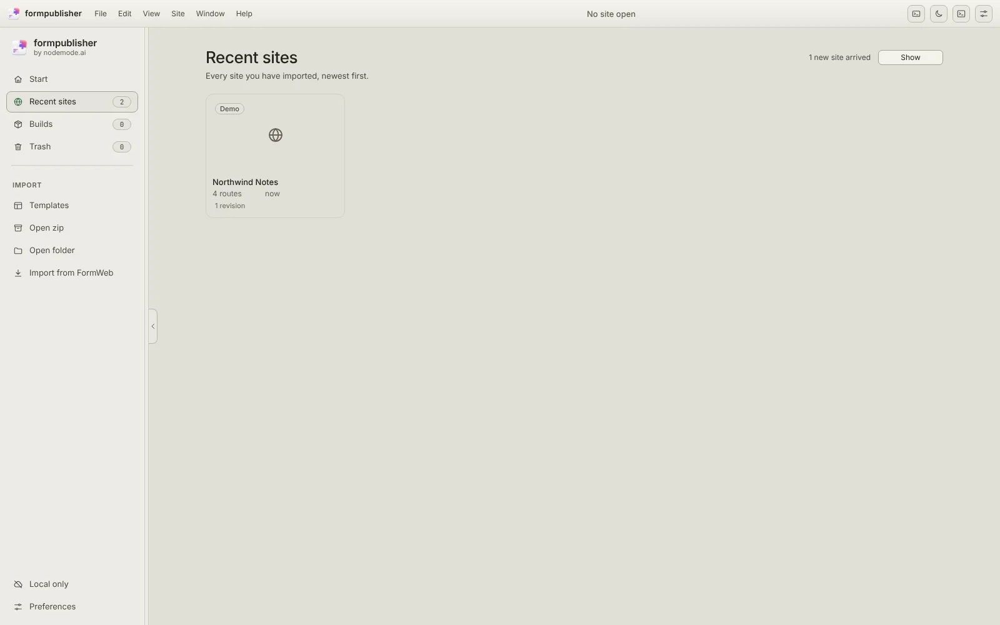
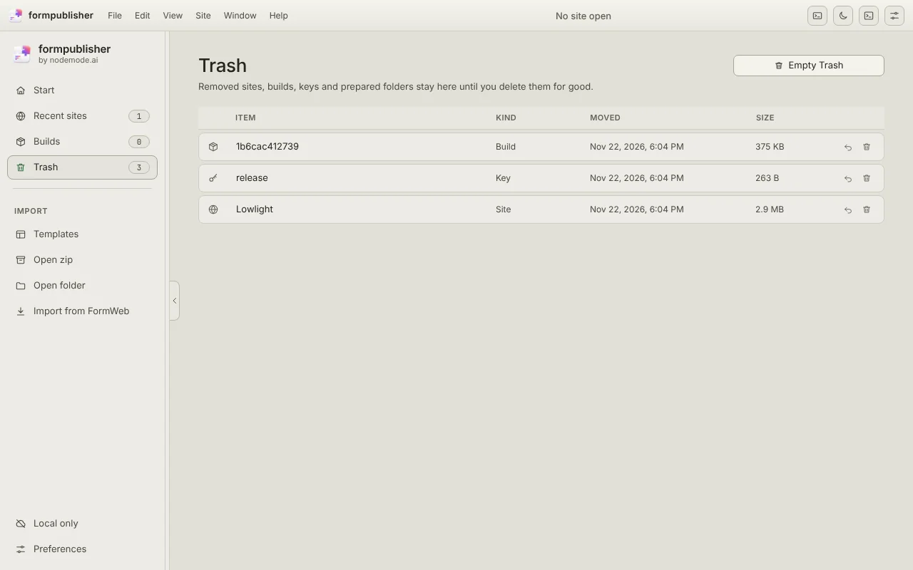
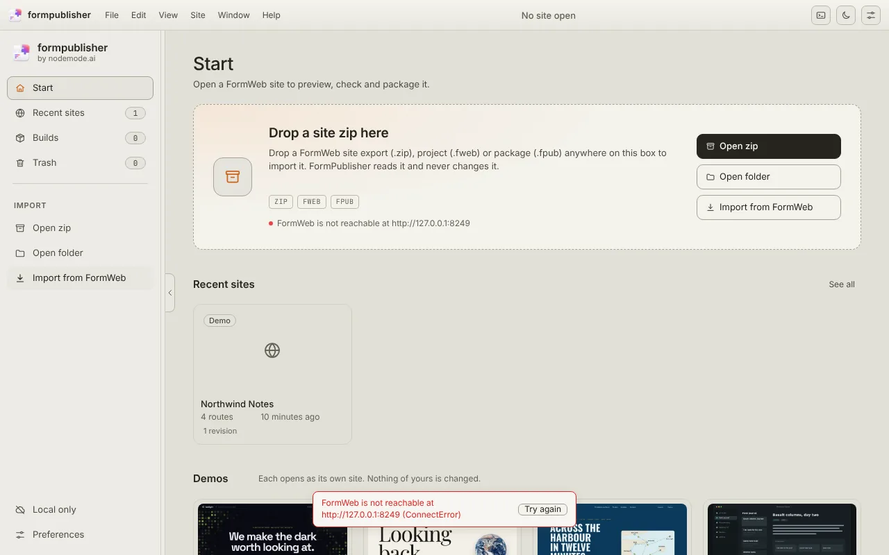

# FormPublisher Manual

FormPublisher is the Form family's site publisher. It opens what FormWeb makes, lists the site's routes and shows them in a FormDeck-style window. People and agents use the same steps: each one is also a command line command and an MCP tool.

It imports FormWeb sites, previews them on device sizes, checks them, builds signed packages, and prepares a folder with the exact commands for each of six hosts. It never uploads anything. It runs in a browser tab or as a desktop app.

## Contents

- [Getting started](#getting-started)
- [The desktop app](#the-desktop-app)
- [Home](#home)
- [Trash](#trash)
- [Keyboard shortcuts](#keyboard-shortcuts)
- [Importing a site](#importing-a-site)
- [Routes](#routes)
- [.fweb projects](#fweb-projects)
- [Preview](#preview)
- [Checks](#checks)
- [Packages and signatures](#packages-and-signatures)
- [The .fpub format](#the-fpub-format)
- [Publish](#publish)
- [Templates](#templates)
- [Receive from FormWeb](#receive-from-formweb)
- [Revisions and diffs](#revisions-and-diffs)
- [The demo](#the-demo)
- [Agents](#agents)
- [The command line](#the-command-line)
- [The MCP server](#the-mcp-server)
- [Settings and the data folder](#settings-and-the-data-folder)
- [Error codes](#error-codes)
- [When something goes wrong](#when-something-goes-wrong)

## Getting started

From the repository:

```sh
./formpublisher_oc_install        # the engine's Python venv and the interface packages, once
./formpublisher                   # engine on 127.0.0.1:8280 and interface on http://localhost:5280
```

Open http://localhost:5280. `./formpublisher build` then `./formpublisher serve` runs the built interface from the engine alone on http://127.0.0.1:8280. `./formpublisher doctor` checks the toolchain, the installs and the ports, and prints a vendor row: `vendor: in step at VERSION`, or the first problem with a pointer to `./formpublisher vendor --check` for the rest. Windows has `formpublisher.bat` and `formpublisher_oc_install.bat`. The launchers stop with their own message and exit code 1 when something they need is missing: `boot` after a failed install, `desktop dev` without the desktop tools ("the desktop tools are missing: run formpublisher.bat install"), `backend\boot_backend.bat` without Python 3.12 ("Python 3.12 is needed") or when installing the engine requirements fails; `doctor` prints "missing" for a tool that is not installed. `formpublisher.bat run`, `cli`, `mcp`, `agents` and `vendor` pass up to 8 arguments on to the command, so `formpublisher.bat vendor --check` and `formpublisher.bat agents sync --check` work. The launchers were run under Wine 9.0; real Windows has not been run.

## The desktop app

`./build_app` (`build_app.bat` on Windows) builds the desktop app from this folder, start to finish, and logs to `build_app.log`. It freezes the engine with PyInstaller into one `formpublisher-engine` program (the built interface, the four demo sites with their font licences and the `formweb-core` compiler go inside it), then builds the Tauri 2 shell around it. `formpublisher-engine --selfcheck` proves a frozen engine starts, runs the `formweb-core` inside it once, and it takes the same commands as the command line (`formpublisher-engine cli ...`). The freeze step runs that self-check before the engine goes into the app, and on macOS `build_app` runs it again on the engine inside the finished app, under the app's signature, before it packs the disk image. With `APPLE_SIGNING_IDENTITY` set the app is signed with that identity and a failed `codesign --verify` stops the build; without it the app is signed ad hoc. `build_app` does not notarize; a downloaded copy of such a build is stopped by macOS once at its first open, and [When something goes wrong](#when-something-goes-wrong) has the step.

When the app starts it shows a small splash with a gradient bar, starts the engine, and reveals the main window only once the interface has drawn its first frame, so there is no white flash. A second launch focuses the running window instead of opening another. Closing the last window ends the app and the engine it started; a terminate or interrupt signal does the same, engine and anything the engine started included.

The port rule: the app uses `FORMPUBLISHER_PORT` when that is set, else 8280 when it is free, else any free port the system hands out. If something already answers the health route on the chosen port, the app uses that engine and does not start another. Once the site host and the inbox watcher are up, the engine writes `engine.json` in the data folder with `app`, `port`, `hostPort` (the site host port it really bound), `pid`, `version` and `started`, so FormWeb finds the running app on whatever port it took. A stopping engine removes the file only when it still names its own pid, so a second engine on another port and data folder never loses its file. When FormPublisher is closed, FormWeb leaves the site in the inbox, where the engine imports it on its next scan (see [Receive from FormWeb](#receive-from-formweb)). Running from source, `./formpublisher desktop dev` opens the window over the source tree instead of the frozen engine.

In the desktop app, Open Folder uses the system folder panel. Cancelling the panel imports nothing, and if the panel fails the app falls back to the typed path dialog, which is also what the browser always shows. Reveal Site Folder opens the site's folder in the system file manager through the app's `reveal_path` command, which only accepts a path inside the data folder (`FORMPUBLISHER_HOME`, or `~/FormPublisher`); anything outside it, or a path that does not exist, is refused.

On Linux the app builds with WebKitGTK 4.1 installed: `setup/freeze_backend` makes the engine program, then `cargo build --release` in `src-tauri` builds the shell (about 8 minutes from cold). Linux and Windows use the menus inside the window. On macOS the menus are in the system menu bar, with Preferences in the app menu; View > Menus in Window keeps them in the window instead, from the next start. On macOS the title row of the page is the window's title bar: the close, minimize and zoom buttons sit at its left, and its empty parts and the site name drag the window. The window's minimum size is 1024 x 680, and the window title stays "FormPublisher" in every language while the page shows the site name. A language change in Preferences changes the menus and the window at once, as in the browser.

## Home

Home is the start page. Its side panel lists Start, Recent sites, Builds and Trash, then your open sites, the three ways to import (Open zip, Open folder, Import from FormWeb), Local only and Preferences. Start offers a drop zone for a FormWeb export, the recent sites and the demos. Opening a site puts it in a tab. Home starts under the title bar, so the brand, the menubar, the theme button and Preferences stay usable while Home is open; only the content below the title bar is locked. File > Home (`Alt+Mod+H`), the brand in the title bar and the plus button of the tab strip all show Home; Escape, or a site under Open sites, goes back to the open site.

The menubar has File (Home first, the imports, New Window, Close Tab, Package Site, Publish Site and Preferences), Edit, View (Builds, Find a Command, the theme, the density and the panes), Site (the checks, Reload Routes, Reveal Site Folder, Remove Site), Window (Minimize, Maximize and Full Screen; the first two work in the desktop app) and Help (Documentation, Keyboard Shortcuts, Demos and About). The menus in the window work from the keyboard: F10 opens File, and on Windows and Linux a lone Alt focuses the bar and Alt with a menu's first letter opens it; the arrow keys, Home and End move, Enter chooses, Escape goes back one level, and typing the start of an item's name jumps to it. Preferences (`Mod+,`, the title bar button, File > Preferences, or the app menu on macOS) is a window with its categories on a rail at the left, General, Interface, FormWeb and About; each category is a card that folds, and the rail can be folded to icons.


Recent sites keep still while they are on screen. When a site arrives (for example from FormWeb's Send to FormPublisher) while Start or Recent sites is showing, the cards do not move. A row above each list says how many new sites arrived, and Show re-sorts the list with the new sites in place. The row is always there, empty when nothing arrived, so the cards never shift. When Recent is not on screen the lists update as before.



## Importing a site

There are four ways in, and all of them only read:

- **A site export.** Drop FormWeb's `site-export.zip` on Home, or choose it. A `.fweb` project (see [.fweb projects](#fweb-projects)) and a `.fpub` package go in the same way: Open, the file picker and the drop take `.zip`, `.fweb` and `.fpub`.
- **A .fpub package.** One build saved from another FormPublisher. See [The .fpub format](#the-fpub-format).
- **A publication folder.** Choose a FormWeb publication folder, `publications/[slug]/[version]/`.
- **The site open in FormWeb, or one of its saved projects.** With FormWeb running on the same computer, import its current site, or pick one of its saved projects from a short list. FormPublisher asks FormWeb's `GET /api/export` (or `GET /api/projects` and `GET /api/projects/[id]/file`) over loopback. It never calls `/api/load` and never changes what FormWeb has open.

## Routes

A site's routes come from its `routes.json`. Each has a path, a page, a locale, an item and a stylesheet. The routes strip lists them, the inspector shows the selected route, and the status bar shows how many there are.

## Trash

Removing a site, a build, a signing key or a prepared folder moves it to `trash/` in the data folder; nothing is deleted at once. Each entry gets a `.trash.json` record beside it with its kind, label, origin, time and size. Home's Trash page lists the entries newest first with a kind icon, the label, the kind, the time and the size. Restore moves an entry back to where it came from. Delete for good and Empty Trash remove entries for good, and both ask first. The page refreshes by itself when something is removed or restored, and restoring a site refreshes Recent.

A restore only goes ahead when the place is free: if something already sits at the origin (or a key with the same id exists) it answers 409 with the reason, and the window shows it as a notice. Entries moved to the trash before 0.1.4 have no record. Their kind and origin are inferred from the name: a site from its `site.json` id, a key from its `entry.json`, a build from `build-[site]-[12 hex]-[stamp]`, and a prepared folder from `prepared-[site]-[build]-[target]-[stamp]`, matched against the known targets and the build id. A stamp may end in a `-N` counter. The list marks such rows as inferred, and they restore like any other. A prepared folder from before 0.1.4 lost its hidden record, so restoring it prepares the same target again from its build, which gives the same folder; if the build is gone or is itself in the trash, the restore answers 409 naming it.

An entry whose origin cannot be recorded or inferred answers 409 with the code `origin-unknown`. Restore it to a named place: the window opens a "Restore from the trash" dialog that shows the kind's own folder as a fixed prefix and asks for the name, a key getting `.pem` added. The engine's refusal shows inside the dialog, which stays open until the name is accepted. The same dialog asks for a passphrase when a locked key needs one, and for a place and a passphrase together when an entry needs both; it sends them in one request, and no row is added or removed while it is open.

The dialog checks the shape of the name before it asks, and the engine applies the same rule (a wrong shape answers 409 `place-invalid`). A site is lowercase letters, digits and hyphens. A key is 16 hex characters. A build is `<site>/<12-hex build id>`. A prepared folder is `<site>/<build id>/<target>`. A restored site whose `site.json` had no id gets its folder name as id.

<picture><source media="(prefers-color-scheme: dark)" srcset="images/trash-origin-dark.webp"></picture>

<picture><source media="(prefers-color-scheme: dark)" srcset="images/restore-dialog-dark.webp"></picture>

A trashed key whose record (`entry.json`) is missing or damaged is rebuilt from its `.pem` when you restore it. An unencrypted key gets back its id (the first 16 hex characters of the SHA-256 of its public key) and its fingerprint, and the list shows it as "Recovered key [id]". An encrypted key answers 409 `passphrase-required`; a wrong passphrase answers `passphrase-wrong`, and the right one restores the key. In the window, restoring a locked key asks for its passphrase in the Restore from the trash dialog, which shows a wrong passphrase inline and clears the field. A file that cannot be read, a key that is not Ed25519, or more than one `.pem` stays `entry-damaged`. An id that is already present answers `place-taken`. The passphrase is never logged, stored or echoed.

The restore answer also carries `message`, kept for older callers. The same restore is `POST /api/trash/{entry}/restore` with the body `{"origin": "...", "passphrase": "..."}` and `trash restore ENTRY --to PATH` on the command line. For a locked key the command line has `trash restore ENTRY --passphrase-stdin`, which reads one line from standard input. No flag takes the passphrase itself. The origin is used only when none is recorded or inferred, it must be free, and it must resolve inside the kind's own folder (a key directly in `keys/`); a path that leaves it, an absolute path, one of another kind or a taken place is refused.



The routes are `GET /api/trash`, `POST /api/trash/{entry}/restore`, `DELETE /api/trash/{entry}` and `DELETE /api/trash` (empty). An entry name is only accepted when it appears in the folder listing. See [The command line](#the-command-line) and [The MCP server](#the-mcp-server) for the agent side: an agent can list the trash and restore from it to a recorded or inferred origin, but restoring to a named place and deleting for good stay with a person.

## Keyboard shortcuts

Keyboard Shortcuts (`Mod+/`, in the Help menu) lists every command with its keys. Each row has Change and Reset. Change records the next combination you press; no command runs while it records. Escape cancels, and Backspace clears the binding. Reset restores that command's default, and Reset all restores every default.

Some combinations are refused with a reason: ones without a modifier, ones the browser or the system keeps, and the text-editing commands (copy, paste and the like). When another command already holds the combination, the dialog names it and offers Replace or Cancel. Overrides are stored in the browser's local storage under `formpublisher_shortcuts`, and the menus, the command palette, the dialog and the desktop app's native menus pick them up at once.

## .fweb projects

A `.fweb` file is a FormWeb project: a JSON envelope with the format `com.nodemode.formweb`. Import it like a zip or a folder, from Home or the file dialog. FormPublisher hands it to `formweb-core`, the compiler built from the FormWeb crates vendored in `vendor/formweb-native/`. The compiler loads the project and exports every locale with the site's default locale as the base, and FormPublisher writes the files and the referenced assets (`/api/assets/[sha].[ext]` references become real files, as FormWeb's own bundling does). The import is recorded with source kind `fweb`; importing the same project again adds a revision.

The files are the ones FormWeb's own export of the same project gives, the root `404.html` included (its links start at the site's base folder, so the not-found page keeps its pictures and fonts at any missing address). One thing differs: a form that posts and has no script of its own gets the address `/api/forms/[site]/[form]` here, where FormWeb's export writes its own address on this computer (`http://127.0.0.1:8240/...`). Neither answers on a static host, and the static checks report both as `forms.local-address` (see [Static tier](#static-tier)), with the same code FormWeb's audit uses.

Version 2 projects import too. When a project is too big for the JSON envelope, FormWeb 0.19.4 writes a zip `.fweb` instead: `project.json` first, then each asset stored as `assets/[id]`. FormPublisher applies FormWeb's own checks to it: `project.json` comes first and is at most 64 MiB, the format and version are right, at most 500 assets are listed once each, every member is exactly `assets/[listed id]`, and each asset matches its digest, size limit and mime type. The file is capped at 512 MiB and assets stream from the zip in 1 MiB chunks. A bad file is refused with the reason. A version 2 zip is recognised by its contents, so it imports as a project even without the `.fweb` extension, and ordinary site zips are unaffected. A version 1 project and its version 2 twin build to the same files and hashes.

`formweb-core` is not part of the Python install. Build it once with `./setup/install_compiler` (`setup\install_compiler.bat` on Windows), which runs `cargo build --release --locked` and copies the binary to `backend/bin/formweb-core`. `./formpublisher_oc_install` runs it when Rust is installed and says how to get Rust when it is not. `FORMPUBLISHER_FORMWEB_CORE` points to a binary elsewhere. The script first runs `./formpublisher vendor --check` and stops before cargo when the vendored crates are out of step; `setup\install_compiler.bat` does the same with `setup\vendor_check.py --check` and `formpublisher.bat doctor` prints the same vendor row (the Windows scripts were run under Wine 9.0, where doctor printed the vendor row in step and out of step and `install_compiler.bat` refused before cargo when out of step; real Windows has not been run). Without the binary an import answers: "Opening .fweb projects needs formweb-core. Run ./setup/install_compiler."

## Preview

Opening a site mounts a revision on the site host, a second listener at 127.0.0.1:8281 (`FORMPUBLISHER_HOST_PORT`) that serves the files the way a production static host does. When that port is already taken, for example by a second engine, the engine takes a free port instead, logs a warning naming both, and reports the port it uses as `hostPort` in `/api/health` and `engine.json`, so its preview and live checks always reach its own site. It is a separate origin from the interface, so the site gets its own storage and cannot call the engine's `/api` routes. One site is mounted at a time; mounting another replaces it.

How the host resolves a request:

- `/a/b` is the file `a/b`, then `a/b/index.html`, then `a/b.html`; `/a/b/` is `a/b/index.html`; `/` is `index.html`. Query strings are ignored.
- Paths with `..`, a backslash or a NUL byte are refused (400); symlinks that leave the revision are not followed.
- `redirects.json` applies when no file matches: 301, 302, 307 and 308 answer with `Location`, 200 rewrites to the target, and a trailing `*` in `from` becomes `:splat` in `to`.
- A missing path answers with the root `404.html` (status 404). When there is no `404.html` it answers with `404/index.html`, where FormWeb puts its 404 page, and otherwise plain text. For that older `404/index.html` fallback the host makes the URLs in the page root-absolute, as the publish targets do.
- Single-range requests answer 206, or 416 when unsatisfiable. Every response carries `Cache-Control: no-store`, `X-Content-Type-Options: nosniff` and `Referrer-Policy: strict-origin-when-cross-origin`.
- Only `GET` and `HEAD` are accepted, and only for `127.0.0.1:[port]` or `localhost:[port]` as Host.

The options toolbar above the stage controls the preview:

| Control | Choices |
| --- | --- |
| Route | an editable field; Enter navigates, and it follows the page's own navigation |
| Device | Desktop 1440 by 900, Laptop 1280 by 800, Tablet 834 by 1112, Phone 390 by 844, Custom |
| Rotate | swaps width and height |
| Zoom | Fit, 50, 75, 100 percent |
| Theme | Auto, Dark, Light |
| Motion | Auto, Reduce |
| Network | None, Fast (40 ms, 1,500 KB/s), Slow (150 ms, 200 KB/s) |
| Reload, Open in browser | reload the frame; open the current route in the system browser |

Theme, motion and network remount the site with the new options and reload the frame. Size and zoom never reload it. Navigating loads a hidden second frame and swaps it in once it has loaded, so the page never blanks. The choices are remembered per window.

In a narrow window the toolbar keeps every control in its row and steps down in stages. Below 1400 px of row each select is as wide as its longest option, so every value shows whole and choosing another option never moves anything. Below 1240 px Publish and Package show only their icon (the label stays as the accessible name and the tooltip). If the row still overflows, the separators go and the route field becomes an icon: focus it and it opens as a 300 px field over the row without moving the row; Enter navigates, and Escape or leaving the field collapses it. If that is not enough, the selects show short labels: the value after "Theme:" and similar prefixes, and the device name without its size; the device select is then as wide as its widest preset name, and Custom shows a short word ("Andere" in German) where its full name would be wider, with the full device name in the tooltip. Only the display is shortened; the options and their keys are unchanged. A last step tightens the row's padding, hides the "x" between width and height and narrows the two number fields. Each width follows the labels of the language shown, so choosing a new language in Preferences moves the toolbar's controls sideways once, at the moment of the switch. The sizing also starts above 1400 px whenever the row would otherwise overflow, which happens in the Linux desktop shell (WebKitGTK draws selects a few pixels wider than Chrome) with long labels such as German. The Problems bar does the same with its two filters: when it would wrap, "All severities" and "All tiers" show "All" (the full name stays in the tooltip), and if that is still too wide in your language both filters give way to one funnel button. Its tooltip reads "Filter problems" with the current severity and tier, a dot marks it while either filter is not All, and it opens a menu with both groups (by mouse, or with Enter, Space or Down, the arrows, Home, End and Escape). Picking there filters the list exactly as the selects do. The bar stays one row at every width.

Theme and motion are emulated by a probe script that the host injects into HTML responses right after `<head>` (only while previewing, never in a package). It makes `prefers-color-scheme` and `prefers-reduced-motion` answer as chosen, and makes `fw-theme-*` storage keys return the forced theme. The same probe reports the console, errors, requests, layout shift and horizontal overflow to the window for the live checks.

The routes strip shows a thumbnail box and a status dot per route: none when not checked, green for no problems, amber for warnings, red for errors. Thumbnails come from a deep check.

## Checks

Checks produce problems. Each problem has an id (stable for the same finding, and for a deep problem the same on every run: the id hashes the failing URL with the site host's port left out, so a new run on a new port gives the same ids. Since 0.1.4 the URL is hashed with the host normalized, so the ids of `deep.request` problems differ from those of 0.1.3 and earlier; a check of the same site (redirects, clean URLs, a directory index and a custom 404 page) gives the same problems, summaries and thumbnails otherwise; messages and the url field still show the real address), a tier (`static`, `live` or `deep`), a severity (`error`, `warning`, `info`), a code, the route, a message and a fix, and optionally the file, line, selector and URL. The Problems tab lists them with filters by severity and tier, and clicking a row selects its route. Counts show in the tab and the status bar. The bottom panel's tabs (Problems, Console, Network, Revisions) each have an icon and a label. When the tab strip is under 460 px they tighten, and under 360 px they show the icon and the count badge, with the label kept as the accessible name. Counts of three digits on more than one tab can still overflow a 760 px window. Run checks starts the static tier; Deep check starts the deep tier.

### Static tier

Runs offline on the revision's files, in the Python standard library. HTML is parsed, paths resolve the way the host resolves them, and results are sorted by route, code and line.

A site whose address has a folder in it (a base URL such as `https://example.org/shop/`, a GitHub project page, or a FormWeb publication folder) carries that folder in its root `404.html` and its sitemap. FormPublisher reads the folder from the `Sitemap:` line of the site's `robots.txt` and looks such a path up inside the site, in the checks and in the preview, so those links and sitemap entries are not reported as missing and the not-found page keeps its styles. A path is always tried as written first.

| Code | Severity | Rule |
| --- | --- | --- |
| `link.broken` | error | an internal `href` resolves to no file, route or redirect |
| `link.anchor` | warning | a `#id` fragment has no element with that id on the target page |
| `asset.missing` | error | `src`, `srcset`, `poster`, `link href`, CSS `url()` or `@import` resolves to no file |
| `redirect.loop` | error | following `redirects.json` returns to a visited path |
| `redirect.chain` | warning | a redirect target is itself redirected |
| `redirect.target` | error | a redirect target resolves to nothing |
| `sitemap.missing` | warning | a route is not in `sitemap.xml` (unless the page is `noindex`) |
| `sitemap.extra` | warning | a sitemap URL path resolves to no route |
| `robots.sitemap` | warning | `robots.txt` has no `Sitemap:` line, or it does not end in `/sitemap.xml` |
| `robots.blocks` | warning | `robots.txt` disallows `/` for `*` |
| `meta.title` | error when missing, warning over 60 characters | the `title` element |
| `meta.description` | warning when missing or over 160 characters | `meta name="description"` |
| `meta.lang` | warning | `html` has no `lang` |
| `img.size` | warning | an `img` has no `width` and `height` and no inline `aspect-ratio` |
| `img.alt` | warning | an `img` has no `alt` (an empty `alt` is fine) |
| `heading.h1` | warning | a page has no `h1`, or more than one |
| `heading.order` | info | a heading level is skipped going down |
| `external.request` | warning | an `http(s)` URL in a resource position (`src`, `srcset`, `poster`, stylesheet `href`, CSS `url()`, `@import`, and string literals passed to `fetch(`, `import(` or `new URL(` in `.js` files) that is not on the site's own host. One warning per distinct URL, on the first page that uses it; when the URL is used more than once, the message gives the number of references and every page, and the problem carries `count` and `pages` |
| `forms.local-address` | warning | a `form` whose `action` goes to this computer or the local network (`localhost`, a `.local` name, a host name without a dot, or a loopback, private, link-local or unspecified address), or into `/api/forms/` on the site itself (FormWeb's own form route, which no static host serves). The message names the page and the address. A form with no `action` (FormWeb writes a form with a scripted reply that way) and a form that posts to a service on the web are not reported. The rest of the page still works, so this is a warning |
| `budget.file` | warning over 1 MiB, error over 5 MiB | HTML, CSS and JS files; media (images, video, audio, fonts) warn over 20 MiB |
| `budget.page` | warning | a route's HTML plus the CSS and JS it references directly totals over 500 KiB |

### Live tier

While you preview, the probe reports what the page does and the window turns it into problems at once: `console.error` and page errors are errors, `console.warn` is a warning, a failed request (network error or status 400 and up) is an error, layout shift of 0.001 or more is a warning and 0.1 or more an error, and horizontal overflow is an error. The live tier measures the page, not the preview: a shift that starts within 500 ms of the preview frame changing size (a Device switch, a dragged pane) is not counted, nor is one before the page's first paint, and overflow is measured 300 ms after the page loads or the frame changes size. The window accepts probe messages only from the visible frame, from the host origin, for the current mount and from the document the frame is showing now. Live problems are sent to the engine at most once a second so the Problems list holds all tiers. The Console and Network tabs show the raw messages.

### Deep tier

A deep check drives the Chrome you already have installed through Playwright. It serves the revision through the same site host as the preview (with no probe), so a deep check sees the same host rules, and for each route at 1440 by 900 and 390 by 844 (or the widths you pass) it opens a fresh context, applies a 4x CPU slowdown and a slow network (150 ms, 200 KB/s), records layout shifts, loads the page, scrolls to the bottom in 8 steps and back, and reads the results. Problems:

| Code | Severity | Meaning |
| --- | --- | --- |
| `deep.console` | error | a console error |
| `deep.pageerror` | error | an uncaught error |
| `deep.request` | error | a failed request or a response of status 400 and up |
| `deep.external` | warning | a request to another host |
| `deep.cls` | warning above 0, error at 0.1 and up | layout shift, with the value in the message |
| `deep.overflow` | error | the page is wider than the viewport |
| `deep.unavailable` | info | Playwright or Chrome is missing |

Each message names the route and width. A thumbnail of each route (1440 by 900, scaled to 320 px wide) is saved under `checks/[site]/[revision]/thumbs/`.

The deep tier needs `backend/requirements-deep.txt` (`./formpublisher_oc_install` installs it) and Chrome. FormPublisher never downloads a browser. It uses Chrome from the `checks.chromePath` setting, or finds one in the usual places (Google Chrome on macOS, `google-chrome`, `google-chrome-stable` or `chromium` on Linux, `Program Files` on Windows). Results are stored per revision in `checks/[site]/[revision]/results.json`.

## Packages and signatures

Package opens with Package (Mod+Shift+B). It shows the check summary, then builds the revision.

### Build

A build contains every file in the revision except FormPublisher's own records. `site.zip` is deterministic: entries sorted by UTF-8 path, forward slashes, timestamps fixed at 1980-01-01, mode 0644, deflate level 9, no directory entries, no extra fields and no comment. The same revision gives the same bytes on every machine. The build id is the first 12 hex digits of the SHA-256 of the site id, a colon and the zip's SHA-256, so the same bytes imported as two sites get two builds; `publish.json` still records the zip's own SHA-256. Building an identical revision again returns the existing build.

Each build lives in `builds/[site]/[id]/`:

| File | What |
| --- | --- |
| `site.zip` | the package |
| `publish.json` | what the package is, kept beside the zip and never inside it |
| `site.zip.sig` | the signature, once signed |
| `build.json` | the library record: id, site, revision, created, size, files, signed; the only file that holds a time |

`publish.json` has sorted keys, two-space indent and a trailing newline:

```json
{
  "builtWith": "FormPublisher 0.4.0",
  "checks": { "errors": 0, "infos": 0, "tiers": ["static"], "warnings": 0 },
  "files": [ { "path": "index.html", "sha256": "...", "size": 1024 } ],
  "format": "formpublisher-site",
  "headers": [
    { "for": "/*", "values": { "Referrer-Policy": "strict-origin-when-cross-origin", "X-Content-Type-Options": "nosniff" } },
    { "for": "/assets/*", "values": { "Cache-Control": "public, max-age=3600" } }
  ],
  "package": { "file": "site.zip", "sha256": "...", "size": 20480 },
  "redirects": [],
  "routes": [],
  "site": { "id": "...", "name": "...", "revision": "...", "source": { "formwebVersion": "0.19.1", "kind": "formweb-export" } },
  "version": 1
}
```

`source.kind` is `formweb-export`, `publication`, `fweb` or `folder`.

`checks` counts the problems of the revision's stored check results, and `tiers` lists the tiers that ran (`static`, `deep`). A build made before any check ran on that revision has `"checks": null`: no check ran, which is not the same as a clean result. A `publish.json` written by 0.3.2 or earlier has `"checks": { "errors": 0, "infos": 0, "tiers": [], "warnings": 0 }` in that case; read an empty `tiers` the same way as `null`.

Reproduce rebuilds the revision in a temporary folder and compares the SHA-256 with the stored one: it answers `same`, the new hash and the expected hash.

### Keys

Signing uses Ed25519. New key creates a pair: the private key is PKCS8 PEM in `keys/[id].pem`, mode 0600, encrypted when you give a passphrase; the public key is raw 32 bytes in base64 in `keys/index.json` with the name, fingerprint, created time and whether it is encrypted. The fingerprint is `SHA256:` followed by the base64 (no padding) of the SHA-256 of the raw public key, and the key id is the first 16 hex digits of that digest. Deleting a key moves its files to the trash. Back up the private key; FormPublisher cannot recover a lost one.

### Sign and verify

Sign signs the exact bytes of `site.zip` and writes `site.zip.sig`, sorted JSON with a trailing newline:

```json
{
  "algorithm": "ed25519",
  "key": "SHA256:...",
  "publicKey": "base64 of the 32-byte public key",
  "signature": "base64 of the signature"
}
```

A wrong passphrase is refused with "The passphrase does not unlock this key." Verify checks that the signature is valid over the current zip bytes with the public key in the file and that the fingerprint matches that key. It answers `valid`, the key, and a reason when invalid. Changing any byte of `site.zip` makes it invalid.

### The Builds page

Builds in Home lists builds newest first with site, id, date, size and signed. Inspect shows the file table from `publish.json`. Compare takes two builds and lists the files added, removed and changed by path, with the count that are the same. Delete moves a build to the [trash](#trash). Download saves the zip. Save as .fpub saves the build as a single `.fpub` file (see below).

## The .fpub format

A `.fpub` file is one build in one file: the build's `publish.json`, its `site.zip` and, when it is signed, its signature. It moves a build from one FormPublisher to another with nothing lost, and the signature still checks out on the other side.

### Saving one

- **The window.** In Home's builds library, each row has a Save as .fpub button (an archive icon, beside Download) that downloads the file. The saved name is `SITE-BUILD.fpub`, the same from the engine's header and from the link's own download name, so it does not depend on the webview.
- **The command line.** `./formpublisher run fpub BUILD [--out FILE] [--force]`. Without `--out` the file is `SITE-BUILD.fpub` in the current folder. The name must end in `.fpub`. An existing file is not replaced unless `--force` is given.
- **MCP.** `save_fpub` with `build` and an absolute `path` ending in `.fpub`. It never replaces a file. It answers the file, size and SHA-256.
- **The engine.** `GET /api/builds/BUILD/fpub` answers the file as a download.

The same build always saves to the same bytes: the entries are in a fixed order, each with the fixed time 1980-01-01 00:00:00, and nothing else varies. Saving twice, in the window, on the command line and over MCP, gives identical files. Saving refuses with `build-damaged` when the build's `site.zip` no longer matches its `publish.json` or its signature no longer holds, and with `too-large` over 512 MiB.

### Opening one

Open it like a site export: Open (`Mod+O`), the file picker or a drop on Home, `./formpublisher run import FILE`, the MCP tool `import_site`, or `POST /api/sites/import`. A `.fpub` is recognised first, by its `.fpub` name or, for a file without that name, by a zip whose first entry is `fpub.json`.

Opening checks everything before it writes anything, and a file that fails any check changes nothing in the data folder:

- the file is a zip of at most 512 MiB and not encrypted, and its entries are exactly the ones listed below, in that order, with safe names and sizes within each entry's limit;
- `fpub.json` has format `formpublisher-package`, version 1, and valid fields;
- `site.zip` has the size and SHA-256 that `fpub.json` records, and `publish.json` records the same digest and size, and the same site id;
- when `fpub.json` says it is signed, `site.zip.sig` is present and valid over the exact bytes of `site.zip` with the key the file carries, and its fingerprint matches that key; when it says it is not, there is no signature entry.

Then it imports `site.zip` as a new revision of the same site id and restores the build byte for byte under its id. A build id that is already taken (for instance, opening the same file twice) gets a fresh id, and the answer says so: `build.remapped` is true and `build.originalId` is the id in the file. The answer's `build.signature` is `{valid, key, keyId, known}`, where `known` says whether the key is one of this computer's own keys; a signature from a key you do not hold is still valid, and it is reported as not one of your keys. Refusals use the codes `fpub-invalid` (not a package, wrong entries, bad fields), `fpub-tampered` (a checksum, size or id that does not match), `fpub-signature` (a signature that does not hold), and `too-large`. For example, a `.fpub` with one byte of `site.zip` changed is refused with "site.zip does not match the checksum recorded in fpub.json".

### Entries

A `.fpub` is an ordinary zip (deflate, no encryption, no zip64 needed) with these entries, in this order and no others:

| Entry | Holds | Limit |
| --- | --- | --- |
| `fpub.json` | the package record, below | 1 MiB |
| `publish.json` | the build's manifest, exactly as in the build | 32 MiB |
| `site.zip` | the build's package, exactly the bytes that were built | 512 MiB |
| `site.zip.sig` | the build's signature file (see [Sign and verify](#sign-and-verify)); present only when the build is signed | 64 KiB |

The whole file is at most 512 MiB. Every entry is stored with the time 1980-01-01 00:00:00 and the mode 0644, so a tool that writes the same content in the same order gets the same bytes.

### fpub.json

UTF-8 JSON, indented two spaces, with a trailing newline:

```json
{
  "format": "formpublisher-package",
  "version": 1,
  "site": { "id": "northwind-notes", "name": "Northwind Notes" },
  "build": "a1b2c3d4e5f6",
  "revision": "20261111T010203Z",
  "builtWith": "FormPublisher 0.4.0",
  "createdAt": "2026-11-11T01:02:03Z",
  "package": { "file": "site.zip", "sha256": "64 lowercase hex digits", "size": 12345 },
  "signature": null
}
```

| Field | Meaning |
| --- | --- |
| `format` | always `formpublisher-package` |
| `version` | the layout version, an integer, `1`. A reader refuses any other number |
| `site.id`, `site.name` | the site's id (the folder name under `sites/`) and its name, at most 120 characters |
| `build` | the build's id when it was saved |
| `revision` | the site revision the build was made from. When it looks like `YYYYMMDDTHHMMSSZ`, opening gives the imported revision that name |
| `builtWith` | the program that built it, as `publish.json` records it |
| `createdAt` | when the build was made |
| `package.file` | always `site.zip` |
| `package.sha256`, `package.size` | the SHA-256 (lowercase hex) and the byte size of `site.zip`; they must equal the same values in `publish.json` |
| `signature` | `null` for an unsigned build; otherwise `{"file": "site.zip.sig", "keyId", "fingerprint", "publicKey"}` |

In `signature`, `publicKey` is the base64 of the raw 32-byte Ed25519 public key, `fingerprint` is `SHA256:` and the unpadded base64 of the SHA-256 of that key, and `keyId` is the first 16 hex digits of that SHA-256. They must equal what `site.zip.sig` carries. The signature signs the bytes of `site.zip` itself, not `fpub.json`, so a reader checks it with nothing but the file's own entries.

To produce one from another tool: build `site.zip` and `publish.json` as in [Packages and signatures](#packages-and-signatures), write `fpub.json` with the digest and size, and zip the entries in the order above. To read one: check the entries and `fpub.json`, compare the digest, then verify the signature with `publicKey` if there is one. `publish.json` must have format `formpublisher-site`, the same package digest and size, and the same site id as `fpub.json`.

## Publish

Publish opens from the toolbar's Publish button, from the Publish button in the Package sheet, or from the command palette (`publish.open`). It prepares a package for a host. It writes a folder and shows the exact commands to run, and it never uploads anything: running the commands is up to you.

The sheet has three parts:

- **Build.** A picker lists the builds of the open site, the latest selected. With no build yet, Build now makes one first.
- **Hosts.** One card per host with a check box: Static zip, Netlify, Cloudflare Pages, Vercel, GitHub Pages and nginx. Select all and Select none tick them together. Prepare writes a folder for each ticked host. The cards have a fixed height with a one-line name, so the sheet does not shift while it fills. The generic name Static zip translates; Netlify, Cloudflare Pages, Vercel, GitHub Pages and nginx stay as written.
- **Keep FormWeb's model files.** A check box under the hosts, off by default. See below.
- **Prepared folders.** One panel per prepared host with the folder path (Reveal opens it in the system file manager, Copy path copies it), the commands (each has a copy button), notes and warnings, Verify, and Remove. Each host's description, notes, warnings and command labels read in the interface language like the rest of the sheet.

What each host gets. Every folder is written from the build's own `site.zip`, never from the live site folder, and the same build always gives the same bytes.

| Host | Writes | Commands |
| --- | --- | --- |
| Static zip | `site.zip` (the build's own bytes), `publish.json`, `SHA256SUMS`, `README.txt` | `unzip site.zip -d site`, `python3 -m http.server -d site 8080` |
| Netlify | `site/` with `_redirects` (301 or 302 per redirect, then `/* /404.html 404` when the site has a 404 page) and `_headers` | `npx netlify-cli deploy --dir site` (draft), the same with `--prod`, and `npx netlify-cli dev --dir site` |
| Cloudflare Pages | `site/` with `_redirects` and `_headers` in Cloudflare's syntax; no 404 rule, because Pages serves `404.html` itself | `npx wrangler pages deploy site --project-name SLUG`, `npx wrangler pages dev site` |
| Vercel | `site/` with `vercel.json` (`cleanUrls`, `trailingSlash`, `redirects`, `headers`) | `npx vercel deploy site`, with `--prod`, and `npx vercel dev site` |
| GitHub Pages | `site/` with `.nojekyll`, a `404.html` that also follows folder redirects, a small `index.html` per redirect (a script that keeps the query and hash, with a meta refresh as the fallback), and `.github/workflows/pages.yml` | the `git` commands for a `gh-pages` branch, or the Actions workflow |
| nginx | `site/` with `formpublisher.conf` (a `server` block with `try_files`, `error_page 404`, one `location =` per redirect, `add_header ... always`, gzip) `nginx-test.conf` and `nginx-check.sh` | `sh nginx-check.sh`, and a `docker run` line with `nginx:stable` |

A FormWeb 404 page exported as `404/index.html` counts as the site's 404, and is also written as `404.html` for the hosts that look for that name. A host that cannot represent something says so under Warnings and never drops it silently: GitHub Pages has no server redirects and ignores custom headers, so each redirect becomes a meta-refresh page and each ignored header is named.

FormWeb 0.19.7 exports splat redirects (`/blog/*` to `/docs/:splat`) and a root `404.html`. Netlify and Cloudflare Pages write the splat into `_redirects`, Vercel writes it as `:path*` in `vercel.json`, and nginx writes it as a regex `location`. GitHub Pages has no server redirects, so it carries a splat redirect through a small script at the top of `404.html` (the site's own or the minimal one): a visitor to `/blog/a/b` is sent to `/docs/a/b` with the query and hash kept, and the status is the 404 page's, not 301 or 302. The script works under the site's base path (the model's `baseUrl`, else the 404 page's canonical link, else `/`, and a note says which), never turns `/blog//evil.com` into another site, and `redirects/README.txt` lists the splats. With scripts off, a visitor at a splat address sees the 404 page, because only the script follows these redirects. Exact redirects stay pages of their own: a small script sends the visitor on with their query and hash (a target with its own query keeps only that query, and a hash in the target wins), and the meta refresh stays as the fallback without scripts. Like the minimal 404 page's home link, use the same base path. An export without `site.formweb.json` and `asset-access.json` still imports, and GitHub Pages then takes the base path from the 404 page's canonical link and says so in its note. A redirect to another site (`/ext` to `https://example.org/x`, or `/out/*` to `https://example.org/:splat`; FormWeb itself refuses such targets, so they come from a hand-edited `redirects.json`) is written with its full URL on all six targets and in the site host, and the GitHub Pages script sends `/repo/out//evil.com` to `https://example.org/evil.com`, never to `//evil.com`. nginx redirects keep the query string (`$is_args$args`) unless the target has its own. An older export has only `404/index.html`. Every target then writes it as `404.html` with its URLs made root-absolute, and says so in its notes. Static zip stays byte for byte.

Left-out model files. A FormWeb site carries its editing model, `site.formweb.json`, and `asset-access.json`. A host does not need them, and they can reveal more of the site than its visitors see, so the `site/` folder of each host is written without them. The Publish sheet's Keep FormWeb's model files box, `--include-model` on the command line and `includeModel: true` in the MCP tool put them back for one prepare. Each prepared panel says "Left out: ..." and the result lists them under `leftOut`; Verify knows which files were left out and does not report them missing. The package is unchanged: `site.zip` is the build's own bytes and still holds both files, and the Static zip host writes that zip as it is, so the option affects the `site/` folders of the other five hosts only.

Verify re-reads the folder and checks every file against the hashes in `publish.json`, and the host's own files against a fresh prepare (a file a target rewrites on purpose, such as the GitHub Pages 404 page, is compared with a fresh prepare instead). Where `nginx` is installed, preparing and verifying the nginx target also run `nginx -t` on the prepared config in a scratch folder (the folder's own `nginx-check.sh` does the same for anyone, with `sh nginx-check.sh` or `./nginx-check.sh`, which is written executable: it runs `nginx -t` on a scratch copy with unix sockets in place of the `listen` ports, then again with each `listen` line on a loopback port, so it needs no root, no IPv6 and no network and changes nothing in the folder; `NGINX_CHECK_PORT` sets the first port, a number from 1024 to 60999, and without it the script starts at 20000 plus the process id modulo 41000, takes one consecutive port per line, and on "Address already in use" tries the next base up to five times, after which it says the listen lines were not checked and exits 0 on the first pass; any other failure in the second pass prints nginx's message and exits 1; a config with no `listen` lines says so. nginx 1.24 does not fail `nginx -t` on a busy loopback port, so the retry only matters on builds that report it). The engine's check then runs a second pass on a copy that points every `listen` line at `127.0.0.1` and a free loopback port, keeping the other parameters, so a bad listen parameter fails the check; with no free port the pass is skipped. Prepare adds a note or a warning (it says whether the listen lines were checked), and verify answers `nginx` with `ran`, `ok`, `version` and `output`, plus `listen` with `ran`, `ok` and `output`; a failure is a problem row and makes `ok` false, and the window shows one line under the result. Without nginx the answer says `ran: false`. An nginx folder prepared by 0.1.7 differs from a fresh prepare (the pid in `nginx-test.conf` is now relative to the prefix) until it is prepared again, and so does one prepared by 0.1.8 (it lacks `nginx-check.sh` and its redirects drop the query string). Every problem row, verify refusal and nginx note reads in the interface language, with paths and nginx's own messages left as they are. The last verify result of each prepared host is kept. It sits beside the prepared record as `.TARGET.verify.json` in `prepared/[site]/[build]/`, outside the host folder, so it is never compared, packaged or copied to a host. It holds the time, `ok`, the number of files checked, the problem rows and the nginx report. `GET /api/publish/BUILD` returns it as `verified` for each host, and `verifiedAt` is in the verify answer. The Publish sheet shows the verdict, its problem rows and a muted time on each host again when you reopen it, reload the window or restart the engine. Preparing a host or removing it deletes that host's kept result; the other hosts keep theirs. Remove moves the folder to `trash/`. Preparing again replaces the folder. Prepared folders live at `prepared/[site]/[build]/[host]/` in the data folder, and the sheet remembers what is prepared for each build when you close and reopen it.

What to do with a prepared folder: each prepared panel has a What to do with this folder button, which opens the Host it yourself guide at that host's part (also Help, Host It Yourself). The same guide is [docs/HOSTING.md](HOSTING.md): what you need, the steps from the folder, your domain's DNS records, HTTPS and updating later, for all six hosts.

## Templates

Templates (Home, File, Start from a Template) starts a new site. The list comes from the public formai-templates repository on GitHub (`index.json`, the FormWeb items). Nothing is fetched until you press Get the templates; the list is then kept in `templates/index.json` in the data folder with its date, and Check again reads it anew.

Only whole sites are offered: the index's three FormWeb demos (`.fweb` projects). Its other FormWeb items (sections, components, a design preset, and a starter assembled from FormWeb's section library) are parts to insert in FormWeb, so the window says how many there are and does not offer them as a start.

Each card shows the name, description, size, licence, credit and the index's preview. Start a site from this asks for a folder, downloads that one file (never more bytes than the index lists, and from a path under `apps/formweb/` only), keeps it only when its SHA-256 matches, opens it with the vendored FormWeb core, and writes it as `[name].fweb` in that folder (an existing file is never replaced). Then there are two next steps: Edit in FormWeb opens FormWeb at the address in Preferences (in FormWeb, File, Import .fweb or .fpub file, and pick the project), and Publish it imports the project here for checks, a package, a signature and a host folder. FormPublisher has no editor of its own. `FORMPUBLISHER_TEMPLATES_URL` points the list at another copy of the repository.

## Receive from FormWeb

FormWeb's Send to FormPublisher hands a site over without a file dialog. There are two ways in, and both end in the same import (a re-send of the same project adds a revision to the same site).

- **The endpoint.** `POST /api/receive/formweb` takes the bytes of a FormWeb `site-export.zip` as `application/zip` (up to 512 MiB), with the header `X-FormWeb-Version` and optionally `X-FormWeb-Site-Name` and `X-FormWeb-Project`. It answers `{site, revision, opened}`, where `opened` is true when a window is listening. Only this computer may send: a request from another address is refused with 403, and so is one with a foreign `Origin`. A running window shows a toast, "Received [name] from FormWeb", with Open; on Home the new site appears in Recent with no reload.
- **The inbox.** When FormPublisher is closed, FormWeb writes the file into `inbox/` in the data folder instead. Every `*.zip` or `*.fweb` there that has not changed for 2 seconds is imported when the engine starts and every 5 seconds while it runs. A file that imports moves to `inbox/imported/` with a timestamp in front of its name; one that does not moves to `inbox/failed/` with a `.txt` file giving the reason.

Inbox metadata. FormWeb writes a small `NAME.zip.json` beside the zip it leaves in the inbox, with `siteName`, `project` and `version` (the same three things the endpoint takes as headers). The import reads it, so a site that arrives through the inbox gets its name and its project, and a later arrival of the same project adds a revision to the same site instead of making a new one. The file moves with the zip to `imported/` or `failed/`. Without it the site arrives with no name and no project.

Import from FormWeb lands on the same site. Before it reads the export, Import asks the running FormWeb which project is open (`GET /api/access`, field `projectId`, the same value FormWeb sends as `X-FormWeb-Project`), so a project that was sent, sent through the inbox or imported before gains a revision, and a new site is made only for a project that has never arrived. The toast then says "Added a revision to [name]" instead of "Imported [name]". A project that arrives under another name than before (renamed in FormWeb) still goes to its site. When FormWeb does not answer that question (an older FormWeb, or one that asks for a sign-in), Import files the site under FormWeb's address as before.

A site imported by 0.3.0 or earlier is keyed by FormWeb's address, not by project. The first time a project arrives (Import, Send or the inbox) and no site of that project exists yet, FormPublisher looks for such an old site with the same name. When exactly one matches, it adopts it: the project's revision is added to that site, which keeps its id, its revisions, its checks and its builds, and from then on is the project's site. When none matches, a new site is made. When more than one matches (for example two old imports of a project with the same name from FormWeb at two addresses), none is adopted: a new site is made and the old ones stay as they are, keyed by FormWeb's address; remove them from Home when you no longer need them.

Import from FormWeb can also take one of FormWeb's saved projects. When the running FormWeb lists saved projects (`GET /api/projects`), Import from FormWeb first shows them in a short list, the project open in FormWeb first and chosen; with only the open site to offer it imports at once, as before. The open project is read from FormWeb's export, so unsaved changes come along. Any other project is read from its last save (`GET /api/projects/[id]/file`, a `.fweb` that FormPublisher compiles with `formweb-core`), so it lands on the same site as that project's Send and Import, keyed by its project id. FormWeb is not asked to open anything and nothing in FormWeb changes. The same choice is `./formpublisher run formweb-projects` and `import-formweb --project ID`, and the MCP tools `list_formweb_projects` and `import_formweb_current` with `project`.

Auto-check and auto-build. Two switches in Preferences, FormWeb section, both off by default: Check a site when it arrives, and Build a site when it arrives (settings `receive.autoCheck` and `receive.autoBuild`). When on, each site that arrives from FormWeb, by the endpoint or the inbox, gets the static checks run and then the package built, in that order, on a background thread so the receive answer never waits. They emit the same events as the manual actions (`checks.done`, then the build's own) and a `receive.pipeline` event with the outcome, so a window that is open updates by itself and the problems are ready when you open the site. A failure is reported in that event and never breaks the import.

`GET /api/receive/status` (and `./formpublisher run receive-status`) reports the endpoint, the inbox path, whether the watcher is running, how many files are waiting, and the last five receipts.

## Revisions and diffs

A site that arrives more than once, by the same project, gains a revision each time. Home's site card shows "N revisions" when there are several; pressing it opens the Revisions dialog, and the site's own panel has a Revisions tab. The list shows each revision's time, its file count and, from the second on, how many files were added, removed and changed from the one before. Pick any two with From and To to see the files that were added, removed and changed (path, size before and after, short hash) and the routes added and removed. With one revision the dialog says there is nothing to compare yet.

The same lists come from `GET /api/sites/{id}/revisions` and `GET /api/sites/{id}/diff?from=&to=` (without `from` and `to` the latest revision is compared with the one before it), from `./formpublisher run revisions SITE-ID` and `./formpublisher run diff SITE-ID [--from R] [--to R]`, and from the MCP tools `list_revisions` and `diff_revisions`. All of them only read.

## The demo

Home's Demos section lists the bundled demos, each a card with a cover picture, its name and one line about it; Help > Demos has the same list as commands. There are four. "Lowlight" (a planetarium-show studio with scroll effects and page components, 5 routes), "Looking Back" (a photo essay on pictures of Earth from far away, 4 routes) and "Harbour Ferries" (a ferry operator with a fare calculator, a page per route and site search, 12 routes) are the three demo sites FormWeb ships, bundled here as FormWeb exported them (`demo/sites/<id>.zip`), so one site can be followed from FormWeb into FormPublisher. "Northwind Notes" is a small product site exported from FormWeb with deliberate problems, a broken link and two pages with two main headings, so the checks have something to find. Opening a demo imports its bundled site as its own site and opens it; opening it again finds the same site, and no other site is changed. When the bundled site has changed since the demo was first opened (a new FormPublisher release), opening the demo again adds the new version as a new revision of that same site, so its earlier revisions stay; a demo you have built or prepared a host folder for is left as it is. A quick tour strip then walks the toolbar through Preview, Checks, Package and Publish. It can be skipped, it is remembered, and it moves nothing on screen. The photographs in Lowlight and Looking Back are NASA pictures, except the Hubble Ultra Deep Field, which is ESA/Hubble's under CC BY 4.0 with its credit line; the fonts are under the SIL Open Font License, and Northwind Notes has only pictures drawn for it, the owner's own work under Apache-2.0: `NOTICE.md` lists every picture with the credit and terms its source states, and `demo/MEDIA.md` every file's source.

`demo/index.html` is an offline version that runs straight from disk, with no network and no build step. It shows the FormPublisher window in both themes driving the sample site in a frame through the device widths, the checks list from a real run, the package manifest from a real build and the six prepared folders with their files and commands. The three data files in `demo/data/` come from real runs of the engine, never written by hand; `demo/data/data.js` bundles them so the page opens from `file://`.

## Agents

An agent does every step a person does. The command line and the MCP server are thin layers over the same engine routes as the window, so what an agent does appears in the open window at once. They use a running engine that has the same data folder, or run the routes in-process when none runs.

The loop is: import a site, list its routes (and, for a site that arrived again, its revisions and what changed), run the checks, build, sign, verify, list the targets, prepare, read what is prepared. A build can also be saved as a `.fpub` (`fpub`, `save_fpub`) and a `.fpub` imported again (`import`, `import_site`). Asking the person comes first for anything that reads from a running FormWeb, for creating or choosing a signing key and for any passphrase. Preparing writes only inside the data folder.

`./formpublisher agents sync` mirrors `.claude/skills` to `.agents/skills` and checks the skill files; `--check` exits 1 on drift. `./formpublisher vendor --check` (also in `formpublisher.bat`) passes only when the Version row of `vendor/formweb-native/VENDOR.md` equals the vendored workspace version, the four crates resolve to it and `Cargo.lock` lists them at it; in a git checkout it also compares each crate's tree with the staged state (computed without writing to `.git`) and refuses unstaged changes and untracked files under `vendor/formweb-native` outside `target/`, and outside git it skips those with one line. It prints `vendor: in step at VERSION` or each mismatch with what to do, and `./setup/install_compiler` runs it first and refuses with "the vendored crates are out of step (see above); nothing was built". `./formpublisher agents install` registers the MCP servers and copies the skills for your account in Claude Code, Codex and Cursor. The repository's kits (`.claude/skills/formpublisher-harness`, `.claude/skills/formpublisher-skillset`, `AGENTS.md`, `CLAUDE.md`) name the tools and commands below.

## The command line

`./formpublisher run` has one command per step. Every command takes `--json` for the raw answer, `--engine URL` to name an engine and `--in-process` to skip any running engine.

| Command | Does |
| --- | --- |
| `status` | the engine, the data folder, the site count and whether FormWeb answers |
| `sites` | lists the imported sites |
| `import PATH [--name N]` | imports a FormWeb export zip, a `.fweb` project, a `.fpub` package or a publication folder |
| `import-formweb [--project ID]` | imports the site open in a running FormWeb, or one of its saved projects, read-only |
| `formweb-projects` | lists the running FormWeb's saved projects, the open one first |
| `routes ID` | lists the routes of a site |
| `check ID [--revision R] [--deep] [--widths 390,1440] [--last]` | runs the checks and prints the problems; `--last` prints the stored result |
| `build ID [--revision R]` | builds the deterministic `site.zip` and `publish.json` |
| `builds` | lists builds, newest first |
| `fpub BUILD [--out FILE] [--force]` | saves a build as a `.fpub` (default `SITE-BUILD.fpub` in the current folder); the name must end in `.fpub`; an existing file is replaced only with `--force` |
| `sign BUILD [--key K] [--passphrase P]` | signs a build with an Ed25519 key |
| `verify BUILD` | verifies a signature; exits 1 when it is not valid |
| `keys [--create NAME] [--passphrase P]` | lists signing keys, or creates one |
| `targets` | lists the six host targets |
| `revisions ID` | lists a site's revisions, newest first, with what changed from the one before |
| `diff ID [--from R] [--to R]` | the files and routes added, removed and changed between two revisions |
| `prepare BUILD --target T [--target T] [--include-model]` | prepares a folder per target, with the commands to run; FormWeb's model files are left out unless `--include-model` |
| `prepared BUILD` | lists what is prepared for a build |
| `trash` | lists the trash, newest first, with each entry's kind, label, time and size |
| `trash restore ENTRY [--to PATH] [--passphrase-stdin]` | moves an entry back to where it came from; fails with the reason when the place is taken. `--to` names the place for an entry whose origin is unknown, inside the kind's own folder. `--passphrase-stdin` reads one line from standard input for a locked key that is rebuilt from its `.pem` |
| `trash delete ENTRY` | deletes one entry for good |
| `trash empty --yes` | deletes every entry for good; refuses to run without `--yes` |
| `receive-status` | the receive endpoint, the inbox folder and the last receipts |
| `templates [--fetch]` | the kept template list; `--fetch` reads it from the templates repository now |
| `start TEMPLATE --to FOLDER [--name N]` | makes a FormWeb project from a kept template in that folder |

```sh
./formpublisher run import demo/sample-site.zip
./formpublisher run check SITE-ID
./formpublisher run build SITE-ID
./formpublisher run prepare BUILD-ID --target netlify --target nginx
./formpublisher run --help
```

Answers are short text, or JSON with `--json`. A failure exits non-zero with the reason. The command uses a running engine with the same data folder, or runs in-process.

## The MCP server

`./formpublisher mcp` serves MCP on stdio with 22 tools over the same routes. `.mcp.json` registers it for Claude Code in this repository, `.codex/config.toml` for Codex and `.cursor/mcp.json` for Cursor. `./formpublisher agents install` sets Claude Code, Codex and Cursor up for your account.

| Tool | Does |
| --- | --- |
| `formpublisher_status` | the engine, the data folder, the site count, FormWeb reachability (read only) |
| `list_sites` | the imported sites (read only) |
| `import_site` | imports a FormWeb export, a `.fweb` project, a `.fpub` package or a publication folder from an absolute path; a `.fpub` also restores its build |
| `import_formweb_current` | imports the site open in a running FormWeb, or with `project` one of its saved projects |
| `list_formweb_projects` | the running FormWeb's saved projects, the open one first (read only) |
| `site_routes` | the routes of a site (read only) |
| `list_revisions` | the revisions of a site, newest first, with what changed from the one before (read only) |
| `diff_revisions` | the files and routes added, removed and changed between two revisions (read only) |
| `run_checks` | runs the static tier, or the deep tier too, and stores the result |
| `get_checks` | the stored check results (read only) |
| `build_package` | builds `site.zip` and `publish.json` |
| `list_builds` | the builds, newest first (read only) |
| `save_fpub` | saves a build as a `.fpub` at an absolute path ending in `.fpub`; never replaces a file; answers the file, size and SHA-256 |
| `sign_build` | signs a build with a named key |
| `verify_build` | verifies a build's signature (read only) |
| `list_targets` | the six hosts a build can be prepared for (read only) |
| `prepare_publish` | prepares a folder per host for a build, with commands, notes and warnings; `includeModel: true` keeps FormWeb's model files, and `leftOut` lists what was left out |
| `get_prepared` | what is prepared for a build (read only) |
| `list_templates` | the kept template list, with when it was fetched; fetches nothing (read only) |
| `start_from_template` | makes a FormWeb project from a kept template in a folder the person named; never replaces a file |
| `list_trash` | the trash entries, newest first (read only) |
| `restore_from_trash` | moves an entry back to where it came from; only a recorded or inferred origin, with no way to name a place. It takes `passphrase` for a locked key rebuilt from its `.pem` |

There is no tool that deletes. Deleting an entry for good or emptying the trash is for a person, in the window or with `trash delete` and `trash empty --yes`.

## Settings and the data folder

Everything is kept in `~/FormPublisher`, or in the folder named by `FORMPUBLISHER_HOME`: `sites/` (imports), `checks/` (results and thumbnails), `builds/` (packages), `prepared/` (the folders Publish writes), `inbox/` (files FormWeb leaves for FormPublisher, each with its `.json` metadata), `keys/` (signing keys), `trash/` (removed items and their `.trash.json` records), `engine.json` (the running engine's app, port, pid, version and start time) and `settings.json`. The engine port is `FORMPUBLISHER_PORT` (8280 by default) and the site host port is `FORMPUBLISHER_HOST_PORT` (8281). The interface is in 26 languages, chosen in Preferences, and every main surface was checked in each of them. Choosing a language changes the open window at once, without a reload: the open site, the selected route, the panel, the preview, open dialogs and typed text stay as they are, and dates and relative times take the new language's format. The choice is stored, so the next start uses it. Names, paths, hashes, ids, versions, URLs and commands stay as written while every interface word translates, including placeholders, labels and tooltips; the language list keeps each language's own name.

## Error codes

Every JSON error answer is `{"detail": "...", "code": "..."}`. The detail is for people. The code is stable, so a script can branch on it. The command line prints `error [code]: detail` and exits 1, or 3 when the engine cannot be reached. MCP tool errors start with the same label.

When no specific code is given, the code follows the status:

| Status | Code |
| --- | --- |
| 400, 405, 421 and 422 validation errors | `invalid` |
| 401 | `unauthorized` |
| 403 | `forbidden` |
| 404 | `not-found` |
| 409 | `conflict` |
| 413 | `too-large` |
| 415 | `unsupported` |
| 422 | `unprocessable` |
| 500 | `internal` |
| 502 | `upstream` |
| 503 | `unavailable` |
| 504 | `timeout` |

The window shows one next step beside some refusals: Restore (`build-missing` or `site-missing` when exactly one trash entry matches: it restores in place and runs the failed action again, and a refused restore opens the Trash page with the reason), Open the trash (several matches), Try again (`formweb-unreachable`), Show the running check (`check-running`), Open the manual (`core-missing`, at this section) and Enter the passphrase (`passphrase-required` or `passphrase-wrong` when signing).

<picture><source media="(prefers-color-scheme: dark)" srcset="images/notice-action-dark.webp"></picture>

<picture><source media="(prefers-color-scheme: dark)" srcset="images/notice-restore-dark.webp"></picture>

Specific codes:

| Code | Meaning |
| --- | --- |
| `not-a-site` | the source has no `routes.json` or `index.html` |
| `path-missing` | the import path does not exist |
| `site-missing`, `revision-missing`, `build-missing`, `key-missing`, `trash-missing`, `prepared-missing` | the thing is not there |
| `target-unknown` | no such publish target |
| `build-damaged` | a build lost its `site.zip` or `publish.json`, or the zip no longer matches |
| `fpub-invalid` | a `.fpub` is not a package: wrong entries, format, version or fields (400) |
| `fpub-tampered` | a `.fpub`'s `site.zip` does not match the checksum or size in `fpub.json`, or `publish.json` does not match (400) |
| `fpub-signature` | a `.fpub`'s signature is missing, malformed, or does not hold for its key (400) |
| `core-missing` | `formweb-core` is not installed (422) |
| `passphrase-required`, `passphrase-wrong` | signing with a locked key, or a trash restore of a locked key whose record is rebuilt from its `.pem` (409) |
| `check-running` | a check is already running for the site (409) |
| `formweb-unreachable`, `formweb-refused` | FormWeb did not answer, or answered with an error (502) |
| `project-missing` | FormWeb has no saved project with the id given to Import from FormWeb (404) |
| `origin-unknown` | a trash restore needs a place (409) |
| `place-invalid` | the restore place has the wrong shape or folder |
| `place-taken` | something already sits there, or a key with that id exists |
| `entry-damaged` | a trashed key's record or file is damaged and a trash restore cannot rebuild it: the file is unreadable, not Ed25519, or there is more than one `.pem` |
| `engine-unreachable` | the engine did not answer (command line only) |

## When something goes wrong

- The window cannot reach the engine: run `./formpublisher doctor` and check that 8280 is listening.
- An import is refused: the message names the reason (not a zip, no `routes.json`, or no FormWeb on loopback).
- A port is taken: stop what uses 8280, 8281, 5280 or 5281, or set `FORMPUBLISHER_PORT` or `FORMPUBLISHER_HOST_PORT`. The desktop app picks another free port by itself when 8280 is taken, and FormWeb then falls back to the inbox. The engine also picks a free site host port by itself when 8281 is taken, and says which in `hostPort`.
- A prepared folder has no `site.formweb.json`: that is the default. Prepare again with Keep FormWeb's model files (`--include-model`) to include it.
- The preview shows a short text page: nothing is mounted (503). Open a site again.
- A `.fweb` import answers 422: run `./setup/install_compiler`.
- A `.fpub` is refused: the message names the check that failed (see [The .fpub format](#the-fpub-format)). The data folder is unchanged. Save it again from the source build rather than editing the file.
- The deep check reports `deep.unavailable`: run `./formpublisher_oc_install` and make sure Chrome is installed, or set `checks.chromePath`.
- macOS says FormPublisher cannot be opened, or that Apple cannot check it: a build that is signed but not notarized (signed with a Developer ID only, or ad hoc) is stopped by macOS the first time it is opened after a download. Move FormPublisher to Applications, open it once and dismiss the message, then open System Settings, Privacy and Security, scroll to the line about FormPublisher and choose Open Anyway. On macOS 14 and older, right-click (or Control-click) FormPublisher in Applications and choose Open, then Open again in the dialog. macOS asks only this once. A build you made on the same Mac with `./build_app` was not downloaded and opens without the question.
- A form in a site from FormWeb posts to `http://127.0.0.1:8240`: that is FormWeb's address on this computer, written by its plain export, and it will not answer on a host. Run checks: the warning `forms.local-address` names the page. Give the form a scripted reply in FormWeb (Motion > Script, trigger Submit), or point its action at a form service on the web, and send the site again.
- Anything else: open an issue with `./formpublisher version` and your platform.
